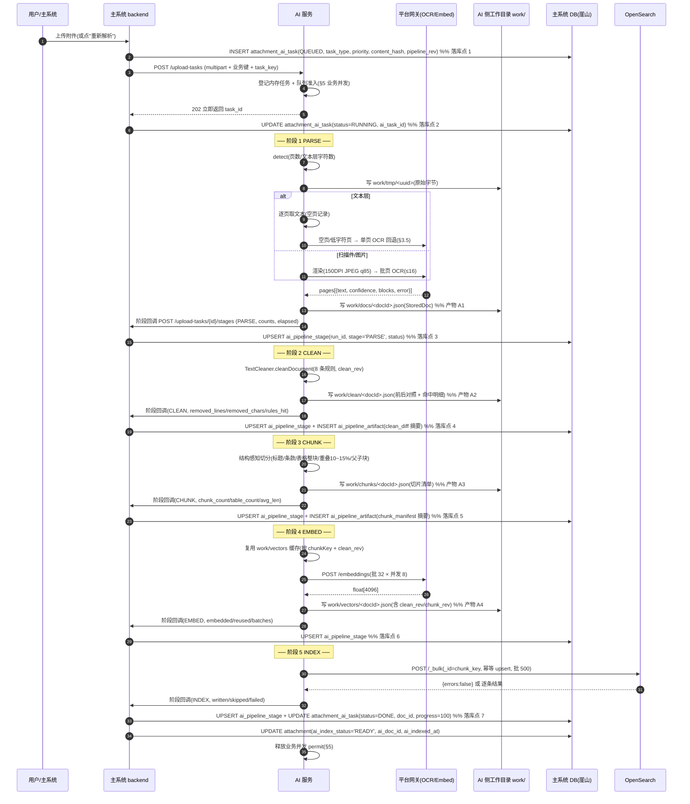

# RAG 流水线设计与并发管理（解析 → 清洗 → 切分 → 向量化 → 索引 → 召回 → 生成）

> **触发问题（用户四条原话，逐条落到本文）**：
> 1. "OpenSearch Java Client 可以接入，另外 http 调用，引入 okhttp 等框架会不会效率更高或者更加便于管理。" → **§2**
> 2. "整个流程可以在解析任务里以**任务流**的方式展示，这样更加直观展示解析质量，可以做**落库**，做到**可溯源**。" → **§4**
> 3. "我觉得还可以参考 data-classification 这个项目，也做一个**统一的并发管理模块**，方便业务处理。" → **§5**
> 4. "整个解析到生成的流程环节一定要**设计好**，这部分是核心关键。" → **§3**
>
> **参考项目（用户补充）**：`C:\Users\yjc\Desktop\data`（项目名 **data-classification**，**不在本仓库内**；用户原话："可以参考**交互**，具体逻辑设计还是**根据本项目实际**"）。
> 本文 **§4.9** 与 **§5.10** 是对照小节：逐项写"它做了什么 → 可借鉴什么 → 必须按本项目改造什么"，并明确**哪些照搬会出错**；
> 所有引用都标了**来源文件路径**；**未能读到的部分如实写"未确认"**（见 §8 未确认 12、15~18）。
>
> **本轮范围**：**只设计、只写文档**，`ai-backend/**`、`backend/**`、`frontend/**`、`scripts/**`、`deploy/**` **一行未动**；
> **参考项目只读、未改它任何文件**（实施状态见上方 §9 链接）。
> **本文的定位**：把 [`RAG流程完整性评估.md`](RAG流程完整性评估.md) 登记的 **22 条缺口（G1~G22）** 与 **9 个量化触发点（T1~T9）**
> 在**设计层面**闭合——给出阶段契约、数据模型（V15 DDL 草案）、状态机、接口与验收指标。
>
> ⚠️ **实施状态（2026-10-13 更新，务必先看）**：本文**已按 §6.1 落地 P0-α 三项**，其余仍为设计（未落地）。
> 逐项状态与代码位置见 **§9 实施状态**（**以 §9 为准**：第 1~8 章是设计目标，未在 §9 标注"已落地"的都还没写代码）。
>
> **初版范围（历史记录，保留以便对照）**：初版**只设计、只写文档**，`ai-backend/**`、`backend/**`、`frontend/**`、`scripts/**`、`deploy/**` 一行未动；
> **参考项目只读、未改它任何文件**。
>
> **证据口径（三类，逐条标注，不混用）**：
> ① **代码/文档事实**＝给出 `文件:行` 或既有文档章节，可逐字复核；
> ② **外部公开事实**＝给出 URL（Maven 中央仓库 POM、官方文档），**属外部不可信数据，仅作选型依据**；
> ③ **估算**＝无实测依据的推导，一律写成 **估算（假设：…）**，并写清假设。
> 读不到、判不了的一律进 §8「未确认项」，并给"怎么确认"。
>
> **与既有文档的边界（不重复结论）**：
>
> | 既有文档 | 它已给结论的部分 | 本文不重复的部分 |
> | --- | --- | --- |
> | [`RAG流程完整性评估.md`](RAG流程完整性评估.md) | 五环节评级、G1~G22 缺口、T1~T9 触发点、技术栈逐项判定 | 缺口的**现象与影响**（本文只引用编号，直接给设计） |
> | [`AI模型调用与任务队列评估.md`](AI模型调用与任务队列评估.md) | 13 个调用点真实配置、并发上限推导（0.16→0.4 QPS）、队列方案 §5.2、P0 五项 | 数字与并发上限推导（本文引用不重算）、每模型信号量的理由 |
> | [`OpenSearch部署与接入.md`](OpenSearch部署与接入.md) 附录 E | 索引 mapping、分片/副本/refresh 取舍、kNN 3.x 查询写法、容量表 | 集群部署步骤与 mapping（本文只做"客户端选型"与"写入路径"的设计） |
> | [`AI工具集与检索编排评估.md`](AI工具集与检索编排评估.md) | 工具留不留、为什么不引 LangChain4j、检索该改服务端预取 | 框架取舍（本文不重新论证） |
> | [`AI前端与集成方案.md`](AI前端与集成方案.md) §9/§11 | P0 接口契约（冻结）、受控查询契约 | 既有接口的字段定义（本文只**新增**接口） |
> | [`../ai-backend/README.md`](../ai-backend/README.md)、[`../ai-backend/docs/知识库实施方案与路线.md`](../ai-backend/docs/知识库实施方案与路线.md) | 配置项、指标名、四层架构与 P0/P1/P2 路线 | 现状盘点 |

---

## 1. 结论摘要

### 1.1 技术选型结论（用户第 1 条）

| 侧 | 结论 | 一句话理由（可证伪） |
| --- | --- | --- |
| **① 平台四模型调用**（chat / ocr / embed / rerank） | **保持 JDK HttpClient + Jackson；不引 OkHttp、不引 Apache HttpClient 5** | 这 4 条链路今天的瓶颈是**模型侧在飞上限（信号量 4/12/8/2）与重排 24 对/s**，不是 HTTP 出口；而 `ModelRegistry.retryable()` 按**异常类型与消息形状**判定重试，换客户端要**同步重写该判定**，属"为 0 收益改安全逻辑" |
| **② OpenSearch 访问**（`_bulk` / kNN / 建索引） | **保持 JDK HttpClient 原生 REST；但必须改掉"每次调用现建 HttpClient"** | 当前 `OpenSearchIndex` 的 `Machine.send()` **每次请求 `new` 一个 `HttpClient`** ⇒ 连接池与 keep-alive **完全不生效**；这是真问题，且**与选哪家客户端无关**（改法一行） |
| **③ 要不要引 `opensearch-java`（Java Client）** | **本阶段不引；留 `OS_CLIENT=rest\|java` 开关，触发条件见 §2.6** | 引它要动的不是"HTTP 调用"而是"**kNN 硬 filter 的构造**"——`OpenSearchIndex` 的核心正确性保证是"**无 filter 的 kNN 一律不查**"（作用域硬约束），而 JDK 手写 JSON 让这条**肉眼可核**；换 Client 后 filter 语义要重新验证，当前**无真集群实测**（T6 的前置） |

**一句话**：**引入 HTTP 框架救不了本文档要解决的问题；但"每次现建 HttpClient"这一条必须修**——它是**免费的**（改 1 个类、约 40 行），且是 §2 里**唯一被代码证实的低效点**。

### 1.2 设计要点（用户第 2、4 条）

| # | 设计要点 | 落在本文 |
| --- | --- | --- |
| D1 | **七阶段契约**：解析 `PARSE` → 清洗 `CLEAN` → 切分 `CHUNK` → 向量化 `EMBED` → 索引 `INDEX` → 召回 `RETRIEVE` → 生成 `GENERATE`；每阶段有输入/输出/产物/幂等键/重试语义/超时预算/可续跑边界 | §3.2 |
| D2 | **清洗是独立阶段**（闭合 G1）：`TextCleaner` 接口 + 8 条规则 + **`clean_rev` 版本号**；`clean_rev` 必须并入**切片键与向量缓存的有效性校验**（T7：规则一改，全量切片键变化） | §3.3 |
| D3 | **切片改进**（闭合 G11/G12）：结构感知（标题/条款）、表格整块不截断、10%~15% 重叠、**父子块 small-to-big** 与 `read_page` 的分工、切片元数据补齐（项目/密级/时间/来源/页码） | §3.4 |
| D4 | **解析改进**（闭合 G4/G5）：混合型 PDF **逐页 OCR 回退**（消除静默丢页）、DOCX/XLSX/PPTX 扩展路径、表格结构化的取舍 | §3.5 |
| D5 | **召回与生成改进**（闭合 G3/G6/G7/G13/G14/G15）：请求级作用域**硬下推**、查询改写（history-aware）、**RRF** 与量纲归一（`hybrid` 开关的前提）、两类缓存、`/chat` 上下文预算与答案侧机器校验 | §3.6 |
| D6 | **任务流 + 落库 + 可溯源**：**V15 迁移** = `attachment_ai_task` 扩 **13 列** + 新建 **3 张表**（阶段/产物/事件），前端"任务流视图" = 阶段条 + 每阶段状态/耗时/计数/失败原因 + 可展开产物；从答案 `[n]` 一键回溯到原始页 | §4 |
| D7 | **统一并发管理**：**业务并发（AI 服务内）→ 模型并发（`ModelRegistry`）两级**，单向获取、排队在业务层、失败明确；任务事实源仍在主系统 DB（抢占式领取） | §5 |
| D8 | **并发与交互参照 data-classification，逻辑按本项目重构**：借鉴它的「环境隔离 + 同环境串行排队 + 阶段项驱动整条流水线 + 作业中心/进度弹窗」四件事的**交互与分层**，但**重新实现**（技术栈/部署形态/事实源/数据源均不同，见 §5.10 与 §4.9） | §4.9、§5.10 |

### 1.3 分期建议（详表见 §6）

| 期 | 目标（一句话） | 验收指标（可测） | 工作量级 |
| --- | --- | --- | --- |
| **P0-α（1 周内）** | 修 3 个**正确性**问题：查询侧全量 `_bulk`、请求级作用域硬下推、OpenSearch 共享 HttpClient | 检索路径**写请求 0 次**（`ai.vector.lazy_backfill`=0）；不传 `doc_id` 的检索只能命中请求作用域；`ai.opensearch.conn.reuse` 的增长曲线在 100 次请求后不再线性增长 | **3~5 人日（估算）** |
| **P0-β（2 周内）** | **V15 落库 + 任务流视图**（用户第 2 条；交互参照 data-classification 的"阶段项 + 作业中心/进度弹窗"，按 antd 与本项目页面风格重做） | 每一份解析文档都有**七阶段行**且 `SUM(阶段耗时)/任务耗时 ≥ 0.9`；任务详情页可展开产物摘要；从 `[n]` 可点回原始页 | **8~12 人日（估算）** |
| **P1-α（1 个月）** | **清洗阶段 + 切片改进**（G1/G11/G12） | `clean_rev` 一改即触发全量重建（可验证）；表格切片不再出现"有表头无表体"；recall@5 不下降（需先有基线） | **10~16 人日（估算）** |
| **P1-β（1 个月，并行）** | **统一并发管理模块**（用户第 3 条；参照 data-classification 的"按环境隔离并发 + 同环境串行排队"，改造成本项目的"交互式/批量/重建"三通道） | 导入 100 份时问答 P95 劣化 **≤20%**；队列满 **0 条永久 QUEUED**；按项目公平性可测 | **8~12 人日（估算）** |
| **P2（按需）** | 解析扩展（混合型 PDF 逐页回退、DOCX/XLSX）、召回改进（改写/RRF/缓存）、答案侧校验 | 见 §6 逐项 | **15~25 人日（估算）** |

> **顺序纪律（继承既有结论）**：**P1-α 的任何质量改动前，必须先完成 G8（9 道文档题页码标注 + recall@5/MRR 基线）**——
> 否则"改好了还是改差了"没有判据（T6）。本文档不重复论证，只在 §6 把它列为**前置卡点**。

---

## 2. 技术选型评估：HTTP 客户端与 OpenSearch 接入（用户第 1 条）

### 2.1 现状盘点（代码事实）

| # | 调用方 | 客户端与关键配置 | 代码位置 | 连接复用 |
| --- | --- | --- | --- | --- |
| 1 | 对话（chat） | `HttpClient`：connectTimeout **15s**、`followRedirects(NORMAL)`、**未设 version（JDK 默认请求 HTTP/2）** | `ai-backend/src/main/java/com/pmgt/ai/module/llm/LlmClient.java:83-86` | **有**（实例字段，进程内共享） |
| 2 | 向量化 + 重排（embed/rerank） | `HttpClient`：connectTimeout **10s**、`followRedirects(NORMAL)` | `.../module/retrieval/VecClient.java:84-87` | **有** |
| 3 | 平台 OCR | `HttpClient`：connectTimeout（常量）、`followRedirects(NEVER)`、**显式 `HTTP_1_1`** | `.../module/ocr/PlatformOcrClient.java:153-157` | **有** |
| 4 | 受控查询回调 | `HttpClient`：connectTimeout **5s** | `.../module/llm/BizQueryClient.java:74-78` | **有** |
| 5 | **OpenSearch** | **每次调用现建 `HttpClient`**（注释原文："每次现建 client：未启用时完全不碰网络，也不持有连接池"） | `.../module/retrieval/OpenSearchIndex.java:782-786` | **无** |
| 6 | 主系统 → AI 服务 | Spring 6.1 `RestClient` + `SimpleClientHttpRequestFactory`（**JDK `HttpURLConnection`**）、两个 bean（chat 180s / fast 10s） | `backend/src/main/java/com/pmgt/module/ai/config/AiHttpClientConfig.java:31-62` | 有（bean 级） |

**从表里能直接读出的三条结论**：

1. **现状不是"没有连接池"，而是"模型侧有、OpenSearch 侧没有"**——所以"要不要引 OkHttp"这个问题在当前代码上**问错了对象**：真正的收益点在**第 5 行**。
2. **HTTP/2 现状**：JDK `HttpClient` 在 `version()` 未显式设置时**请求 HTTP/2 并按 ALPN/升级协商降级**；代码里只有 OCR 显式设了 `HTTP_1_1`，其余三处**交给协商**。而 **OpenSearch 3.x 的 REST 接口默认是 HTTP/1.1**（HTTP/2 需要显式开启），因此"上 OpenSearch"这一侧 **HTTP/2 拿不到收益**。
3. **超时现状是"连接超时 + 请求级超时"两层**，且请求级超时由 `ModelRegistry.timeoutSeconds(kind)` 提供（chat 150 / embed 30 / rerank 20 / ocr 600，见 `ai-backend/README.md:49`），**这层治理已经做完了**——换客户端不会让它变得更好，只会让异常类型变掉。

### 2.2 候选方案对照评估（逐项）

> 口径：**依赖面**只列**新增**的编译期/运行期依赖；**离线影响**指"内网离线装机时要额外预置的 jar"。

| 评估项 | ① JDK HttpClient + Jackson（现状） | ② OkHttp | ③ Apache HttpClient 5 | ④ OpenSearch Java Client（`opensearch-java`） |
| --- | --- | --- | --- | --- |
| **连接池与复用** | `HttpClient` **自带**连接池与 keep-alive（实例级共享；JDK 无公开的池上限 API，靠 keep-alive 与并发自适应） | `ConnectionPool` 显式可配（默认最大空闲 5、keep-alive 5 分钟）；复用语义清楚 | `PoolingHttpClientConnectionManager` 显式可配（默认 `maxTotal=25`、`defaultMaxPerRoute=5`） | **不自己实现**：v3 默认走 `ApacheHttpClient5Transport`，池就是 ③ 的池；`RestClientTransport` 已被官方标记 **deprecated**（[官方 Java client 页](https://docs.opensearch.org/latest/clients/java/)） |
| **HTTP/2** | 支持（默认请求 h2，协商降级；显式 `HTTP_1_1` 可关） | 支持（ALPN；连接复用与多路复用成熟） | 支持（但**协议模块单独发**：`httpcore5-h2`，见 2.3） | 跟随所选 transport：HC5 异步传输可用 h2；**对 HTTP/1.1 的 OpenSearch 无实际收益** |
| **超时** | 连接超时 + **请求级** `HttpRequest.timeout()`（两层都可配） | `connectTimeout` / `readTimeout` / `callTimeout`（**三层**，per-call 可覆盖） | `connectTimeout` / `responseTimeout`（5.x 用 `ConnectionConfig`/`RequestConfig`） | 跟随 transport；另有 `TransportOptions` 的请求级超时 |
| **重试** | **无内置**（现状由 `ModelRegistry.callIdempotent` 统一做：仅连接错误/超时/5xx/429/408，退避 1s→4s+抖动） | 有 `RetryOnConnectionFailure`（**只重试连接层**，默认 true）——**与现有治理重叠且语义不同** | 有 `DefaultHttpRequestRetryStrategy`（默认重试幂等请求 1~3 次）——**同样与现有治理重叠** | 无（重试仍是我们的 `ModelRegistry`） |
| **连接数上限与排队** | **无公开上限**（无法做"队列深度"指标）；并发闸门只能靠我们自己的信号量 | `Dispatcher.maxRequests` / `maxRequestsPerHost`（默认 64 / 5）——**会与 `ModelRegistry` 的信号量形成"两层排队"，且第二层不可见** | `maxTotal` / `defaultMaxPerRoute`——同上，形成第二层排队 | 继承 transport 的池上限 |
| **可观测（指标/日志）** | 无内置指标；现状**已由 micrometer 覆盖**（`ai.model.*` / `ai.opensearch.retries`，见 `ai-backend/README.md:127-148`） | 有 `EventListener`（可挂 `callStart/callEnd/callFailed`）；无 micrometer 集成 | 有 `HttpClientContext` / 日志组件 `httpclient5` 的 wire log（**会打 request/response 体，含口令风险**） | 有 `OpenSearchTransport` 层可挂钩；**但会把"检索了几次、检到什么"藏进方法调用**（与 `OpenSearchIndex.java:41-45` 的既有取舍相反） |
| **错误语义** | 异常类型明确：`HttpTimeoutException` / `ConnectException` / `SocketTimeoutException` / `InterruptedIOException`，**`ModelRegistry.retryable()` 正是按这些类型 + `"HTTP 5xx"` 消息判定**（`ModelRegistry.java:368-394`） | `IOException` 家族 + OkHttp 自有类型（`SocketTimeoutException` 同名但**不同包**）⇒ **`retryable()` 必须同步重写** | `IOException` 家族 + `HttpException` ⇒ 同上 | 把 HTTP 错误包成 `OpenSearchException`/`ResponseException` ⇒ 同上，且**要重新区分"4xx 不重试"** |
| **依赖体积** | **0 新增** | okhttp 4.12.0 jar **789,531 字节**（Maven 中央仓库实测）；JetBrains/Kotlin 版另带 `kotlin-stdlib` + `okio` | 见 2.3：`httpclient5` **+** `httpcore5` **+** `httpcore5-h2` | 见 2.3：**14 个新增 artifact** |
| **离线装机影响** | **无** | 需预置 2~3 个 jar；**Kotlin 系依赖**在纯 Java 项目里是额外的心智负担 | 需预置 3 个 jar | **需预置 14 个 jar（估算合计 8~9 MB）**；且**每个都要进发布包的离线 m2 仓库**（B 级风险，见 2.3） |
| **与 Spring 6.1 `RestClient` 结合** | `RestClient` 默认用 `JdkClientHttpRequestFactory`（**JDK HttpClient**）或 `SimpleClientHttpRequestFactory`（`HttpURLConnection`）；**主系统现状是后者**（`AiHttpClientConfig.java:57-62`） | 需 `okhttp3` 的 `ClientHttpRequestFactory` 实现（Spring 不提供；要么自写、要么第三方） | Spring 提供 `HttpComponentsClientHttpRequestFactory`（HC5）；**推荐组合** | 不涉及 `RestClient`（它是 OpenSearch 专用客户端） |
| **迁移代价（改哪些类）** | — | **ai-backend 4 个类**（`LlmClient`/`VecClient`/`PlatformOcrClient`/`BizQueryClient`）+ `ModelRegistry.retryable()` + `OpenSearchIndex`；**若主系统也换**，再动 `AiHttpClientConfig` **1 个类** | 同 OkHttp，但 Spring 侧有现成 factory | **仅 `OpenSearchIndex` 1 个类**（+ 可选：`OpenSearchIndexTest` 的离线替身） |
| **影响已发布镜像** | — | ai-backend 镜像会变（新增依赖）⇒ 必须重出 `pm-ai-release-*`；**主系统镜像不变**（若只动 ai-backend） | 同 OkHttp | 同 OkHttp；且若走"本地 system scope jar"模式，Dockerfile 常驻需改（会**影响主系统 Dockerfile 的构建缓存**） |

### 2.3 `opensearch-java` 的传递依赖与版本绑定（外部公开事实，可复核）

**POM 实测（Maven 中央仓库）**：[`opensearch-java/3.1.0`](https://repo1.maven.org/maven2/org/opensearch/client/opensearch-java/3.1.0/opensearch-java-3.1.0.pom) 与 [`3.10.0`](https://repo1.maven.org/maven2/org/opensearch/client/opensearch-java/3.10.0/opensearch-java-3.10.0.pom)。

| 依赖（groupId:artifactId） | 3.1.0 声明版本 | 3.10.0 声明版本 | scope | 用途 | 与我们现有依赖的关系 |
| --- | --- | --- | --- | --- | --- |
| `org.apache.httpcomponents.client5:httpclient5` | **5.5** | 5.6.4 | compile | 默认 transport（异步） | **新增**；其 POM **显式排除** `org.apache.httpcomponents.core5:*` |
| `org.apache.httpcomponents.core5:httpcore5` | **5.3.4** | 5.4.3 | compile | HC5 核心 | **新增**（因上一条排除，必须显式声明） |
| `org.apache.httpcomponents.core5:httpcore5-h2` | **5.3.4** | 5.4.3 | compile | HTTP/2 支持 | **新增** |
| `commons-logging:commons-logging` | 1.3.5 | 1.3.6 | compile | 日志桥 | **新增**（Spring Boot 3 默认走 SLF4J，多一个桥） |
| `com.google.code.findbugs:jsr305` | 3.0.2 | 3.0.2 | compile | 注解（编译期） | **新增** |
| `org.eclipse.parsson:parsson` | 1.1.7 | 1.1.7 | compile | Jakarta JSON 实现 | **新增** |
| `jakarta.json.bind:jakarta.json.bind-api` | 2.0.0 | 2.0.0 | runtime | JSON-B API | **新增**（注意是 **2.0.0**，与 Jakarta EE 10 的 3.x 不同代） |
| `jakarta.annotation:jakarta.annotation-api` | 1.3.5 | 1.3.5 | runtime | 注解 | **新增**（且是 **1.3.5**，与 Spring Boot 3 默认的 `jakarta.annotation-api 2.1.x` **不是一个坐标代**——多一份老 API） |
| `com.fasterxml.jackson.core:jackson-core` | 2.18.3 | 2.22.2 | runtime | JSON | **已有**（Spring Boot 3.3.5 的 BOM 管到 **2.17.x**）⇒ **声明版本会被压回 2.17.x** |
| `com.fasterxml.jackson.core:jackson-databind` | 2.18.3 | 2.22.2 | runtime | JSON | **同上** |
| `org.eclipse:yasson` | 2.0.2 | 2.0.2 | runtime | JSON-B 实现 | **新增** |

**新增 artifact 合计 14 个**（含 `opensearch-java` 本体）。

**离线装机影响（三条，必须一起看）**：

| # | 影响 | 量化 | 结论 |
| --- | --- | --- | --- |
| 1 | **体积** | **估算（假设：httpclient5 约 0.8 MB、httpcore5 约 0.9 MB、httpcore5-h2 约 0.1 MB、opensearch-java 约 3~4 MB、其余 6 个小包合计约 1.5 MB；均为 jar 压缩后大小的量级估算，**未逐个下载实测**）** ⇒ 合计 **约 8~9 MB** | 相对 AI 镜像（当前含 PDFBox/Spring Boot）占比很小，**不是否决理由** |
| 2 | **离线拉取** | 本仓库既有约定："内网离线装机时**少一个依赖少一份风险**"（`OpenSearchIndex.java:37-40`）；且主系统已有一处"驱动本地引入（system scope）"的先例（`ITERATION.md` v3.0 的 `yashandb-jdbc-1.9.3.jar`） | 若引，必须复用该模式：**把 14 个 jar 预置进 `deploy/` 或本地 m2 仓**，并同步 Dockerfile 常驻 + `scripts/make-release.ps1` 的打包清单 |
| 3 | **版本绑定与升级耦和** | `opensearch-java` 的版本号与 OpenSearch **发行版**同轨（3.1.0 发布于 2025-06-03，服务器也是 3.1.0）；但**服务端 3.1.0 索引 mapping 是我们手工建的（附录 E），不由客户端管理** | 客户端升级与服务端升级**可以解耦**（我们没有用 Client 的索引管理做事实源），但**每次升级都要重跑一遍 kNN 一致性验证**（步骤 19 ①-3 的协议） |

**版本选择建议（若将来要引）**：钉 **`3.1.0`**（与生产服务端 3.1.0 同轨），
**不要**用最新的 3.10.0——它与服务端跨了 9 个 minor，kNN 查询体结构与异常语义都可能变，而我们的验证资源只有"手工对照"。

### 2.4 分侧结论

**① 平台四模型调用（chat / ocr / embed / rerank）——结论：保持 JDK HttpClient，不引任何 HTTP 框架。**

理由（按可证伪性排序）：

| # | 理由 | 可证伪判据 |
| --- | --- | --- |
| R1 | **瓶颈不在 HTTP 出口**：问答上限 ≈**0.16 QPS**（实测口径见《AI模型调用与任务队列评估》§3.3，由重排 24 对/s 决定）；`ModelRegistry` 已把在飞数钉死在 4/12/8/2 | 若"换 OkHttp 后问答 P95 明显下降"，R1 被证伪——**可测**：同一压测脚本跑前后两版 |
| R2 | **HTTP 框架的收益（连接复用）在平台侧今天已经拿到**：4 个客户端都持有实例级 `HttpClient`（§2.1 #1~#4），keep-alive 已生效 | 若"平台侧存在 per-call new client"，R2 被证伪——**已 grep 验证，不存在** |
| R3 | **换客户端要改安全逻辑**：`ModelRegistry.retryable()` 按异常类型 + 消息形状判定（`ModelRegistry.java:368-394`），OkHttp/HC5 的异常类型不同 ⇒ 必须重写，而重写要重新定义"哪些失败可重试"，这是**已有 129 例测试覆盖的路径**（含 `ModelRegistryTest.java:236` 的 `HttpTimeoutException` 断言） | 若"异常类型完全兼容"，R3 被证伪——**可测**：写一个 4xx/5xx/超时三类故障的矩阵测试 |
| R4 | **多一层排队会破坏现有的诚实失败语义**：OkHttp `Dispatcher`（64/5）、HC5 池（25/5）都会在 `ModelRegistry` 信号量**之外**再排一层，而这一层**没有指标**（毫秒级"等池"不可见）；现有纪律是"等不到 permit 1.5s 就 503 说清楚"（`ai-backend/README.md:52`） | 若"新客户端的池上限可以被指标观测且不等于二次排队"，R4 被证伪 |
| R5 | **依赖与离线成本**：OkHttp 4.x 是 Kotlin 实现（带 `kotlin-stdlib` + `okio`），5.x 明确声明 `kotlin-stdlib 2.2.0`（[5.0.0 POM](https://repo1.maven.org/maven2/com/squareup/okhttp3/okhttp/5.0.0/okhttp-5.0.0.pom)）；纯 Java 项目引 Kotlin 运行时是**长期维护面** | 若"团队已接受 Kotlin 运行时"，R5 的权重下降（但 R1~R4 仍成立） |

**同时必须做的（免费收益，不是"引框架"）**：

| 动作 | 内容 | 工作量 |
| --- | --- | --- |
| A1 | 把 4 个客户端**重复的** `HttpClient.newBuilder()` 配置抽成**一个共享 Bean**（`common/http/HttpClients.java`），统一 connectTimeout / 连接池 / 指标挂载点；**类名与公开方法签名不变** | **0.5 人日（估算）** |
| A2 | 修 `ModelRegistry.retryable()` 的一个真实脆弱点：`message.contains("Timeout")` 会命中**任意**含该词的业务异常（如"OCR Timeout 配置非法"）⇒ 改为**白名单前缀**（`"HTTP 5"`/`"HTTP 429"`/`"HTTP 408"`/`"ConnectException"`/`"Connection refused"`/`"Connection reset"`/`"集群不可达"`）+ 异常类型 | **0.5 人日（估算）** |
| A3 | 给 4 个客户端的共享 `HttpClient` 加**一个可观测信号**：`ai.http.requests{client,outcome}`（client = chat/ocr/embed/rerank/biz/opensearch），使"HTTP 层"与"模型层"的请求计数可比对 | **0.5 人日（估算）** |

**② OpenSearch 访问——结论：保持 JDK HttpClient 原生 REST，但改掉"每次现建 client"。**

| 项 | 设计 |
| --- | --- |
| 为什么不是"引 `opensearch-java`" | ① **核心正确性在 filter 构造**：`OpenSearchIndex` 的规格是"**作用域无约束时不加 filter；有约束时必须下推**"（`SearchScope.java:46-49` + `OpenSearchIndex.java:536-545,607-638`），这是**越权即空**的实现；换 Client 后这段变成 Builder 调用，**肉眼核对能力下降**，而真集群实测（步骤 19 ①-3）**尚未做**；② **查询体是给人看的 JSON** 这条既有取舍（`OpenSearchIndex.java:41-43`）与手册附录 E 逐字对照，是当前唯一的版本差异防线（3.x `knn` 下第一层是**字段名**）；③ 14 个新增 artifact + 离线预置 + `jakarta.annotation-api 1.3.5` 这类**跨代坐标**，对"只 5 个 REST 动作"的收益比不划算 |
| 什么时候该引（**触发条件，可证伪**） | ① 动作数 > **10~15 个**（当前 5~8 个：`PUT /<index>`、`HEAD /<index>`、`POST /_bulk`、`POST /_search`、`GET /_cluster/health`、terms 聚合、`DELETE /_doc`）；② 需要 **PIT / scroll / 聚合树 / 跨版本兼容矩阵**这类手写 JSON 明显易错的查询；③ **真集群 kNN 一致性验证已完成**（T6 前置之一），此时"改用 Builder"的回归风险才可控；④ 需要 **OpenSearch 侧的连接池上限治理**（如集群侧限制单 IP 连接数） |
| 现在改成什么 | **单例共享 `HttpClient`**：`OpenSearchIndex` 持一个 `private final HttpClient http`（构造器里建，配置：connectTimeout 取 `min(10, timeoutSeconds)`、`followRedirects(NEVER)`、**显式 `HTTP_1_1`**——集群 REST 是 1.1，避免每次请求尝试 h2 升级）；**同时保留"未配置时不碰网络"的语义**（`configured()` 已提供，构造器不主动发请求即可） |
| 收益（估算） | **估算（假设：内网 RTT 1~3ms、未启用 TLS（当前是内网 HTTP + basic auth，见《OpenSearch部署与接入》附录 D）、一次问答走 2 次 kNN 检索 + 1 次 query 向量化）**：现状每次 `_search` 新建 client ⇒ 1 次 TCP 握手 + 1 次 `HttpClient` 内部 Selector/线程池初始化；改为单例后握手与初始化**只发生一次**。按 RTT 3ms 估算，**每次检索省 6~10ms、每次问答省 15~30ms**（相对问答实测 ≈10s **< 0.3%**）；**真正的收益不是延迟，而是"连接与线程不再每次重建"**（`HttpClient` 每次新建会创建自己的 selector 线程，请求量大时表现为线程数与 GC 抖动上升） |
| 明确不做的 | **不引 `RestClientTransport`**（官方已 deprecated）；**不引 `opensearch-rest-client`**（同族，同样多余） |

### 2.5 迁移代价清单（若真要做，改哪些类、几个文件、是否影响已发布镜像）

| 方案 | 改动点（文件:类） | 文件数 | 测试影响 | 是否影响已发布镜像 |
| --- | --- | --- | --- | --- |
| **A. 本阶段推荐（不改依赖）** | `OpenSearchIndex`（共享 client）+ `ModelRegistry`（`retryable` 收紧）+ 新增 `common/http/HttpClients` | **2 改 + 1 新增** | `ModelRegistryTest`（重试矩阵）需补例；`OpenSearchIndexTest` 的离线替身**不受影响**（它覆写 `health`/`search`，见 `OpenSearchIndex.java:92-96`） | **AI 镜像需重出**（代码变更）；主系统镜像**不变** |
| **B. 平台侧换 OkHttp/HC5** | 上述 A + `LlmClient`、`VecClient`、`PlatformOcrClient`、`BizQueryClient` 的出口替换 | **6 改 + 1 新增** | 129 例中与模型调用相关的用例需逐个复核异常断言 | **AI 镜像需重出**；若主系统也换 `AiHttpClientConfig`，则**主系统镜像也要重出** |
| **C. OpenSearch 侧引 `opensearch-java`** | `OpenSearchIndex` 全量重写（建索引 / `_bulk` / kNN / terms agg / health 5 条路径）+ 2.3 的 14 个 jar 预置 + Dockerfile/m2 常驻 | **1 大改 + Dockerfile + 发布脚本** | `OpenSearchIndexTest` 的离线断言（`knn` 结构）需重写；**真集群验证协议必须重跑** | **AI 镜像需重出且变大**；主系统镜像不变 |

> **"是否影响已发布镜像"的统一结论**：`ai-backend` 的任何依赖或代码变更都要**重出 `pm-ai-release-<版本>` 并重新 `docker load`**
> （发布链路见 `ai-backend/README.md:62-98`）；**主系统发布包不含 AI 服务**（`ai-backend/README.md:60`），
> 只要不动 `backend/**`，**主系统镜像与发布包零影响**。

### 2.6 结论的可证伪条件（明确写出来，便于以后推翻）

| 结论 | 推翻它需要什么证据 |
| --- | --- |
| R1"HTTP 出口不是瓶颈" | 同一压测下，把 4 个客户端换成 OkHttp 后问答 P95 下降 **>10%**（且模型侧信号量不变） |
| R2"平台侧连接已复用" | 代码里出现 per-call `HttpClient.newBuilder()`（本轮 grep 为**不存在**） |
| OpenSearch 侧"引 Client 不划算" | ① 动作数涨到 **>10 个**；② 手工 JSON 出现**一次**因结构写错导致的线上问题；③ 真集群 kNN 一致性验证通过后，仍认为 Builder 更不易错 |
| "HTTP/2 无收益" | OpenSearch 侧实测开启 HTTP/2 后 `_bulk`/kNN 吞吐提升 **>20%**（当前集群是 1.1，**未确认**是否支持 h2，见 §8） |

---

## 3. 流水线总体设计（用户第 4 条）

### 3.1 设计目标与三条不变式

| # | 不变式 | 为什么（依据） |
| --- | --- | --- |
| I1 | **主系统是任务与状态的唯一事实源**；AI 服务只写"阶段进度与产物"，不直连库 | `V13__ai_integration.sql:12-15` 已写死；《AI模型调用与任务队列评估》§5.2.4 判定"复用 `attachment_ai_task`，不新建 `ai_task`" |
| I2 | **可重建物不进主系统**：切片全文、向量、页 markdown 全文留在 AI 服务侧（`work/`），主系统只存**摘要与计数** | 同上；也是 §4.7"保留与清理"的前提 |
| I3 | **越界即空**：请求作用域（doc_ids / attachment_ids / project_ids / 密级）是**硬约束**，缺元数据**不通配** | `SearchScope.java:16-22`；G3 |

### 3.2 七阶段契约（核心表）

> 口径说明：**产物**=写进 AI 服务侧持久层的对象；**落库**=写进主系统 DB 的摘要行（§4）；
> **幂等键**=重复执行同一阶段时用来判定"已做过、可跳过"的键；**超时预算**一律标"沿用现状"或"新增"。

| # | 阶段 | 输入 | 输出 | 产物（AI 服务侧） | 状态机（AI 侧） | 幂等键 | 失败与重试语义 | 可续跑边界 | 超时预算 |
| --- | --- | --- | --- | --- | --- | --- | --- | --- | --- |
| 1 | **PARSE**（解析） | 原始字节（`work/tmp/<uuid>`）+ `dpi` + `parse_rev` | `StoredDoc`（`pages[]`，每页 `text/confidence/source/blocks/error`）+ `notes` | `work/docs/<docId>.json` | `QUEUED → PARSING → PARSED / FAILED / CANCELLED` | `sha1(字节) + parse_rev` | 幂等重试 **2 次**（沿 `MODEL_RETRY_MAX`，仅连接错误/超时/5xx/429）；**页级失败不中断整份**（失败页占位 + `notes`） | **页级**：已 OCR 成功的页可复用（需新增页级缓存，见 §3.5）；**任务级**：不可续跑（重启标 FAILED，现状） | **沿用现状**：OCR 单请求 600s（`OCR_TIMEOUT`）；**新增**：任务级软上限 **30 min**（见 §3.8） |
| 2 | **CLEAN**（清洗） | `StoredDoc.pages[].text` + `clean_rev` + 规则配置 | `CleanResult`（`pagesClean[]` + `removedLines[]` + `stats{}`） | `work/clean/<docId>.json`（**前后对照 + 规则命中明细**） | `PENDING → CLEANING → CLEANED / CLEAN_SKIPPED / FAILED` | `sha1(清洗前文本) + clean_rev` | **纯本地、确定性**：失败即缺陷，**不重试**（重试结果相同） | **完全可续跑**（幂等纯函数，逐页可重算） | **新增**：单份 **60s**（本地 CPU） |
| 3 | **CHUNK**（切分） | `pagesClean[]` + `chunk_rev` + 切片参数 | `Chunk[]`（含 `chunkKey`、`parentKey`、`pageNo`、`order`、`isTable`） | `work/chunks/<docId>.json`（**新增**，供 §4 产物表与只读视图复用） | `PENDING → CHUNKING → CHUNKED / FAILED` | `sha1(清洗后文本) + clean_rev + chunk_rev` | 纯本地；**不重试** | 完全可续跑（逐页重算） | **新增**：单份 **30s** |
| 4 | **EMBED**（向量化） | `Chunk[]` | `Map<chunkKey, float[4096]>` | `work/vectors/<docId>.json`（**现状已存在**） | `PENDING → EMBEDDING → EMBEDDED / FAILED` | `chunkKey`（`docId:pageNo:sha1(cleanText)[0:12]` + `clean_rev/chunk_rev` 参与） | **幂等重试 2 次**（沿 `ModelRegistry.callIdempotent`）；**批 32 × 并发 8**（现状） | **批级可续跑**：已缓存向量不重算（`DocIndexer.java:124-131` 现状） | **沿用现状**：单请求 30s（`VEC_EMBED_TIMEOUT`）；**新增**：单文档向量化软上限 = `30s × ceil(切片数/32/8)` |
| 5 | **INDEX**（索引） | `Chunk[] + vectors` | 写入结果（`written / skipped / failed`） | `work/docs/<docId>.json`（已存在）+ OpenSearch 索引文档（`_id = chunkKey`） | `PENDING → INDEXING → INDEXED / PARTIAL / FAILED` | `chunkKey`（`_id` 幂等 upsert） | **幂等重试 2 次**；**`PARTIAL` 是新增状态**（部分切片写入失败，见 §4.4） | **切片级可续跑**（`existingChunkKeys` 跳过已存在，现状 `OpenSearchIndex.java:452-474`） | **沿用现状**：单请求 20s（`OPENSEARCH_TIMEOUT`）；`_bulk` 每批 500 |
| 6 | **RETRIEVE**（召回） | 查询文本 + `SearchScope`（含密级）+ 缓存 | `Hit[]`（`chunkKey/score/pageNo/父块摘要`） | 无（**在线**阶段，不落产物；只落 trace） | `N/A`（在线；不建模为任务状态） | `(query, scope, recall, rerank_model, clean_rev)` 的 sha1（**缓存键**） | 降级可见（现状：local 路径降级关键词并写 `note`；opensearch 失败直接抛） | N/A | **沿用现状**：rerank 20s；**新增**：单次检索总预算 **5s**（见 §3.6.5） |
| 7 | **GENERATE**（生成） | `Hit[]` + 历史 + 工具结果 | 答案 + `citations` + `verification`（**新增**） | 无（在线）；留痕进主系统 `ai_ask_log` | `N/A` | 不幂等（**永不自动重试**，现状） | 失败明确（现状"问答失败 + 排查三选"） | N/A | **沿用现状**：chat 单轮 150s；**新增**：单次问答**总预算 170s** + **上下文预算**（见 §3.6.4） |

**阶段与现状的对照（哪些是新增的）**：

| 阶段 | 现状 | 本文新增/改动 |
| --- | --- | --- |
| PARSE | 已有（`UploadTaskService.run` 的 `detect → read → store`） | 拆出**独立阶段行**；新增**逐页 OCR 回退**（§3.5）；新增 `parse_rev` |
| CLEAN | **不存在**（G1） | **全新**（§3.3） |
| CHUNK | 隐含在 `DocStore.iterChunks`（`DocIndexer` 内调用） | 提为**独立阶段**（可观测、可复算）；切分算法改进（§3.4） |
| EMBED | 已有（`DocIndexer.indexDocument` → `retrieval.embedChunks`，P0-3 已前移） | 提为**独立阶段行**；`chunkKey` 纳入 `clean_rev/chunk_rev` |
| INDEX | 已有（`openSearchIndex.indexChunks`） | 提为**独立阶段行**；新增 `PARTIAL` 语义；**删掉查询侧 `upsertAll`**（G2，P0-α） |
| RETRIEVE | 已有（`RetrievalService.searchInScope`） | 作用域硬下推（G3）、RRF（G13）、改写（G14）、缓存（G15） |
| GENERATE | 已有（`ToolAgent` + `QaService`） | 上下文预算（G6）、答案侧机器校验（G7）、`verification` 字段 |

### 3.3 清洗阶段（G1）落地设计

#### 3.3.1 接口（新增 `module/clean/**`，**只设计，不写代码**）

| 类型 | 职责 | 关键约束 |
| --- | --- | --- |
| `TextCleaner`（接口） | `CleanResult clean(PageText page, CleanContext ctx)` | **纯函数**：同输入 + 同 `clean_rev` ⇒ 同输出（可缓存、可对比、可复算） |
| `CleanContext` | 携带 `docId/filename/pageNo/pageCount/全页文本（用于跨页重复检测）/规则配置/clean_rev` | **跨页规则**（页眉页脚）需要"整份文档"的视角 ⇒ 接口必须分两层：`cleanDocument(List<PageText>, ctx)` 做跨页检测 → 再逐页应用 |
| `CleanResult` | `pageNo` / `text`（清洗后）/ `removedLines[]`（`{line, rule, pageNo, count}`）/ `stats{removedChars, removedLines, rulesHit{}}` | **必须保留"删了什么"**（否则无法做 §4.6 的清洗前后对照） |
| `CleanRule`（枚举/策略） | 每条规则一个实现：`boolean applies(...)` + `String apply(...)` | 规则**独立可开关**（配置驱动），开关状态进 `clean_rev` |
| `CleanRev` | `clean_rev = 1` 起步；**规则清单 + 每条规则开关 + 阈值**任一变化即 **+1** | 见 §3.3.3 |

#### 3.3.2 规则清单（8 条；每条给"判据 / 风险 / 优先级"）

| # | 规则 | 判据（可实现的算法） | 默认 | 风险与对策 | 优先级 |
| --- | --- | --- | --- | --- | --- |
| C1 | **跨页重复行检测（页眉/页脚）** | 每页按行归一（折空白、去数字）后统计；**同一归一化行在 ≥50% 的页出现**且**位于页首 2 行或页末 2 行** ⇒ 判为页眉/页脚并整行剔除 | **开**（阈值 50% 可配） | 误删"每页都出现的条款标题"⇒ 对策：**命中行写入 `removedLines` 供人工复核** + 白名单正则配置；**短行（< 4 字）不参与** | **P0** |
| C2 | **纯页码行剔除** | 归一化后匹配 `^[\-—–\s]*\d{1,4}[\s]*$`、`^第\s*\d+\s*页(\s*共\s*\d+\s*页)?$`、`^\d+\s*/\s*\d+$`、`^Page\s+\d+(\s+of\s+\d+)?$`（大小写不敏感） | **开** | "共 Y 页"**可能是有用信息**（页数与完整性）⇒ 对策：**先抽成页级元数据（`total_pages`）再删行** | **P0** |
| C3 | **空白与不可见字符归一** | 统一 `\r\n`/`\r` → `\n`；全角空格 `\u3000` → 半角；零宽字符（`\u200B-\u200D`、`\uFEFF`）删除；连续空白（≥3 空格/≥2 空行）压缩；行首尾 `strip()` | **开** | 表格用空格对齐时压缩会破坏视觉对齐（markdown 表用竖线分隔，不受影响）⇒ 对策：**表格块内不压缩连续空格** | **P0** |
| C4 | **断行合并 / 连字符修复** | ① 行尾**无标点**且下一行**首字符非**列表符号/数字序号 ⇒ 合并；② 行尾为 `-`/`‐` 且下一行首字符为小写字母 ⇒ 去连字符合并 | **开** | **条款换行**（"（一）…"独占一行）**不能合并** ⇒ 对策：条款起始模式（`（[一二三四五六七八九十]+）`、`^\d+[\.、]`、`^第[一二三四五六七八九十百]+条`）**强制断行** | **P0** |
| C5 | **表格与正文分离** | ① 优先用平台 `blocks[label=table]` 的 **bbox**（`StoredDoc.BlockRef` 已有）与行文本做范围匹配；② 无 blocks 时用 markdown 表结构正则 | **开**（**仅做"标记"，不删内容**） | 误判会把正文判成表格 ⇒ 对策：**本期只"标记 `isTable=true` 并交给切分阶段整块处理"**（§3.4.2），不改写文本 | **P1** |
| C6 | **段级去重** | 归一化后**完全相同**的段落（长度 ≥ 20 字）在同一文档内出现 ≥2 次 ⇒ 保留首次、后续标记 `duplicate_of`（**默认保留，不删**） | **开（标记模式）** | 直接删会丢"附件清单在多页重复"这类事实 ⇒ 对策：**默认只标记**，`CLEAN_DEDUP_DROP=true` 才删（默认 false） | **P1** |
| C7 | **编码归一** | ① 全角 ASCII（`Ａ-Ｚａ-ｚ０-９`）→ 半角；② 全角标点（`，。；：？！（）`）**保留**；③ 检测并记录**替代字符** `\uFFFD` 的数量（不静默删） | **开** | 全角→半角会改动金额写法（`１２３` → `123`）——实际**有利于** `Checks` 的数字校验；但**必须在 `removedLines` 之外单列 `normalized[]`**（不是"删除"） | **P1** |
| C8 | **水印剔除** | ① 归一化后**非页首/页末**位置的高频重复行（≥60% 页出现）；② 已知水印词表（`CLEAN_WATERMARK_PATTERNS`，正则列表） | **默认关**（词表为空时不生效） | **合规风险高于收益**：水印文字可能是"内部资料 严禁外传"（本身是密级线索）⇒ 对策：**默认关**，且**只允许正则白名单命中才删**；删除行必须进 `removedLines` | **P2** |

#### 3.3.3 `clean_rev` 与缓存/切片键的联动（T7 的落点，**这是本节最关键的一条**）

**问题（T7 原文）**：切片键是 `docId:pageNo:sha1(文本)[0:12]`（`RetrievalService.java:583-586`），所以**清洗规则一改，全部切片文本变化 ⇒ 全部切片键变化 ⇒ 全部向量缓存与索引失效**。

**设计（三层防护）**：

| 层 | 改动 | 效果 |
| --- | --- | --- |
| L1 | **切片键增补版本段**：`chunkKey = docId + ":" + pageNo + ":" + sha1(cleanText)[0:12] + ":" + clean_rev + ":" + chunk_rev`（形态建议 `d=<docId>:p=<pageNo>:h=<sha1-12>:c=<cleanRev>:k=<chunkRev>`，**解析器同时兼容旧 3 段格式**） | 规则变更 ⇒ 新键 ≠ 旧键 ⇒ **旧索引不会被误当命中** |
| L2 | **向量缓存有效性校验加 `clean_rev/chunk_rev`**：`work/vectors/<docId>.json` 的头部元数据从 `{model, dimensions}` 扩为 `{model, dimensions, clean_rev, chunk_rev, chunks_sha1}`；不匹配即**整体失效并重算**（与现状"模型名或维度不符即失效"同一写法，`RetrievalService.java:795-823`） | 规则变更 ⇒ 向量**强制重算**（不会拿旧向量配新文本） |
| L3 | **重建调度**：`clean_rev` 变化时，`POST /admin/reindex?force=true` 的语义扩展为"**按 `clean_rev` 差异只重建受影响的文档**"（重建任务行的 `pipeline_rev` 与文档当前的 `pipeline_rev` 比对；不等才重建） | 规则变更**可控**（不是"全库无条件重跑"），且进度可观测 |

**`pipeline_rev` 的组合口径**（建议并入任务键，见 §4.3）：

```
pipeline_rev = "parse=" + parse_rev + ",clean=" + clean_rev + ",chunk=" + chunk_rev + ",embed=" + embed_model_rev
其中 embed_model_rev = sha1(embed_model 名 + dimensions)   // 换模型/维度也要重建，现状已按 model/dimensions 校验
```

**幂等键（任务级）**：

```
task_key = sha1(内容 sha1 + pipeline_rev)
```

- 同 `task_key` 且已 `DONE` ⇒ **默认复用**（直接返回旧 `doc_id`），`force=true` 才重跑（闭合 G10）。
- 建议落到 `attachment_ai_task.content_hash`（见 §4.3 的 V15 列）。

#### 3.3.4 清洗的质量口径（进 §4.6 的指标）

| 指标 | 定义 | 为什么要它 |
| --- | --- | --- |
| `clean.removed_lines_per_doc` | 每份文档被剔除的行数 | 突变即规则回归（如 C1 阈值调错） |
| `clean.removed_chars_ratio` | 剔除字符数 / 清洗前字符数 | **估算（假设：真实政务文档页眉页脚占比 3%~8%）**，超过 15% 需人工复核 |
| `clean.rules_hit{rule}` | 每条规则命中的文档数 | 判断"这条规则有没有用"（C8 长期 0 命中 ⇒ 考虑删掉） |
| `clean.pages_all_removed` | 清洗后整页为空的页数 | **> 0 即异常**（说明规则过头，把正文删了） |

### 3.4 切分改进（G11/G12）

#### 3.4.1 结构感知切分

| 能力 | 判据（可实现） | 行为 |
| --- | --- | --- |
| **标题层级识别** | 行满足**任一**：① markdown 标题（`^#{1,6}\s`）；② 编号标题（`^第[一二三四五六七八九十百]+[章节条]`、`^\d+(\.\d+)*\s`、`^[（(][一二三四五六七八九十]+[）)]`）；③ OCR blocks 里 `label in {title, section_header}`；④ **短行（≤ 30 字）+ 独占一行 + 无句末标点** | 识别为 `heading(level)`；**标题总是"边界"**（不在标题与其后续正文之间切） |
| **条款（clause）切分** | 条款起始模式（`^第[一二三四五六七八九十百]+条`、`^(\d+\.)+\d*`、`^（[一二三四五六七八九十]+）`） | 条款**优先成独立切片**（即使 < 500 字）；超过 `chunkChars` 时才二次切（**每片重复条款标题**） |
| **章节路径（父子块用）** | 维护"当前章节栈"（H1→H2→H3→…），每个切片记录 `sectionPath = "第三章 > 3.2 付款方式"` | 进切片元数据（§3.4.5），并作为**父块**的一种（见 3.4.4） |

#### 3.4.2 表格整块不截断

| 项 | 设计 |
| --- | --- |
| 识别 | ① `PageText.tableCount()`（现状 `label=="table"` 计数，`PageText.java:102-104`）+ `BlockRef` bbox；② 清洗阶段 C5 标记的行区间；③ markdown 表结构正则 |
| 切法 | **表格整体成一个切片**（不做 `chunkChars` 截断）；**表格超长（> 2× chunkChars）**时按**行**切，**每片重复表头行 + 分隔行**，并在切片文本前置 `【表格：<表头摘要>】` |
| 元数据 | `isTable=true`、`tableRows=n`、`tableHeader="…"` |
| 与正文的关系 | 表格切片**不跨页合并**（保持页码可溯源）；表头与表体**同页**时一定在同一片（避免"有表头无表体"） |
| 现状差距 | 现状是"段落累积到 500 字就断"（`DocStore.java:233-242`）⇒ 800 字宽的表格**必被切断**（G11） |

#### 3.4.3 重叠窗口

| 项 | 设计 | 依据 |
| --- | --- | --- |
| 重叠比例 | **10%~15%**（`chunkChars=500` ⇒ 重叠 **50~75 字**） | 主流做法区间（《RAG流程完整性评估》§3.3） |
| 重叠方式 | **按句回退**（不按字符硬切）：从上一片末尾向前找最近的句末标点（`。！？；`），最多回退 `0.15 × chunkChars` | 硬切会把句子劈成两半，语义更差 |
| 与父块的关系 | 重叠只发生在**同一页内**（不跨页，保持页码语义） | 现状"不跨页"是刻意的（`DocStore.java:195-196`） |
| 去重 | 重叠内容会导致**近似重复**切片 ⇒ 检索融合时按 `chunkKey` 去重（键含 sha1，**不同重叠内容 = 不同键**，所以需要**新增"同页同区间"去重**：按 `(docId, pageNo, order)` 保留分数最高的一片） | 避免 top_k 被重叠片占满 |

#### 3.4.4 父子块（small-to-big）与 `read_page` 的关系

| 项 | 设计 |
| --- | --- |
| 三级粒度 | **子块（child）**= 检索单元（现状的切片，~500 字）；**父块（parent）**= 章节/整页（`sectionPath` 或 `page@@）；**根（root）**= 整份文档 |
| 检索 | **子块检索**（向量 + 关键词），命中后**自动上卷到父块摘要**：把 `parentSummary`（父块前 200 字 + 标题路径 + 页范围）一并给模型 |
| 为什么这样分工 | 现状命中只返回切片本体（`RetrievalService.java:355-365`），要完整上下文就**再花一轮 `read_page`**（`Tools.java:253-282`）——这是"一次问答 2 次检索 + 1 次读页"的延迟来源 |
| 与 `read_page` 的边界 | **父块摘要 ≤ 300 字**（廉价、必给）；**整页 4000 字仍走 `read_page`**（贵、按需）⇒ 上卷**减少**（不是消除）`read_page` 调用：**估算（假设：现状 1 次/问答，上卷后约 0.4 次/问答）** ⇒ 每问省 ≈0.6 次工具往返 |
| 落库 | 父块不落库（可重建）；**父子关系落切片元数据**（§3.4.5 的 `parentKey`）与产物表（`chunk_manifest` 的 `parent_count`） |
| 实现分期 | **先做"同页邻块"最简版**（父块 = 同页全部子块拼接的前 200 字），**不建章节树**；章节树作为 P2 |

#### 3.4.5 切片元数据（补齐 G3/G17 的过滤维度）

| 字段 | 来源 | 用途 | 现状 |
| --- | --- | --- | --- |
| `doc_id` / `filename` / `page_no` | 解析 | 溯源 | **已有** |
| `chunk_key` | 计算 | 幂等 `_id`、溯源 | **已有**（**新增版本段**，见 §3.3.3） |
| `order_in_page` | 切分 | 排序、重叠去重 | **新增** |
| `parent_key` / `section_path` | 切分 | 父子块上卷 | **新增** |
| `is_table` / `table_rows` | 清洗 C5 + 切分 | 表格检索策略 | **新增** |
| `project_id` | 主系统（`DocMeta`） | **硬作用域** | **已有**（`DocMeta`/索引 mapping） |
| `security_level` | 主系统 | **硬作用域**（闭合 G17） | **有字段、无作用域维度** ⇒ **新增维度** |
| `doc_type` / `source` / `phase_code` / `attachment_id` | 主系统 | 硬作用域 + 展示 | **已有** |
| `created_at`（业务时间） | 主系统 | 时间范围过滤（P2） | **索引有 `created_at`**，**作用域无时间维度**（P2 再评） |
| `clean_rev` / `chunk_rev` | 清洗/切分 | 缓存与重建判据 | **新增** |
| `char_len` | 计算 | 质量统计（平均长度） | **新增** |

### 3.5 解析改进（G4/G5）

| 项 | 设计 | 现状与差距 |
| --- | --- | --- |
| **混合型 PDF 逐页 OCR 回退** | ① 文本层路径逐页返回后，对 `emptyPages()`（`DocumentText.java:140-142`）**且 `pageCount > 1`** 的页：单独渲染（沿用 150 DPI JPEG q85）→ **单页 OCR 批**（`batchPages=1`）→ 回填 `PageInfo.text`，`source` 标 `ocr_fallback`；② 每页成功/失败都写 `notes`；③ **回退也失败**时该页 `error` 非空 ⇒ 进 `review_pages`；④ **页级缓存（新增）**：`work/pages/<sha1(文件字节)>/p<N>.json` 存该页 OCR 结果，二次解析不重跑 | **现状：整份按平均字符 <50 二分，文本层路径从不回填空页**（`DocumentReader.java:107-111,121-139`）⇒ 电子版夹扫描页**静默为空** |
| **非 PDF 格式扩展路径（G5）** | ① **接口不变**：新分支仍产出 `DocumentText`；② DOCX → POI（`poi-ooxml`），**页**取"分页符/分节"近似（无法精确分页 ⇒ `page_no` 用**段序占位**并在 `notes` 写明）；③ XLSX → POI（每个 sheet 一"页"）；④ TXT/MD → 直读（按空行分段，500 行一"页"）；⑤ PPTX → POI（每 slide 一页）；⑥ **OFD 不做**（需专用库，收益低） | **现状：只认 `.pdf` + 7 种图片**，其余 `kind=error`（`DocumentReader.java:69-70,113-116`）⇒ docx/xlsx 附件解析**必然失败** |
| **表格结构化的取舍** | **不做**（本阶段）：平台返回的 `blocks[].content` 当前**被丢弃**（只留 `label+bbox`，`PlatformOcrClient.java:477-503`）；要做结构化需要"blocks → 行列重建"，而**平台是否已给 markdown 表**未确认（§8 未确认 1）⇒ **先按 C5"标记 + 整块切片"处理**；若确认平台 markdown 已含表结构，则**结构化需求直接消失** | 现状：表格只做页头计数（`PageText.java:102-104`） |
| **解析质量抽检基线（G16）** | 建 20~30 份样例的**解析基线快照**（页数/字符数/空页数/关键字段/表计数），解析改动后跑**差分报告**（形态与 `scripts/eval-ai.mjs --write-truth` 的漂移快照一致） | 现状：只有 `review_pages()` 人工优先级，**无基线** |

### 3.6 召回与生成改进（G3/G6/G7/G13/G14/G15）

#### 3.6.1 请求级作用域**硬下推**（G3）

| 层 | 改动 |
| --- | --- |
| 契约 | `/chat` 请求新增（可选）`scope = { doc_ids?, attachment_ids?, project_ids?, security_levels? }`；**旧字段 `doc_ids` 保留且等义**（向后兼容，见 §4.5 的接口表） |
| 传递 | `QaService` → `ToolAgent` → `Tools.searchDocuments`：把请求作用域作为**不可被模型覆盖的上界**传下去 |
| 合并规则 | 模型给的 `doc_id` 与请求作用域**取交集**（不是覆盖、不是并集）；交集为空 ⇒ **返回空 + 明确文案**，**不退回全库** |
| 缺失元数据 | 一旦给了 `project_ids`/`security_levels`，**元数据缺失的文档一律排除**（`SearchScope.java:16-17` 的既有语义），并在返回里写明"被作用域排除 N 个切片"（`ai.retrieval.scope.filtered` 已有） |
| 密级 | `SearchScope` 增 `securityLevels` 维度（G17）；本地路径加一条交集判断，OpenSearch 路径加一个 `terms` 子句（`OpenSearchIndex.java:619-638` 已是通用写法） |
| 验收 | 不传 `doc_id` 的检索**只能**命中请求作用域内切片（补 1 条测试钉住"越界即空"） |

#### 3.6.2 查询改写（G14，history-aware）

| 项 | 设计 |
| --- | --- |
| 时机 | **检索前一步**（每轮工具调用的第一次检索之前；同一轮内的多次检索**复用同一改写结果**） |
| 输入 | `history`（最近 2 轮） + 当前问题 |
| 输出 | 一个**独立 query**（指代消解 + 省略补全），**写入 `trace.rewrite`**（可复现、可审计） |
| 成本 | 一次短 chat 调用（**估算（假设：输入 ≈600 字、输出 ≈60 字、平台 4 副本）**：≈0.3~0.8s；**相对重排 3.1s/次很小**） |
| 降级 | 改写失败/超时（**预算 8s**）⇒ **用原问题**（不阻断），并记 `ai.retrieval.rewrite.degraded` |
| 前置 | **G8 的评测基线** |
| 不做 | HyDE / 多查询扩展（P2，见 §7） |

#### 3.6.3 RRF 与量纲归一（G13，`hybrid` 开关的前提）

| 项 | 设计 |
| --- | --- |
| 融合算法 | **RRF**：`score(d) = Σ_r 1/(k + rank_r(d))`，`k=60`（业界常用默认），对**每一路**分别排名后融合 |
| 为什么用 RRF | **免归一**：BM25（5~30）与 `cosinesimil`（0~1）**不比较分数，只比较名次**——这正是现状 `hybrid=true` 的缺陷（`OpenSearchIndex.java:558-572` + `RetrievalService.java:299,685-692` 把两种量纲塞进同一个 Map 后按分数降序选候选） |
| 三路输入 | ① 本地关键词（2-gram + IDF，现状）；② kNN 向量；③ **可选的平台 BM25**（`OPENSEARCH_HYBRID=true` 时才发第三路） |
| `hybrid` 打开的前置 | ① RRF 已落地；② 有评测基线（T6）；③ 三路的 `recall` 分配写入配置（建议 `knn=1.0×recall`、`kw=0.5×recall`、`bm25=0.5×recall`，融合后取 `recall` 条送重排） |
| 验收 | 开/关 hybrid 各跑一次 recall@5/MRR；**MRR 不下降**才允许改默认 |

#### 3.6.4 `/chat` 上下文预算（G6）与答案侧机器校验（G7）

**上下文预算（G6）**：

| 项 | 设计 |
| --- | --- |
| 预算口径 | 新增 `CHAT_MAX_INPUT_CHARS`（默认 **60000**，与 `/analyze` 的 `LLM_MAX_INPUT_CHARS=20000` **分开配置**——两者用途不同） |
| 计入项 | system 提示词 + 文档清单 + 历史（6 轮）+ **本轮已产生的全部工具结果**（检索命中 5×500 字、`read_page` ≤4000 字、`calculate`/`biz_query` 结果） |
| 裁剪顺序（超预算时） | ① 先把**历史**截断到最近 2 轮（现状 6 轮）；② 再把**本轮较早的工具结果**替换为**摘要**（"（已省略：检索命中 5 条，共 2,340 字，命中页码 P3/P7/P11…）"）；③ 仍超 ⇒ 命中片段从 500 字压到 300 字；④ 仍超 ⇒ **停止再取新工具结果**，进"收尾作答"（沿用现状"到轮数上限后禁用工具再问一次"的机制） |
| 必须告知 | **每一次裁剪都要写进答案尾部说明**（与 `/analyze` 的截断口径一致）+ 记 `ai.chat.context.truncated{reason}` |
| 验收 | 8 轮工具循环 + 6 轮历史的最坏情况下，**送给模型的字符数 ≤ 预算**；`ai.chat.context.truncated > 0` 时答案里有明确说明 |

**答案侧机器校验（G7）**：

| 校验 | 算法 | 输出（响应字段 `verification`） | 是否改写答案 |
| --- | --- | --- | --- |
| 引用编号合法性 | 抽出答案里全部 `[n]`（正则 `\[(\d{1,3})\]`）与 `citations[].index` 求差集 | `invalid_cites[]`（未登记编号）+ `unused_cites[]`（登记未引用） | **不改写**（只标注；前端把非法编号标红） |
| 数字可溯源 | 复用 `Checks.verifyNumbersInSource`（现状只被 `/analyze` 调用，`AnalyzeService.java:146`） | `unsourced_numbers[]`（答案里出现、但命中片段里找不到的数字） | **不改写** |
| 拒答判定一致性 | 答案含"文档中未找到"时，检查是否**确实**零命中或低分（`max(score) < 阈值`） | `refusal_consistent`（bool） | 不改写 |
| 降级可见 | 把检索 `note`（现状只进工具返回）提升为**响应级字段** `degraded[]` | `degraded[]` | 不改写 |
| 指标 | `ai.chat.cite.invalid`、`ai.chat.numbers.unsourced`、`ai.retrieval.empty`、`ai.retrieval.rerank.degraded`、`ai.chat.refusal` | — | — |

#### 3.6.5 缓存（G15）与检索总预算

| 缓存 | 键 | 值 | TTL | 依据 |
| --- | --- | --- | --- | --- |
| **query embedding** | `sha1(query 文本 + embed_model + dimensions)` | `float[4096]` | LRU，容量 **512**（内存 **估算（假设：512 × 16 KB）≈ 8 MB**） | 重复提问常见（《AI模型调用与任务队列评估》P2-1） |
| **rerank 结果** | `sha1(query + 候选 chunkKey 排序后拼接 + topK + rerank_model)` | `List<{chunkKey, score}>` | **5 分钟** | 重排是当前最贵的单步（0.16 QPS 的第一瓶颈） |
| **检索结果（可选）** | `sha1(query + scope + recall + clean_rev)` | `Hit[]` | **60s** | 同一问连续追问场景；**须带 scope**（否则越权风险） |
| **业务查询短时缓存** | `sha1(entity + 参数 + calib 时间)` | 结果 | **30~60s** | 已在《AI模型调用与任务队列评估》P2-1 登记 |
| 检索总预算 | `RETRIEVE_TOTAL_BUDGET_MS`（默认 **5000**）：改写（≤8s，独立不计入）+ 本地关键词 + kNN + 重排 的总墙钟；**超时**⇒ ① 若重排未开始：跳过重排、用"向量分+关键词分"排序（现状 local 路径的降级算法）并写 `degraded`；② 若重排已开始：等它完成 | | | 现状：`rerank` 20s 超时但**总预算无界**（2 次检索 × 20s = 40s） |

### 3.7 端到端时序/流程图（mermaid，标出产物与落库点）

**图 1：入库（解析 → 清洗 → 切分 → 向量化 → 索引）**



**图 2：问答（召回 → 生成）与溯源链**

```mermaid
sequenceDiagram
    autonumber
    participant U as 用户(浏览器)
    participant M as 主系统 backend
    participant A as AI 服务
    participant P as 平台网关(Embed/Rerank/Chat)
    participant O as OpenSearch
    participant D as 主系统 DB

    U->>M: 提问(问题 + 作用域选择器)
    M->>M: AiScopeResolver 解析作用域(项目/附件/密级) + 签发 scope_token
    M->>D: INSERT ai_ask_log(问题/作用域)  %% 落库点 8 (审计)
    M->>A: POST /chat{question, scope, history, biz_query?}
    A->>A: 业务并发准入(§5 交互式通道)
    Note over A: ── 阶段 6 RETRIEVE ──
    A->>A: 查询改写(§3.6.2, ≤8s, 失败降级)
    A->>P: 查询向量化(带 query embedding 缓存)
    A->>O: kNN(vector, k=recall, filter=硬作用域)  %% 硬下推: doc/attach/project/密级
    A->>A: 本地关键词 2-gram+IDF(作用域内)
    A->>A: RRF 融合(§3.6.3) → 候选 ≤ recall
    A->>P: Rerank(≤1.5×recall 对; 结果缓存 5min)
    P-->>A: 精排序 → top_k=5
    A->>A: 父块上卷(同页邻块摘要 ≤300 字)
    Note over A: ── 阶段 7 GENERATE ──
    A->>A: 组消息(上下文预算 ≤60000 字符, 超则裁剪并标注)
    A->>P: POST /chat(带工具; chat 150s; 不重试)
    P-->>A: 答案 + [n] 标注
    A->>A: 答案侧机器校验(§3.6.4: [n] 合法性 + 数字可溯源)
    A-->>M: {answer, citations[], verification{}, degraded[], trace{}}
    M->>D: UPDATE ai_ask_log(cited_count, elapsed_ms, degraded, biz_query_count)  %% 落库点 9
    M-->>U: 答案 + 引用卡片(可点)
    U->>M: 点引用 [2] → 打开附件第 N 页
    Note over U,M: ── 溯源链(§4.5) ──
    M->>M: [n] → citation{index,doc_id,page_no} → attachmentId → 预览 #page=N
    U->>M: 点"查看解析任务流"
    M->>D: SELECT ai_pipeline_stage/artifact WHERE run_id=任务
    M-->>U: 阶段条 + 每阶段状态/耗时/计数/失败原因 + 可展开产物摘要
```

### 3.8 超时预算总表（新增/沿用的分界）

| 阶段 | 单步超时 | 阶段级预算（新增） | 任务级预算（新增） | 依据 |
| --- | --- | --- | --- | --- |
| PARSE | OCR 单请求 **600s**（沿用 `OCR_TIMEOUT`） | **无**（按页数线性） | 软上限 **30 min**（到点拒绝继续新页，已识别页保留并标 `PARTIAL`） | **估算（假设：100 份 20 页扫描件端到端 ≈14 min，见《AI模型调用与任务队列评估》§3.2）** |
| CLEAN | — | **60s** | 含在任务级 | 本地纯字符串处理 |
| CHUNK | — | **30s** | 含在任务级 | 本地纯字符串处理 |
| EMBED | 单请求 **30s**（沿用 `VEC_EMBED_TIMEOUT`） | `30s × ceil(切片数 / 32 / 8) + 抖动` | 含在任务级 | 批 32 × 并发 8（沿用） |
| INDEX | 单请求 **20s**（沿用 `OPENSEARCH_TIMEOUT`） | 每 500 切片 1 次 `_bulk`，按 20s/批 | 含在任务级 | `OPENSEARCH_BULK_SIZE=500`（沿用） |
| RETRIEVE | rerank **20s**（沿用） | **总预算 5000ms**（新增） | — | §3.6.5 |
| GENERATE | chat 单轮 **150s**（沿用 `LLM_CHAT_TIMEOUT`） | **单次问答总预算 170s**（新增，< 调用方 180s） | — | `ai-backend/README.md:199-201` 的超时链不变式 |
| 硬不变式 | `chat 150 < 调用方 180 ≤ nginx 300`；`embed 30 / rerank 20 / ocr 600`（ocr 是有意例外，批量不占问答槽位） | | | 启动校验已实现（`StartupDiagnostics`） |

---

## 4. 任务流 + 落库 + 可溯源（用户第 2 条，重点）

### 4.1 设计原则（先定边界，再定表）

| # | 原则 | 说明 |
| --- | --- | --- |
| P1 | **不建第二个事实源** | 任务主表**复用** `attachment_ai_task`（《AI模型调用与任务队列评估》§5.2.4 判定），只**扩列 + 加子表** |
| P2 | **主系统只存摘要，不存全文** | 页级 markdown 全文、清洗前后全文、切片全文都留在 `work/`（可重建物）；DB 只存**摘要 + 计数 + 键** |
| P3 | **阶段行"追加 + upsert"** | 阶段表以 `(run_id, stage)` 唯一；同一阶段重跑 ⇒ **同一行更新**（`attempts` +1），不产生多行噪音 |
| P4 | **产物行不可变** | 产物表**只 INSERT**（同一阶段重跑生成新行，`artifact_rev` 递增）；这样才能做"两次解析差异对比" |
| P5 | **AI 服务不直连库** | 阶段/产物由 AI 服务**回调主系统接口**写入（`scope_token` 同族短时令牌保护，续用 §11 的机制），或由主系统**读 AI 任务详情时投影**（两种形态的取舍见 §4.4.3） |

### 4.2 数据模型全景

| 表 | 角色 | 粒度 | 预估行数（估算） | 保留期 |
| --- | --- | --- | --- | --- |
| `attachment_ai_task`（**扩列**） | 任务（事实源） | 1 行 = 1 次解析尝试 | 每附件每次解析 1 行 | **永久**（审计；与 `attachment` 同寿命） |
| `ai_pipeline_stage`（**新建**） | 阶段（任务流） | 1 行 = 1 任务 × 1 阶段 | 1 任务 **5 行**（PARSE/CLEAN/CHUNK/EMBED/INDEX） | **180 天**（可配） |
| `ai_pipeline_artifact`（**新建**） | 产物/证据 | 1 行 = 1 任务 × 1 产物类型 × 1 版本 | 1 任务 **4~6 行** | **180 天**（可配）；`chunk_manifest` 建议**永久** |
| `ai_pipeline_event`（**新建**） | 事件流（状态机审计） | 1 行 = 1 次状态迁移 | 1 任务 **10~15 行** | **90 天**（可配） |

**体量估算**：**估算（假设：每份文档 30 切片、每附件平均解析 1.5 次、年入库 5,000 附件）** ⇒ 阶段行 5,000×1.5×5 ≈ **3.8 万行/年**；产物行 ≈ 4 万行/年；事件行 ≈ 10 万行/年。**合计 ≈ 18 万行/年**，单行平均 1~2 KB ⇒ **约 200~400 MB/年**。⇒ **保留期可放心放宽**，无需分区。

### 4.3 V15 DDL 草案（`backend/src/main/resources/db/migration-yashan/V15__ai_pipeline_flow.sql`）

> 风格严格照 `V13__ai_integration.sql` / `V14__ai_ask_log_biz_query.sql`：**`VARCHAR(n CHAR)`**、`BIGINT GENERATED BY DEFAULT AS IDENTITY`、`TIMESTAMP`、**表外 `COMMENT ON`**、索引表外 `CREATE INDEX`、
> **不做"列已存在则跳过"的方言判断**（幂等由 `YashanMigrationRunner` 按文件名登记 `schema_version` 保证）。

```sql
-- ============================================================
-- V15 (yashan) 解析流水线「任务流 + 落库 + 可溯源」
--
-- 背景（见 docs/RAG流水线设计与并发管理.md §4）：
--   V13 只记了「一次解析任务的状态 + doc_id」，无法回答三件事：
--     ① 卡在哪个阶段、每个阶段花了多久、失败原因是什么（用户第 2 条：任务流要直观）；
--     ② 清洗剔除了什么、切片切成什么样（解析质量要可看、可对比）；
--     ③ 答案里的 [n] 引用如何一键回溯到原始页（可溯源）。
--   为此：attachment_ai_task 扩 13 列（全部可空/有默认值，存量零影响），
--   并新建 3 张子表：阶段 / 产物证据 / 事件流。
--
-- 三条边界（与 V13 完全一致，不重复体现）：
--   * 主系统是唯一事实源：切片全文/向量/清洗前后全文都是「可重建物」，留在 AI 服务 work/，
--     本迁移只存「摘要 + 计数 + 键」；
--   * AI 服务不直连主系统库：阶段/产物由主系统代理层回写（AI 服务回调主系统接口）；
--   * 权限在主系统收口：所有子表都冗余 project_id，列表可按项目过滤、附件删除后仍可追溯。
--
-- 约定（与 V1/V9/V13/V14 一致）：
--   * 字符列 VARCHAR(n CHAR)；时间 TIMESTAMP；逻辑删除 deleted TINYINT DEFAULT 0；
--   * 主键 BIGINT GENERATED BY DEFAULT AS IDENTITY；
--   * 索引在表外单独 CREATE INDEX；
--   * 幂等：迁移登记由 YashanMigrationRunner 负责（schema_version 按文件名只跑一次），
--     脚本内不做「列已存在则跳过」的方言判断（崖山 Oracle 模式 ADD COLUMN 不支持 IF NOT EXISTS）。
-- ============================================================

-- ── 1) attachment_ai_task 扩列（13 列，全部可空或带默认值）────────
-- 用途分组：
--   A. 任务流展示（阶段/耗时/计数/重试）        → stage_key/stage/stage_done/stage_total/elapsed_ms/attempts
--   B. 幂等与重建（内容指纹 + 流水线版本）      → content_hash/pipeline_rev/clean_rev
--   C. 统一并发管理（分类与优先级）            → task_type/priority
--   D. 双机抢占式领取（唯一事实源 + 心跳续约）  → claimed_by/claim_expires_at
ALTER TABLE attachment_ai_task ADD (
    content_hash      VARCHAR(64 CHAR)  NULL,
    pipeline_rev      VARCHAR(128 CHAR) NULL,
    clean_rev         INT               NOT NULL DEFAULT 0,
    task_type         VARCHAR(16 CHAR)  NOT NULL DEFAULT 'PARSE',
    priority          INT               NOT NULL DEFAULT 0,
    stage_key         VARCHAR(16 CHAR)  NULL,
    stage             VARCHAR(32 CHAR)  NULL,
    stage_done        INT               NOT NULL DEFAULT 0,
    stage_total       INT               NOT NULL DEFAULT 0,
    elapsed_ms        BIGINT            NOT NULL DEFAULT 0,
    attempts          INT               NOT NULL DEFAULT 0,
    claimed_by        VARCHAR(64 CHAR)  NULL,
    claim_expires_at  TIMESTAMP         NULL
);

COMMENT ON COLUMN attachment_ai_task.content_hash     IS '原始内容指纹（附件字节 sha1，十六进制）；与 pipeline_rev 共同构成幂等键 task_key，同键且 DONE 时默认复用（force=true 才重跑）';
COMMENT ON COLUMN attachment_ai_task.pipeline_rev     IS '流水线版本串，形如 parse=1,clean=1,chunk=1,embed=<模型+维度 sha1 前 8 位>；任一段变化即需重建（§3.3.3 L3）';
COMMENT ON COLUMN attachment_ai_task.clean_rev        IS '清洗规则版本号（§3.3.3）；0 = 未经过清洗阶段（存量行与未开启清洗时的语义）';
COMMENT ON COLUMN attachment_ai_task.task_type        IS '任务分类（§5.2 统一并发管理）：PARSE 上传解析 / RETRY 重试 / REINDEX 重建索引 / EMBED 批量向量化 / EVAL 评测跑批';
COMMENT ON COLUMN attachment_ai_task.priority         IS '优先级：数值越大越优先（0 默认；交互式相关任务可临时提权，批量任务按项目公平调度，见 §5.3）';
COMMENT ON COLUMN attachment_ai_task.stage_key        IS '当前阶段键（机器可读）：PARSE/CLEAN/CHUNK/EMBED/INDEX/DONE 等，与 ai_pipeline_stage.stage_key 同源';
COMMENT ON COLUMN attachment_ai_task.stage            IS '当前阶段中文名（前端直接显示，如「识别」「清洗」「切分」「向量化」「入库」）';
COMMENT ON COLUMN attachment_ai_task.stage_done       IS '当前阶段已完成的计量值（页数/切片数/批数），与 stage_total 组成阶段进度';
COMMENT ON COLUMN attachment_ai_task.stage_total      IS '当前阶段的总计量值；0 表示该阶段总量未知（前端显示为不确定进度）';
COMMENT ON COLUMN attachment_ai_task.elapsed_ms       IS '任务端到端耗时（毫秒）；与各阶段 elapsed_ms 之和的比值应 ≥ 0.9（验收口径见 §6）';
COMMENT ON COLUMN attachment_ai_task.attempts         IS '本任务已尝试次数（含重试）；与 §5 的退避/死信判定配套';
COMMENT ON COLUMN attachment_ai_task.claimed_by       IS '双机抢占式领取的持有者标识（主机名+进程/节点 id）；仅主系统侧 worker 写入，AI 服务不感知';
COMMENT ON COLUMN attachment_ai_task.claim_expires_at IS '领取租约到期时间；过期视为可重新领取（stale claim recovery），worker 按 30s 心跳续约';

-- 领取热路径与公平调度要用的索引（抢占式领取的 WHERE 条件是 status+priority+claim_expires_at）
CREATE INDEX idx_att_ai_task_claim    ON attachment_ai_task (status, priority, claim_expires_at);
CREATE INDEX idx_att_ai_task_tasktype ON attachment_ai_task (task_type, create_time);
CREATE INDEX idx_att_ai_task_content  ON attachment_ai_task (content_hash);

-- ── 2) 流水线阶段表（任务流视图的数据源）──────────────────────────
-- 一行 = 一个解析任务的一个阶段；同一任务同一阶段重跑时「更新同一行」，
-- attempts 递增 —— 这样前端阶段条不会因为重试而出现重复节点。
CREATE TABLE ai_pipeline_stage (
    id            BIGINT GENERATED BY DEFAULT AS IDENTITY NOT NULL,
    run_id        VARCHAR(64 CHAR)  NOT NULL,
    task_id       BIGINT            NULL,
    project_id    BIGINT            NULL,
    attachment_id BIGINT            NULL,
    doc_id        VARCHAR(64 CHAR)  NULL,
    stage_key     VARCHAR(16 CHAR)  NOT NULL,
    stage_name    VARCHAR(32 CHAR)  NULL,
    seq           INT               NOT NULL DEFAULT 0,
    status        VARCHAR(16 CHAR)  NOT NULL DEFAULT 'PENDING',
    started_at    TIMESTAMP         NULL,
    finished_at   TIMESTAMP         NULL,
    elapsed_ms    BIGINT            NOT NULL DEFAULT 0,
    input_digest  VARCHAR(500 CHAR) NULL,
    output_digest VARCHAR(500 CHAR) NULL,
    item_count    INT               NOT NULL DEFAULT 0,
    item_failed   INT               NOT NULL DEFAULT 0,
    counters_json VARCHAR(2000 CHAR) NULL,
    error_msg     VARCHAR(1000 CHAR) NULL,
    attempts      INT               NOT NULL DEFAULT 0,
    create_time   TIMESTAMP         NULL,
    update_time   TIMESTAMP         NULL,
    deleted       TINYINT           NOT NULL DEFAULT 0,
    PRIMARY KEY (id)
);

COMMENT ON TABLE  ai_pipeline_stage              IS '解析流水线阶段（任务流视图数据源）：一行=一任务一阶段；同一阶段重跑更新本行并 attempts+1；PARSE→CLEAN→CHUNK→EMBED→INDEX（§3.2）';
COMMENT ON COLUMN ai_pipeline_stage.id           IS '主键';
COMMENT ON COLUMN ai_pipeline_stage.run_id       IS '流水线运行 id（一次解析尝试；与 attachment_ai_task.ai_task_id 同源，用于把阶段/产物串起来）';
COMMENT ON COLUMN ai_pipeline_stage.task_id      IS '关联 attachment_ai_task.id（冗余，便于按任务过滤）';
COMMENT ON COLUMN ai_pipeline_stage.project_id   IS '冗余：项目 id（按项目过滤/公平调度统计用）';
COMMENT ON COLUMN ai_pipeline_stage.attachment_id IS '冗余：附件 id';
COMMENT ON COLUMN ai_pipeline_stage.doc_id       IS 'AI 服务的文档 id（PARSE 阶段完成时才有）';
COMMENT ON COLUMN ai_pipeline_stage.stage_key    IS '阶段键：PARSE/CLEAN/CHUNK/EMBED/INDEX（§3.2 七阶段中的入库侧五个；RETRIEVE/GENERATE 是在线阶段，不进本表）';
COMMENT ON COLUMN ai_pipeline_stage.stage_name   IS '阶段中文名（识别/清洗/切分/向量化/入库），前端阶段条直接显示';
COMMENT ON COLUMN ai_pipeline_stage.seq          IS '阶段顺序（1..5），前端据此排序与画阶段条';
COMMENT ON COLUMN ai_pipeline_stage.status       IS '阶段状态：PENDING 未开始 / RUNNING 进行中 / DONE 成功 / PARTIAL 部分成功（页级或切片级有失败但整体可用）/ SKIPPED 跳过（幂等命中）/ FAILED 失败 / CANCELLED 取消';
COMMENT ON COLUMN ai_pipeline_stage.started_at   IS '阶段开始时间';
COMMENT ON COLUMN ai_pipeline_stage.finished_at  IS '阶段结束时间（进行中为空）';
COMMENT ON COLUMN ai_pipeline_stage.elapsed_ms   IS '阶段耗时（毫秒）';
COMMENT ON COLUMN ai_pipeline_stage.input_digest IS '输入摘要（人读，如「20 页 / 12,340 字 / sha1=ab12cd34」），用于两次解析对比';
COMMENT ON COLUMN ai_pipeline_stage.output_digest IS '输出摘要（人读，如「切片 30，其中表格 4，平均 412 字」）';
COMMENT ON COLUMN ai_pipeline_stage.item_count   IS '本阶段处理的条目总数（页数/切片数/批数，口径随阶段）';
COMMENT ON COLUMN ai_pipeline_stage.item_failed  IS '本阶段失败的条目数（如 OCR 失败页数、切片写入失败数）；>0 时状态为 PARTIAL';
COMMENT ON COLUMN ai_pipeline_stage.counters_json IS '阶段计数明细（JSON 字符串，如 {"empty_pages":2,"tables":4,"removed_lines":37,"batches":1}）；口径见 §4.6';
COMMENT ON COLUMN ai_pipeline_stage.error_msg    IS '失败原因原文（不吞异常，直接带出）；PARTIAL 时为失败明细摘要';
COMMENT ON COLUMN ai_pipeline_stage.attempts     IS '本阶段尝试次数（重试递增；用于判断"反复失败"与死信）';
COMMENT ON COLUMN ai_pipeline_stage.create_time  IS '创建时间';
COMMENT ON COLUMN ai_pipeline_stage.update_time  IS '最近更新时间';
COMMENT ON COLUMN ai_pipeline_stage.deleted      IS '逻辑删除 0 否 / 1 是';

CREATE UNIQUE INDEX uk_ai_pl_stage_run_stage ON ai_pipeline_stage (run_id, stage_key);
CREATE INDEX idx_ai_pl_stage_run      ON ai_pipeline_stage (run_id, seq);
CREATE INDEX idx_ai_pl_stage_task     ON ai_pipeline_stage (task_id);
CREATE INDEX idx_ai_pl_stage_status   ON ai_pipeline_stage (status, update_time);
CREATE INDEX idx_ai_pl_stage_project  ON ai_pipeline_stage (project_id, create_time);

-- ── 3) 流水线产物/证据表（可溯源与质量对比的载体）──────────────────
-- 只 INSERT，不 UPDATE（同一阶段重跑生成新 artifact_rev），这样「两次解析差异对比」才成立。
-- content_json 一律是「摘要」，不是全文（全文在 AI 服务 work/，按 object_key 取）。
CREATE TABLE ai_pipeline_artifact (
    id            BIGINT GENERATED BY DEFAULT AS IDENTITY NOT NULL,
    run_id        VARCHAR(64 CHAR)   NOT NULL,
    task_id       BIGINT             NULL,
    project_id    BIGINT             NULL,
    attachment_id BIGINT             NULL,
    stage_key     VARCHAR(16 CHAR)   NOT NULL,
    artifact_type VARCHAR(32 CHAR)   NOT NULL,
    artifact_rev  INT                NOT NULL DEFAULT 1,
    object_key    VARCHAR(255 CHAR)  NULL,
    content_json  VARCHAR(4000 CHAR) NULL,
    char_count    BIGINT             NOT NULL DEFAULT 0,
    item_count    INT                NOT NULL DEFAULT 0,
    sha1          VARCHAR(64 CHAR)   NULL,
    create_time   TIMESTAMP          NULL,
    deleted       TINYINT            NOT NULL DEFAULT 0,
    PRIMARY KEY (id)
);

COMMENT ON TABLE  ai_pipeline_artifact             IS '流水线产物/证据（只 INSERT）：页级 markdown 摘要、清洗前后差异摘要、切片清单与 chunk_key、向量化批次、索引入库结果；全文留 AI 服务 work/，本表存摘要+计数+sha1';
COMMENT ON COLUMN ai_pipeline_artifact.id          IS '主键';
COMMENT ON COLUMN ai_pipeline_artifact.run_id      IS '流水线运行 id（与 ai_pipeline_stage.run_id 同源）';
COMMENT ON COLUMN ai_pipeline_artifact.task_id     IS '关联 attachment_ai_task.id';
COMMENT ON COLUMN ai_pipeline_artifact.project_id  IS '冗余：项目 id';
COMMENT ON COLUMN ai_pipeline_artifact.attachment_id IS '冗余：附件 id';
COMMENT ON COLUMN ai_pipeline_artifact.stage_key   IS '产出该产物的阶段：PARSE/CLEAN/CHUNK/EMBED/INDEX';
COMMENT ON COLUMN ai_pipeline_artifact.artifact_type IS '产物类型：page_digest 页级摘要 / clean_diff 清洗差异 / chunk_manifest 切片清单 / embed_batch 向量化批次 / index_result 入库结果';
COMMENT ON COLUMN ai_pipeline_artifact.artifact_rev IS '产物版本（同一 run 同一类型的第几版；重跑递增，用于两次解析差异对比）';
COMMENT ON COLUMN ai_pipeline_artifact.object_key  IS 'AI 服务侧对象相对键（如 clean/<docId>.json、chunks/<docId>.json）；仅当该产物有全文落盘时才有值，主系统按需向 AI 服务取';
COMMENT ON COLUMN ai_pipeline_artifact.content_json IS '产物摘要（JSON 字符串，≤4000 字符，超长截断并置 char_count 为真实值）；每类产物的字段口径见 §4.5 与 §4.6';
COMMENT ON COLUMN ai_pipeline_artifact.char_count  IS '产物全文的字符数（摘要被截断时用来反映真实体量）';
COMMENT ON COLUMN ai_pipeline_artifact.item_count  IS '产物的条目数（页数/切片数/批数/写入数，口径随 artifact_type）';
COMMENT ON COLUMN ai_pipeline_artifact.sha1        IS '产物全文的 sha1（用于"两次解析产物是否一致"的快速比对）';
COMMENT ON COLUMN ai_pipeline_artifact.create_time IS '创建时间';
COMMENT ON COLUMN ai_pipeline_artifact.deleted     IS '逻辑删除 0 否 / 1 是';

CREATE INDEX idx_ai_pl_art_run    ON ai_pipeline_artifact (run_id, stage_key);
CREATE INDEX idx_ai_pl_art_task   ON ai_pipeline_artifact (task_id);
CREATE INDEX idx_ai_pl_art_type   ON ai_pipeline_artifact (artifact_type, create_time);
CREATE INDEX idx_ai_pl_art_sha    ON ai_pipeline_artifact (sha1);

-- ── 4) 流水线事件表（状态机审计：谁在什么时候把状态改成了什么）────
CREATE TABLE ai_pipeline_event (
    id          BIGINT GENERATED BY DEFAULT AS IDENTITY NOT NULL,
    run_id      VARCHAR(64 CHAR)  NOT NULL,
    task_id     BIGINT            NULL,
    project_id  BIGINT            NULL,
    stage_key   VARCHAR(16 CHAR)  NULL,
    from_status VARCHAR(16 CHAR)  NULL,
    to_status   VARCHAR(16 CHAR)  NOT NULL,
    reason      VARCHAR(500 CHAR) NULL,
    operator    VARCHAR(64 CHAR)  NULL,
    create_time TIMESTAMP         NULL,
    PRIMARY KEY (id)
);

COMMENT ON TABLE  ai_pipeline_event            IS '流水线状态迁移事件（可溯源）：每次状态变化一行，回答"谁/何时/为什么把状态改成了什么"';
COMMENT ON COLUMN ai_pipeline_event.id         IS '主键';
COMMENT ON COLUMN ai_pipeline_event.run_id     IS '流水线运行 id';
COMMENT ON COLUMN ai_pipeline_event.task_id    IS '关联 attachment_ai_task.id';
COMMENT ON COLUMN ai_pipeline_event.project_id IS '冗余：项目 id';
COMMENT ON COLUMN ai_pipeline_event.stage_key  IS '发生迁移的阶段键（任务级迁移为空）';
COMMENT ON COLUMN ai_pipeline_event.from_status IS '迁移前状态（首次进入为空）';
COMMENT ON COLUMN ai_pipeline_event.to_status  IS '迁移后状态';
COMMENT ON COLUMN ai_pipeline_event.reason     IS '迁移原因（如"队列已满被拒绝""用户取消""重试第 2 次""租约过期重新领取"）';
COMMENT ON COLUMN ai_pipeline_event.operator   IS '触发者标识：主系统用户 id / 节点 id / AI 服务实例名；自动流转记 SYSTEM 或节点名';
COMMENT ON COLUMN ai_pipeline_event.create_time IS '发生时间';

CREATE INDEX idx_ai_pl_event_run   ON ai_pipeline_event (run_id, create_time);
CREATE INDEX idx_ai_pl_event_task  ON ai_pipeline_event (task_id, create_time);
CREATE INDEX idx_ai_pl_event_time  ON ai_pipeline_event (create_time);
```

**与既有 `attachment_ai_task` 的关系（明确回答"扩展还是新建"）**：

| 问题 | 答案 | 理由 |
| --- | --- | --- |
| 任务表是扩展还是新建？ | **扩展**（V15 加 13 列） | ① 《AI模型调用与任务队列评估》§5.2.4 已判定"复用 `attachment_ai_task`、不新建 `ai_task`"（新建会与它形成两个事实源）；② 前端"任务队列"页与 `AiTaskService` 已就绪；③ 13 列**全部可空或带默认值**，存量行零影响（`task_type` 默认 `PARSE`、`priority` 默认 0、`clean_rev` 默认 0 表示"未经过清洗"） |
| 阶段/产物为什么要新建表？ | **因为它们是"一对多"，塞进任务表必然变成 JSON 大字段** | ① 阶段行要被 SQL 聚合（`SUM(elapsed_ms)`、`MAX(attempts)`、按状态过滤），JSON 里做不到；② 产物行**只 INSERT**（P4），与任务表的"更新同一行"语义相反 |
| 迁移与兼容策略 | ① **V15 一次提交**（扩列 + 3 张表），`YashanMigrationRunner` 按文件名只跑一次；② **存量任务行**：`stage_key` 与 `stage` 两列为空 ⇒ 前端任务流视图显示"历史任务（无阶段明细）"而不是报错；③ **AI 服务不升级时**（`ai-1.2.0` 及以前）：主系统写不出阶段行 ⇒ 视图退化为"单阶段"（`PARSE` 一行 + `RUNNING/DONE`），**不阻塞发布**； | ④ **回滚**：V15 只加列与加表，**回滚 = 停止写入 + 前端隐藏视图**，不需要 DROP（崖山迁移**无自动回滚**，见《崖山数据库与迁移约定》） |
| 表数量口径 | 主系统表数 **16 → 19**（+3） | 与设计稿 §8「16 张表」的口径需同步（§6 任务清单已列） |

### 4.4 状态机（合法状态、迁移、谁写状态）

#### 4.4.1 任务级状态机

| 状态 | 含义 | 是否终态 | 谁可写入 |
| --- | --- | --- | --- |
| `QUEUED` | 已受理、未开始（含"已在 DB 排队"） | 否 | 主系统（提交时） |
| `RUNNING` | 执行中（对应 AI 侧 `PARSING`） | 否 | 主系统（领取/对账回写） |
| `DONE` | 成功（`doc_id` 有值） | **是** | 主系统（对账/回调） |
| `PARTIAL`（**新增**） | **部分成功**：页级或切片级有失败，但文档可用（可检索） | **是**（但允许"补齐重试"） | 主系统 |
| `FAILED` | 失败（含 AI 侧 `CANCELLED` 的适配） | **是** | 主系统 |
| `CANCELLED`（**新增**，与 `FAILED` 分开） | 用户主动取消 | **是** | 主系统（用户动作） |
| `DEAD`（**新增**） | 重试耗尽（`attempts >= 3`） | **是** | 主系统（调度器） |

**合法迁移**（`from → to`，括号内为触发）：

| # | 迁移 | 触发 | 写事件 `reason` |
| --- | --- | --- | --- |
| T1 | `(空) → QUEUED` | 提交解析（手动/自动/重试） | `SUBMIT:<action>` |
| T2 | `QUEUED → RUNNING` | 主系统 worker 抢占式领取成功（`affected rows = 1`） | `CLAIM:<nodeId>` |
| T3 | `QUEUED → FAILED` | 准入被拒（AI 队列满 429 / 附件不可读 / 校验失败） | `REJECT:<原因原文>` |
| T4 | `RUNNING → DONE` | AI 回调/对账：`status=DONE` 且 `doc_id` 非空 | `AI_DONE` |
| T5 | `RUNNING → PARTIAL` | AI 回调：有失败页或失败切片，但产出可用 | `AI_PARTIAL:<失败计数>` |
| T6 | `RUNNING → FAILED` | AI 回调：`FAILED`（含"未提取到任何文本"） | `AI_FAILED:<error_msg>` |
| T7 | `RUNNING → QUEUED` | **可续跑回退**：租约过期（`claim_expires_at < now`）且 AI 侧无该 run ⇒ 视为未领取 | `STALE_CLAIM` |
| T8 | `RUNNING → CANCELLED` | 用户取消（协作式，AI 在下一次进度回调处中断） | `CANCEL_BY_USER:<userId>` |
| T9 | `PARTIAL/FAILED → QUEUED` | 重试（**新建任务行**，保留历史；`attempts` 从旧行 +1 继承） | `RETRY_BY:<userId>` |
| T10 | `FAILED → DEAD` | 调度器判定 `attempts >= 3`（不再自动重试） | `RETRY_EXHAUSTED` |
| T11 | `DONE → QUEUED` | **`pipeline_rev` 变化触发的重建**（清洗规则/切片规则/模型变更） | `REBUILD:<rev 变化摘要>` |

**"可续跑"与"部分失败"的语义（明确写死）**：

| 概念 | 定义 | 落库表现 |
| --- | --- | --- |
| **可续跑** | 中断后**能从断点继续**，不重做已完成的工作。当前具备：INDEX（按 `chunk_key` 跳过）、EMBED（向量缓存命中即复用）、REINDEX（文档级 + 切片级双断点，现状 `ReindexService`） | 阶段行 `status=SKIPPED`（该阶段本次跳过）+ 计数 `skipped`；任务行回 `RUNNING → DONE` |
| **不可续跑（现状）** | PARSE 整份重跑（重启把 `QUEUED/PARSING` 标 `FAILED`，`UploadTaskService.java:118-132`）。**本设计新增页级缓存后，OCR 成功的页可复用**（§3.5），但**PDF 渲染与 detect 仍重跑** | 任务行回到 `QUEUED`（T7/T9）后重跑，阶段行 `PARSE.attempts+1` |
| **部分失败** | 有 item 失败但整体可用：OCR 失败页（现状 `failed_pages`）、切片写入部分失败（`_bulk` 逐条 errors）、向量化部分批次失败 | 阶段行 `status=PARTIAL` + `item_failed>0` + `error_msg` 明细；任务行 `PARTIAL`；**前端必须显式提示"可检索但有 N 项需人工复核"** |

#### 4.4.2 阶段级状态机

| 状态 | 含义 | 迁移入口 |
| --- | --- | --- |
| `PENDING` | 未开始 | 阶段行创建时 |
| `RUNNING` | 进行中（`started_at` 有值、`finished_at` 空） | AI 服务上报"阶段开始" |
| `DONE` | 成功（`item_failed=0`） | AI 服务上报"阶段结束" |
| `PARTIAL` | 部分成功（`item_failed>0`） | 同上（带失败计数） |
| `SKIPPED` | 幂等命中，本次未执行（如"同 `task_key` 已 DONE 复用"、"向量缓存全命中"） | 同上（带 `reason`） |
| `FAILED` | 失败 | 同上（带 `error_msg`） |
| `CANCELLED` | 用户取消 | 同上 |

合法迁移：`PENDING → RUNNING`；`RUNNING → {DONE, PARTIAL, FAILED, CANCELLED}`；`{FAILED, CANCELLED} → PENDING|RUNNING`（重试，`attempts+1`）；`SKIPPED → DONE`（补齐执行时）。

#### 4.4.3 谁写状态？（取舍与建议）

| 方案 | 机制 | 优点 | 缺点 | 判定 |
| --- | --- | --- | --- | --- |
| **A. AI 服务写、主系统读**（AI 直连主系统库） | AI 服务 JDBC 连崖山 | 实时、少一次网络跳 | **破坏 I1**（AI 服务成为第二个事实源写入者）+ 需要把库口令给 AI 服务 + 双机 LB 下 AI 侧写放大 | **否决** |
| **B. AI 服务回调主系统接口**（推荐） | AI 服务在阶段边界 `POST /api/ai/pipeline/{runId}/stages`（带短时 `pipeline_token`，续用 `scope_token` 同族机制），主系统事务内 upsert 阶段行 + 写事件 | 主系统保持事实源与权限收口；实时性够（阶段边界才回调，非逐页）；与既有 §11 回调范式一致 | AI 服务不可达时回调丢失 ⇒ 需要**对账兜底** | **推荐（主）** |
| **C. 主系统轮询投影**（兜底） | 主系统读 AI 任务详情（`GET /upload-tasks/{id}`）时把 `stages/notes/checks/summary` **投影**成阶段/产物行 | 零新增回调、天然幂等（`run_id+stage_key` 唯一） | 实时性取决于轮询频率（现状"读接口即对账"）；**AI 只留最近 100 条任务**（`MAX_TASKS_KEPT`）⇒ 老任务投影不到 | **推荐（兜底，两者并存）** |
| **D. AI 侧只留文件态，主系统不落库** | 保持现状 | 零改动 | **做不到用户第 2 条**（任务流 + 落库 + 可溯源） | **否决** |

**建议（B + C 双写，明确优先级）**：

1. **B 优先**：AI 服务在**每阶段边界**（共 5 次/任务）回调一次，报文是"阶段 + 状态 + 计数 + 摘要"，**不含正文**（正文留 `work/`）。
2. **C 兜底**：主系统在"列表/详情/对账"时，若发现任务 `RUNNING` 但**无阶段行**（回调丢失），用 AI 任务详情的 `stages` 字典**补投影**（幂等 upsert）。
3. **冲突口径**：**同 `(run_id, stage_key)` 以"时间更新者胜"**；任务的**终态**（`DONE/PARTIAL/FAILED/CANCELLED`）**以主系统为准**（因为主系统是权限与审计的事实源）。
4. **AI 服务侧不落库、不建持久队列表**（沿用《AI模型调用与任务队列评估》§5.2 的结论）：`work/tasks.json` 仍只作**影子缓存**（≤100 条），**不作为任何阶段的判据**。

### 4.5 可溯源：从答案 `[n]` 到原始附件页

#### 4.5.1 溯源链（每一跳都有载体）

| 跳 | 起点 | 终点 | 载体（字段/接口） | 现状 |
| --- | --- | --- | --- | --- |
| 1 | 答案正文 `[2]` | 结构化引用项 | `citations[].index` | **已有**（`ai-1.1.0`，`/chat` 响应 `citations[]`） |
| 2 | `citations[i]` | 切片 | `citations[i].{doc_id, filename, page_no, snippet, score}` | **已有** |
| 3 | 切片 | `chunk_key` | **新增**：`citations[i].chunk_key`（`docId:pageNo:sha1:cleanRev:chunkRev`） | **缺失** ⇒ 加一个字段（AI 侧已能算，`RetrievalService.chunkKey`） |
| 4 | `chunk_key` | 清洗后文本 | `GET /api/ai/chunks/{chunkKey}`（API-4）→ 该切片全文（从 AI 服务 `work/chunks/<docId>.json` 取，主系统只代理） | **缺失** |
| 5 | 清洗后文本 | 原始页 markdown | 切片元数据 `page_no` + `work/docs/<docId>.json` 的 `pages[pageNo].text`（**原文**）；两版对照 = §4.5.2 的 `clean_diff` 产物 | **部分**（`/documents/{id}` 有 pages；**无"原文 vs 清洗后"对照接口**） |
| 6 | 原始页 markdown | 原始附件页 | `citations[i].attachment_id`（**主系统回填**，现状 `AiAnswerAdapter` 已做）+ 前端预览 `#page=N` | **已有**（v3.6.0，「引用可点击跳原文第 N 页」） |

**"一键回溯"的完整定义**：**答案里的 `[n]` → 点开引用卡片 → 卡片上有三个动作**：
① 「看原文第 N 页」（现状已有）；② **「看切片（清洗后）」**（新增，走 API-4）；③ **「看解析任务流」**（新增，跳到 §4.8 的视图，定位到该 `chunk_key` 所在阶段与产物）。

#### 4.5.2 主系统侧接口设计（**新增，不改既有接口**）

| # | 方法 | 路径 | 用途 | 关键返回 | 鉴权 |
| --- | --- | --- | --- | --- | --- |
| API-1 | `GET` | `/api/ai/tasks/{taskId}/pipeline` | **任务流视图主接口**：任务概要 + 阶段列表 + 产物类型清单（不含 content） | `{ task:{...}, stages:[{stage_key,stage_name,seq,status,elapsed_ms,item_count,item_failed,counters,error_msg,attempts}], artifacts:[{artifact_type,artifact_rev,item_count,char_count}] }` | 复用现有任务权限（`AiScopeResolver`） |
| API-2 | `GET` | `/api/ai/tasks/{taskId}/artifacts/{artifactType}` | **产物详情**（取 `content_json`；`?rev=` 指定版本） | `{ artifact_type, artifact_rev, content:{...}, char_count, truncated:bool, object_key }` | 同上 |
| API-3 | `GET` | `/api/ai/tasks/{taskId}/artifacts/{artifactType}/compare?revA=&revB=` | **两次解析差异对比** | `{ diff:{ chunk_count:{a,b,delta}, avg_len:{...}, removedLines:{...}, emptyPages:{...} }, changed_chunks:[chunk_key...] }` | 同上 |
| API-4 | `GET` | `/api/ai/chunks/{chunkKey}` | **按切片键取切片全文 + 上下文** | `{ chunkKey, doc_id, page_no, text, clean_text, parent_summary, is_table, section_path, neighbors:[{chunkKey,order,text}] }` | 复用附件可见性 |
| API-5 | `GET` | `/api/ai/pages?docId=&pageNo=&version=raw\|clean` | **页级原文/清洗后对照** | `{ page_no, raw_text, clean_text, removed_lines:[{line,rule}], confidence, source, tables, seals }` | 同上 |
| API-6 | `GET` | `/api/ai/quality?projectId=&from=&to=` | **解析质量看板数据**（§4.6 的指标聚合） | `{ docs, avg_empty_page_ratio, ocr_fallback_pages, removed_lines_avg, chunk_count_avg, avg_chunk_len, table_count, embed_success_rate }` | 同上 |
| API-7 | `GET` | `/api/ai/queue/status` | **统一并发管理看板**（§5.7） | `{ queues:[{name,depth,inflight,limit,waiting_ms_p95,rejected}], fairness:{perProject:[...]}, models:[...] }` | 管理员 |

**契约纪律（沿用 §9 的既有约定）**：
① 新接口**只增不改**（既有 `GET /api/ai/tasks`、`GET /api/ai/tasks/{id}` 字段与语义不动）；
② 新接口一律走 **主系统代理**（浏览器**永不直连 AI 服务**）；
③ 失败语义沿用：主系统侧 4xx/5xx + 明确原因；AI 服务不可达时 API-4/API-5 返回 **503 + "解析产物服务不可用"**（**不降级为"未找到"**）。

**本轮（`code-1.4`）落地的读取路径与鉴权（两条路径、一套读逻辑）**：

| 读者 | 路径 | 门票 | 说明 |
| --- | --- | --- | --- |
| AI 服务（回调/对账/投影） | `GET /api/ai/pipeline/runs`、`GET /api/ai/pipeline/runs/{run_id}` | `X-AI-Service-Token` | 与 §4.4.3 方案 B 的写入端点同前缀、同门票；**不接受用户 JWT** |
| 浏览器（任务流视图/溯源） | `GET /api/ai/runs`、`GET /api/ai/runs/{run_id}/pipeline`（另有 `/api/ai/tasks/{taskId}/pipeline`、`/api/ai/attachments/{id}/pipeline[/runs]`、`.../artifacts[/{artifact_type}]`） | 用户 JWT | 与冻结契约**同形状**（`run_id` 原样可用、字段同名字段），走仓库既有登录链路 |

> 为什么不能合成一条：契约同时要求"前缀用服务令牌"与"用户 JWT 不能调该前缀"，而任务流视图是浏览器在读——
> 两个要求都成立时，只能"同一份读逻辑 + 两种门票"。因此用户侧提供**同形状**的等价路径，
> 前端只需把两处调用的 path 换掉（见 `docs/AI前端与集成方案.md` §12 的迁移说明），字段与语义不变。

### 4.6 「解析质量」要看哪些指标（六项 + 阈值）

| # | 指标 | 定义（数据来源） | 建议阈值/告警 | 为什么看它 |
| --- | --- | --- | --- | --- |
| Q1 | **页级空页率** | `empty_pages / page_count`（`page_digest` 产物 + `summary.empty_pages`） | > **10%** 告警（扫描件正常；电子版应 < 2%） | 直接暴露"静默丢页"（G4） |
| Q2 | **OCR 回退页数**（新增） | PARSE 阶段 `counters.ocr_fallback_pages` | > 0 时**必须**在任务详情提示"第 N 页由 OCR 补识别" | 混合型 PDF 的可观测化（§3.5） |
| Q3 | **OCR 置信度与标签分布** | `avg_confidence`（现状 `StoredDoc.avgConfidence`）+ `counters.label_dist` + `failed_pages` | `avg_confidence < 0.85` 或 `failed_pages > 0` ⇒ 标"需人工复核" | 现有 `review_pages` 的量化版 |
| Q4 | **清洗剔除量** | `removed_lines` / `removed_chars_ratio` / `rules_hit{rule}` / `pages_all_removed` | `removed_chars_ratio > 15%` 或 `pages_all_removed > 0` ⇒ 告警（规则过头） | 清洗唯一的质量护栏（G1 反面） |
| Q5 | **切片数 / 平均长度 / 表格数** | `chunk_manifest`：`chunk_count`、`avg_char_len`、`table_chunks`、`max_char_len`、`overlap_ratio` | `avg_char_len` 偏离 350~600 需查；`max_char_len > 2000` 需查（超长未二次切） | 切片质量的直接读数（G11/G12） |
| Q6 | **向量化成功率** | `embed_batch`：`embedded / failed / batches / seconds` + `ai.vector.lazy_backfill` | `lazy_backfill > 0` **即缺陷**（README 已写"正常应为 0"）；`failed > 0` 告警 | 入库完整性的判据 |

**看板聚合（API-6）**：以上六项按 **项目 / 时间窗** 聚合（`AVG` + `P95`），并保留**单文档下钻**。

### 4.7 保留与清理（体量控制 / 保留期 / 重建复用）

| 问题 | 设计 | 理由 |
| --- | --- | --- |
| **大文本存摘要还是全量？** | **DB 只存摘要**（`content_json ≤ 4000 字符`，超长截断并记 `char_count` 真实值）；**全文留 AI 服务 `work/`**（`object_key` 指路） | ① 切片全文 × 30/份 × 5,000 附件 ≈ **估算（假设：500 字/切片、UTF-8 中文 3 字节/字）≈ 225 MB/年**（其实不大），但**页级 markdown 原文**才是体量大头；② 全文是**可重建物**（I2） |
| **文件态与库的边界** | 库：任务/阶段/产物摘要/事件；文件态：`work/docs`（文档全文）、`work/clean`（清洗前后）、`work/chunks`（切片清单）、`work/vectors`（向量）、`work/pages`（页级 OCR 缓存） | 与既有边界一致（V13 注释："切片/向量等可重建物留在 AI 服务侧"） |
| **保留期** | ① `ai_pipeline_stage` / `artifact`：**180 天**（可配 `PM_AI_PIPELINE_RETAIN_DAYS`）；② `ai_pipeline_event`：**90 天**；③ **`chunk_manifest` 类产物永久**；④ `attachment_ai_task` **永久** | 体量估算见 §4.2，无需分区 |
| **清理任务** | 主系统加一个**每日**清理作业：`UPDATE ... SET deleted=1 WHERE create_time < now-retain`（**逻辑删除**，与全仓纪律一致） | 物理删除不做（审计） |
| **重建索引时如何复用** | ① **文档级跳过**：任务 `pipeline_rev` 与文档当前 `pipeline_rev` **相等且状态 DONE** ⇒ 整份跳过（`SKIPPED`）；② **阶段级跳过**：PARSE 若 `content_hash + parse_rev` 未变 ⇒ 直接复用 `work/docs/<docId>.json`（**不重跑 OCR**）；CLEAN/CHUNK 同理（纯函数 + rev 校验）；③ **切片级跳过**：EMBED 按 `chunk_key` 命中向量缓存、INDEX 按 `chunk_key` 跳过已存在（**现状已有**）；④ `force=true` ⇒ 忽略①②③ | "重建"最贵的两件事是**重跑 OCR**（分钟级）与**重算向量**（百秒级）——rev 校验把"只改了清洗规则"的重建成本压到**几乎只有清洗+切分+向量重算**（**估算（假设：3,000 切片、批 32 并发 8 = 147.9 条/s）≈ 20s**） |
| **AI 服务 `work/` 清理** | ① `work/pages/<hash>/`（页级 OCR 缓存）保留 **30 天**（可配）；② `work/tmp/` 每次任务 finally 清理（**现状已有**）；③ `work/clean`、`work/chunks` 随 `docId` 生命周期（删除文档时一并删，闭合 G10） | 现状 `work/` 无界增长（G10） |

### 4.8 前端交互：解析任务详情页里的「任务流视图」

| 区块 | 内容 | 交互 |
| --- | --- | --- |
| **① 阶段条（Stepper）** | 5 个节点：识别 → 清洗 → 切分 → 向量化 → 入库；每个节点显示：状态图标（进行中/成功/部分/跳过/失败）、**耗时**、**计数** | 点节点 ⇒ 展开该阶段卡片；进行中节点显示 `stage_done/stage_total` |
| **② 阶段卡片（可折叠）** | 输入摘要 / 输出摘要 / 计数器明细（`counters_json` 渲染成"键: 值"列表）/ 失败原因（红色）/ `attempts`（>1 时显示"已重试 N 次"） | 「查看产物」⇒ 打开产物抽屉（API-2） |
| **③ 产物抽屉** | 按 `artifact_type` 分组：`page_digest`、`clean_diff`、`chunk_manifest`、`embed_batch`、`index_result` | 「对比上次解析」⇒ API-3；「看这一片」⇒ API-4 |
| **④ 质量徽标** | 任务卡片右上角：Q1~Q6 六项 | 异常值标黄/红（阈值可配） |
| **⑤ 溯源入口** | 从问答引用卡片「看解析任务流」⇒ 直接跳到本视图并**高亮命中切片**（按 `chunk_key`） | — |

**组件与风格（与本项目前端一致：React 18 + TS + Vite + antd 5）**：阶段条用 `Steps`（用 `direction="vertical"` 或 `Timeline`，与 `/ai` 页现有风格一致）；阶段卡片用 `Collapse` + `Descriptions`；产物抽屉用 `Drawer` + `Table`/`Descriptions`；进度用 `Progress`。**不引入新组件库**；所有数值来自 API，**不在前端二次计算**。

### 4.9 交互借鉴：data-classification 的任务流/进度交互（用户补充的参考项目）

> **来源**：`C:\Users\yjc\Desktop\data\data-classification\src\**`（React + antd 前端）与
> `C:\Users\yjc\Desktop\data\data-classification-backend\src\main\java\com\example\dc\scheduler\**`（Spring Boot 后端）。
> **纪律**：只读、未改其任何文件；以下逐条给**文件路径**便于复核。

#### 4.9.1 它长什么样（事实盘点）

| 维度 | 它的做法 | 来源文件 |
| --- | --- | --- |
| **顶层入口** | 顶栏一个**常驻**"后台任务"按钮 + `Badge` 显示**进行中数量**；`App.tsx` 里独立 5s 轮询 `getActiveJobs()` 只取计数（开销极小） | `src/App.tsx`（第 34~74、95 行） |
| **作业中心（列表）** | `Modal`（宽 1000）分两段：**进行中**（无分页）+ **历史任务**（分页 10）；列 = 类型/范围/环境/进度/结果/耗时/操作；**3s 轮询**；顶部有"只看失败任务"复选框 + 失败数角标 + `Alert` 提示条 | `src/components/JobCenterModal.tsx` |
| **进度弹窗（详情）** | `Modal`（宽 920）：6 个 `Statistic` 卡片（总项数/成功/失败/跳过/**并行中 N/并发M**/**峰值并行**）+ 总进度条 + 一行"环境 X（并发 N）、已处理 a/b、排队 p、耗时 t、正在跑：A、B"；打开时**一定重新取一次完整详情**（因为列表接口不带项明细）；未结束时 **1.5s 轮询** | `src/components/JobProgressModal.tsx` |
| **项级明细表** | 列 = 项目(key/label)/**并发**（`env / parallelism`）/状态/结果(失败原因红字)/耗时；**"只看失败项"**复选框；失败行整行红底；分页 12 条、表体 `scroll y=320` | 同上 |
| **失败与重试** | ① 结束时若 `failed>0`，详情内弹 `Alert type=error` + **「重试这 N 项」按钮**；② 重试**只重跑失败的项**（默认 `onlyFailed=true`），参数从落库的 `PARAMS_JSON` 重建 ⇒ 进程重启后也能重试；③ 重试是**新建一个 job**（`meta.retryOf` 指回原 job），不是原地复活 | `JobProgressModal.tsx`（175~187）、`JobStartController.java`（117~167） |
| **取消** | `POST /jobs/{jobId}/cancel` 只**置一个标志位**；已在跑的项**跑完**，未开始的项**跳过**（`SKIPPED`）；前端文案明确说清这一点 | `JobScheduler.java`（459~465、349~355）、`JobProgressModal.tsx` |
| **排队怎么表达** | 同环境内**串行**：后提交的进 `QUEUED`，详情里用 `Alert type=warning` 说明"**等待同环境的前一个任务结束**"并显示**已等待 N 秒**与 `queuedBehind`（前一个作业 id）；列表里显示 `Tag color=orange` "排队中 + 等待模型空闲 Ns" | `JobProgressModal.tsx`（111~119）、`JobCenterModal.tsx`（134~155） |
| **阶段项（"任务流"）** | **项粒度 = 阶段**：`OcrParseJobRunner.plan()` 一次性建 3 个阶段项（`pdf2png`/`ocr`/@@llm`，**全部 PENDING**），每项带自己的 `env` 与 `parallelism`；真正执行由**一个"驱动项"**（`pdf2png`）跑整条流水线，通过进度回调把各阶段推到 `RUNNING`/`OK` 并写 `message="已完成/总数"`；**天然动态追加项**（页数要打开 PDF 才知道） | `scheduler/runner/OcrParseJobRunner.java` |
| **刷新方式** | **全部是 HTTP 轮询**（列表 3s、详情 1.5s、顶栏角标 5s），**没有 SSE/WebSocket** | 上述三个前端文件 |
| **落库与历史** | 提交时先落一条 `RUNNING`；结束时更新表头 + **一次性批量写项明细**（`deleteByJobId` 后 `saveAll`）；读的时候**内存优先、库里兜底**（历史合并去重按时间倒序） | `JobPersistenceService.java`、`JobQueryService.java` |
| **配置热更新** | `T_SYS_CONFIG` 覆盖值 + 内存 cache；每项配置回显 `source`（DB/yml/默认）与 `restartRequired`；"任务调度（各环境并发度）"**明确标注需重启** | `service/SysConfigService.java`、`controller/SysConfigController.java` |

#### 4.9.2 可借鉴什么 → 落到本项目（用户原话："参考交互，逻辑按本项目实际"）

| 借鉴点 | 在本项目的落地形态 | 与我们既有设计的一致/冲突 |
| --- | --- | --- |
| **① 顶栏常驻入口 + 进行中角标** | 本项目已有"上传任务中心"（`UploadTaskProvider`/`UploadTaskCenter`）与 `/ai` 页"任务队列"签；**借鉴点是"角标 + 全局可见"**：在 `/ai` 任务队列签上加进行中计数角标，并在全局悬浮区显示"有 N 个解析任务在跑" | **一致**（本项目已有全局上传任务中心，复用它的轮询） |
| **② 阶段项 = 本次任务流的节点** | **直接采用**：`PARSE/CLEAN/CHUNK/EMBED/INDEX` 五个阶段各一行（§3.2），前端 `Steps` 渲染；这与它 `pdf2png/ocr/llm` 三个阶段项是同一形态 | **一致**，但我们的阶段**落库**（它只在内存 + 结束时批量落 item），见下条 |
| **③ "只看失败项" + 失败项一键重试** | **采用**：产物抽屉/阶段卡片支持"只看失败"（如 OCR 失败页、写入失败切片）；重试**只重跑失败项**在解析场景对应"只重跑失败页"（§3.5 的页级缓存让它成为可能） | **部分冲突**：本项目"重解析"语义是"整份重来"（`AiTaskService.parse` 刻意不跳过已 READY），所以**默认仍是整份重试**，"只重跑失败页"作为**新增选项**（P2） |
| **④ 排队用 `Alert` 说清"在等什么、等了多久"** | **采用**：交互式繁忙/批量排队时，前端文案必须带"当前深度 + 上限 + 原因 + 建议"（与本项目"诚实失败"纪律一致） | **一致**（本项目已有 429/503 + 原因文案，这里是补"等待时长"） |
| **⑤ 取消语义"已跑的跑完、未开始的跳过"** | **采用**：与现状协作式取消一致，文案照抄这个口径 | **一致** |
| **⑥ 详情接口必须重新取全量（列表只给表头）** | **采用**：API-1（列表/概要）与 API-2（产物详情）分开；列表不带 `content_json` | **一致**（本项目接口设计已按此分层） |
| **⑦ 打开就拉一次 + 结束后停止轮询** | **采用**：前端轮询策略 = 打开即拉全量 → 未结束 1.5~3s 轮询 → 结束立即停 | **一致** |
| **⑧ 配置项回显 source 与 restartRequired** | **采用**（P2）：§5.6 的 `ai.gate.*` 若做"系统配置"页，照这个口径回显 | **一致**（本项目目前是纯 yml/环境变量，无配置页） |
| **⑨ HTTP 轮询而非 SSE/WebSocket** | **采用**：本项目已有 `scope_token` + nginx 300s 的超时链，**推流会引入新的连接模型与运维面**；解析任务最长 30 min，轮询足够 | **一致**（既有前端全部是轮询） |

#### 4.9.3 落到本项目的交互设计（字段清单 + 刷新策略 + 组件层级）

| 项 | 设计 |
| --- | --- |
| **组件层级** | `/ai` 页「任务队列」签（现有 `TasksTab`）→ 行内"详情"按钮 → **任务流抽屉/弹窗**（新增 `PipelineFlowDrawer`，宽 920，与它 `JobProgressModal` 同形态）→ 内含 `Steps`（阶段条）→ 每个 `Steps` 子项展开 `Descriptions`（阶段卡片）→ 「查看产物」→ `Drawer`（产物列表 `Table`）→ 产物行展开 `content_json` 渲染 |
| **阶段条字段** | `stage_name`（中文）、`status`（PENDING/RUNNING/DONE/PARTIAL/SKIPPED/FAILED/CANCELLED）、`elapsed_ms`、`item_count`/`item_failed`、`stage_done`/`stage_total`（仅 RUNNING 阶段） |
| **阶段卡片字段** | `input_digest`、`output_digest`、`counters_json`（键值列表）、`error_msg`（红）、`attempts`（>1 显示"已重试 N 次"） |
| **产物行字段** | `artifact_type`（中文名）、`artifact_rev`、`item_count`、`char_count`、`sha1`（前 8 位）、`create_time` |
| **列表行字段（现有表格扩展）** | 现有 `AiTask` 字段 + **当前阶段**（`stage`）+ **阶段进度**（`stage_done/stage_total`）+ 阶段耗时（`elapsed_ms`） |
| **刷新策略** | 列表页：沿用现有轮询（本项目 `useAiAttachmentStatus` 已有轮询模式）；任务流抽屉：**打开即拉一次全量**，未终态时 **1.5s 轮询**（与参考项目详情一致），终态或关闭立即**停止**（避免"关了还在打接口"） |
| **失败／重试表达** | ① 任务状态 `PARTIAL` 用 `Tag color=orange` + `Tooltip` 写明"可检索，但有 N 项需人工复核"；② `FAILED` + `DEAD` 分别用红/深红；③ 重试按钮放在任务行（现状已有"重新解析"）+ 阶段卡片的"只重试本阶段"（**P2 新增**，需 §3.3.3 的 rev 校验支撑） |
| **取消** | 沿用现状 `POST /upload-tasks/{id}/cancel`（协作式）；抽屉里给"取消"按钮 + 文案"正在执行的页会跑完，未开始的会跳过" |
| **与主系统风格一致性** | 全部用 antd 5 现有组件（`Steps`/`Collapse`/`Descriptions`/`Drawer`/`Table`/`Progress`/`Statistic`/`Tag`/`Alert`），**不引入新依赖**；配色沿用 `config/tagDict.ts` 的风格；不打断现有 `TasksTab` 表格 |

> **落地情况（`code-1.3`，见 §9.1-I6）**：本表已按上面实现，四处与本文原稿的**差异**如实登记——
> ① 轮询间隔按参考项目的详情口径取 **1.5s**（原稿写 2s），并额外做了**页面不可见暂停**与**连续 3 次失败自动停**（参考项目没有这两条）；
> ② **取消按钮没做**：冻结契约里没有流水线级取消/重试端点，抽屉里改成一句"待接"说明（**不摆点不动的按钮**）；若将来要接，端点必须挂在**用户侧**前缀下（如 `POST /api/ai/runs/{run_id}/cancel`），`/api/ai/pipeline/**` 是服务间前缀、浏览器调会 401；
> ③ 组件落在 `/ai` 页**新增的「解析流水线」签**上（不是改造「任务队列」）：两者主键与状态枚举不同（`task_id`/四态 vs `run_id`/八态），硬拼只能靠 `attachment_id` 猜关联；
> ④ 前端读的是**用户侧**入口 `GET /api/ai/runs`、`GET /api/ai/runs/{run_id}/pipeline`（`code-1.4` 起；与 §4.5.2 的 API-1/API-2 同形状，但门票是用户 JWT——服务间同形状入口只认 `X-AI-Service-Token`）。

---

## 5. 统一并发管理模块（用户第 3 条）

> **两层含义先分清**：用户说的"统一并发管理模块"= **业务级**并发/队列管理（本节的 L1）；
> 本项目**已有**的是"每模型信号量"= **模型级**并发（`ModelRegistry`，L2）。本节把两层的关系、分层与落地位置写清。

### 5.1 与既有「每模型信号量」的分层关系（**两级，单向**）

| 层级 | 名称 | 管什么 | 现状 | 载体 |
| --- | --- | --- | --- | --- |
| **L1 业务并发**（新） | `PipelineGate`（业务级统一并发/队列管理） | **谁可以开始干活**：任务分类（交互式/批量/重建）、准入上限、优先级、按项目公平、背压与拒绝语义 | **不存在**（现状：交互式与批量**完全不隔离**，只有"上传线程池 4 + 队列 100"这一层，且它只覆盖解析） | AI 服务进程内（内存状态）；**任务事实源在主系统 DB** |
| **L2 模型并发**（已有） | `ModelRegistry` | **一次模型调用的在飞上限**：4 个 `Semaphore`（chat 4 / ocr 12 / embed 8 / rerank 2）+ 幂等重试 + 每模型指标 | **已落地**（`ModelRegistry.java`，P0-5） | AI 服务进程内 |
| 关系 | **L1 → L2 单向获取** | L1 决定"进入哪条通道、以什么优先级排队"；拿到准入后，L2 再决定"能不能打到模型"。**L2 绝不回调 L1** | — | — |

**三条防死锁/防优先级反转的硬规则**：

| # | 规则 | 为什么（可证伪） |
| --- | --- | --- |
| **H1** | **L1 与 L2 的获取顺序全局统一：先 L1 后 L2，且 L1 的 permit 在整个任务期间持有** | 若允许"先拿 L2 再等 L1"，则批量任务持有 embed permit 去等 L1 的批量槽位，而 L1 的槽位又被交互式占着且交互式在等 embed permit ⇒ **经典死锁**。统一顺序即消除该环 |
| **H2** | **L1 的排队发生在"任务开始之前"，L2 的排队发生在"单次调用之前"** ⇒ **排队不会嵌套两层** | 若把 L1 也做成"每次调用前取 permit"，就会出现"L1 排队 + L2 排队"两层等待，`等待时长` 指标失去意义，且 503 语义混乱 |
| **H3** | **优先级只在 L1 生效；L2 永远是公平信号量（`new Semaphore(limit, true)`）** | L2 的 permit 数是**平台物理上限**（4 个对话副本、重排单实例），在这里做优先级会造成"高优先级饿死低优先级"且**不增加任何吞吐**；公平模式已是现状（`ModelRegistry.java:117`） |

**层级图（文本版）**：

```
                        ┌──────────────────────────── 主系统（事实源 + 权限 + 审计）────────────────────────────┐
                        │  attachment_ai_task: task_type / priority / claimed_by / claim_expires_at（V15）      │
                        │  ai_pipeline_stage / ai_pipeline_artifact / ai_pipeline_event（V15）                   │
                        │  API-7 GET /api/ai/queue/status  ← 只读聚合 AI 侧队列快照                                │
                        └───────────────────────────────┬───────────────────────────────────────────────────────┘
                                                        │ （1）抢占式领取：UPDATE ... WHERE status='QUEUED'
                                                        │      影响行数 = 1 才算领到；30s 心跳续约
                                                        ▼
   ┌──────────────────────────── AI 服务（执行者；无持久队列表）───────────────────────────────────────┐
   │  L1 PipelineGate（业务并发 / 队列管理）                                                          │
   │    ├── 分类：INTERACTIVE（/chat、自检、检索调试）│ BATCH（解析、重建、批量向量化、评测）             │
   │    ├── 准入上限：interactive=并发数可配（默认 = chat 信号量 4）│ batch=文档并发 4~8               │
   │    ├── 优先级：priority 数值（主系统写入）+ 类型权重 + 老化（等待越久权重越高，防饥饿）              │
   │    ├── 公平：按 project_id 轮转（每项目在飞上限）                                                 │
   │    ├── 背压：队列上限 + 等待超时 ⇒ 明确 429/503 + 原因 + 当前深度（诚实失败）                       │
   │    └── 指标：ai.gate.*（depth/inflight/waiting_ms/rejected/admitted/fairness）                     │
   │                                     │（2）单向获取；先 L1 后 L2（H1）                                │
   │                                     ▼                                                             │
   │  L2 ModelRegistry（每模型在飞上限，公平信号量；已落地）                                             │
   │    chat 4 │ ocr 12 │ embed 8 │ rerank 2 ；幂等重试 2 次 + 退避；ai.model.* 指标                    │
   └───────────────────────────────────────────────────────────────────────────────────────────────────┘
```

### 5.2 任务分类、优先级与抢占

| 分类 | 包含什么 | 特征 | 准入上限（建议默认） | 拒绝语义 |
| --- | --- | --- | --- | --- |
| **INTERACTIVE** | `/chat`、`/health?with_*=true`、检索调试 | 有人在等（前端 180s）；延迟敏感；**不可重试** | `gate.interactive.max = chat 信号量（4）`；等待上限 **1.5s**（沿用 `MODEL_ACQUIRE_TIMEOUT_MS`） | **503 + "当前问答繁忙（在飞 4/4，排队 N），请稍后重试"** |
| **BATCH.PARSE** | 上传解析（含自动触发）、重试解析 | 无人等；幂等；OCR 密集 | 文档并发 **4~8**（现状 4）；队列 **100**（现状） | **429 + "解析队列已满（N/100），请稍后重试"**（现状已实现） |
| **BATCH.REINDEX** | `/admin/reindex`、`force=true` 重建 | 无人等；**长任务**；可取消/续跑 | **并发 1**（现状：单 job） | 409/429 + "已有重建任务在跑" |
| **BATCH.EMBED** | 批量向量化（重建的一部分） | 与 chat 共享 embed 信号量 | 借用 embed 的 8 个 permit（现状） | 由 L2 处理（繁忙即 503） |
| **BATCH.EVAL** | 评测跑批 | 最低优先级 | **并发 1** | 直接排队（无人等） |

**优先级（数值越大越优先）**：

```
effective_priority = task.priority (主系统写入，默认 0)
                   + type_weight   (INTERACTIVE=100 / BATCH.PARSE=20 / BATCH.REINDEX=10 / BATCH.EMBED=5 / BATCH.EVAL=0)
                   + aging_bonus   (floor(等待秒数 / 30) * 2，上限 40)   // 防饥饿
```

**抢占（明确"做与不做"）**：

| 场景 | 是否抢占 | 机制 |
| --- | --- | --- |
| 交互式请求在 L2（`chat` 信号量）排队 | **不抢占** | L2 是物理上限，抢占只会把某条推理打断（平台侧不支持我们的取消协议）；正确做法是 **1.5s 快速失败**（现状） |
| 批量任务在 L1 排队时，交互式到来 | **不抢占**（但交互式**插队**） | L1 用**优先级堆 + 老化**：交互式 `effective_priority` 高 ⇒ 下一个槽位空出时优先给它（**不是踢掉正在跑的批量任务**） |
| 批量任务在跑、用户在等 | **不抢占，但可"降载"** | ① 交互式不排队（快速失败）；② **建议新增**：当交互式队列非空时，L1 **暂停派发新的 BATCH.PARSE**（"软闸门"）——**唯一需要"抢占"语义的地方**，实现成本极低（一个布尔判断） |
| 用户取消 | **协作式取消** | 现状（进度回调抛异常，`UploadTaskService.java:246-255`）；**新增**：取消后立即释放 L1/L2 permit（现状：被遗弃请求仍占槽位，《AI模型调用与任务队列评估》瓶颈排序第 4 位） |

### 5.3 按项目/租户公平调度

| 机制 | 设计 | 现状 |
| --- | --- | --- |
| **公平维度** | `project_id`（主系统写入任务行；AI 服务从任务报文里读） | **无**（现状 `uploadTaskExecutor` 是 FIFO，单项目一次 100 份导入会把其他项目排在后面） |
| **算法** | **加权轮转 + 每项目在飞上限**：`per_project_inflight_max = ceil(batch_max / 2)`（默认 4）、按 `project_id` 轮转派发；同一项目内按 `effective_priority` 排序 | — |
| **公平性可测** | 指标 `ai.gate.fairness.per_project{project, admitted, waiting_ms_p95}`；**验收**：3 个项目各提交 40 份，**第 3 个项目的首个任务等待时间 ≤ 前两个项目平均等待时间的 2 倍** | — |
| **跨租户** | 本项目是**单位内部单租户**（《政府信息化项目管理系统-设计方案》系统定位"单位内部使用"）⇒ 公平维度用 `project_id` 而非 `tenant_id`；若将来多租户，**在同一层加 `tenant_id` 维度即可**（算法不变） | — |

### 5.4 全局限流与背压、队列上限与诚实失败

| 层 | 限流对象 | 上限（建议） | 拒绝语义 | 现状 |
| --- | --- | --- | --- | --- |
| L1 | 交互式在飞 | = chat 信号量（4） | 503 繁忙 | **无此层**（Tomcat 默认 200 线程全部接受，压力传导到 L2 后"排队到超时"） |
| L1 | 批量在飞（文档数） | 4~8 | 429 队列满 | 现状：线程池 max 4 + 队列 100（**只覆盖解析**） |
| L1 | 批量等待队列 | 100（现状） | 429 + 深度 | 现状：有 |
| L2 | 每模型在飞 | chat 4 / ocr 12 / embed 8 / rerank 2 | 503 模型繁忙 | **已有** |
| L2 | 等 permit 时长 | 交互式 1500ms / 批量 60000ms | 503/超时 | **已有** |
| **全局限流**（新） | **平台网关总在飞**（四类模型共用同一网关） | 建议 **≤ 26**（= 4+12+8+2，即"等于 L2 之和"，作**交叉校验**而非新闸门）；**真正需要新增的是"按网关分组的自适应降速"（P2）** | — | **无**（网关是否有独立配额**未确认**，§8 未确认 3） |
| 诚实失败（硬纪律） | **绝不出现"接受了但永远不跑"** | 拒绝要带：**当前深度 + 上限 + 原因 + 建议** | — | 现状已实现 429 + FAILED + 清临时文件（**0 条永久 QUEUED**，P0-4） |

### 5.5 可观测（指标清单）

| 指标 | 类型 | 标签 | 用途 |
| --- | --- | --- | --- |
| `ai.gate.depth` | Gauge | `queue=interactive\|batch.parse\|batch.reindex\|batch.eval` | 队列深度 |
| `ai.gate.inflight` | Gauge | `queue=...` | 在途数 |
| `ai.gate.limit` | Gauge | `queue=...` | 上限 |
| `ai.gate.admitted` | Counter | `queue=...,class=...` | 准入计数 |
| `ai.gate.rejected` | Counter | `queue=...,reason=full\|timeout\|paused` | 拒绝计数（**带原因**） |
| `ai.gate.waiting_ms` | Timer | `queue=...` | 等待时长分位（P50/P95/P99） |
| `ai.gate.fairness.per_project` | Counter | `project=...` | 每项目准入数（公平性验证） |
| `ai.gate.aging.bonus` | Gauge | — | 老化补偿的当前值（调参用） |
| `ai.pipeline.stage.elapsed_ms` | Timer | `stage=PARSE\|CLEAN\|CHUNK\|EMBED\|INDEX` | 阶段耗时（与任务流同源） |
| `ai.pipeline.stage.item_failed` | Counter | `stage=...` | 部分失败计数（Q1~Q6 的在线版） |

**看板接口 `API-7`** 返回这些指标的**聚合快照**（进程内 registry 直接读，与 `/health?with_metrics=true` 同风格）。

### 5.6 可配置与热更新

| 项 | 是否支持热更新 | 依据/取舍 |
| --- | --- | --- |
| **分类上限 / 队列上限 / 等待超时** | **不做热更新**（需重启） | Spring `@ConfigurationProperties` 是启动期绑定；热更新要引入 `@RefreshScope`（Spring Cloud 依赖）或自写配置监听 ⇒ **超出当前依赖纪律**；且这些值**不该频繁改**（改了要跑验收指标） |
| **L2 信号量容量** | **不做热更新** | 容量改造需要替换 `Semaphore` 实现，且"缩容时如何回收 permit"是并发正确性问题 ⇒ §7 推迟 |
| **优先级 / 老化参数** | **可运行时调整（白名单方式）** | 一个 `POST /admin/gate/config`（管理员令牌）改内存字段（`AtomicInteger`），**不落盘**（重启回默认）——这是**唯一**建议支持的"热更新" |
| **暂停批量派发（软闸门）** | **可运行时开关** | `POST /admin/gate/pause-batch?on=true`（交互式压力大时人工降载；也可按"交互式队列非空"自动开） |
| 配置项命名 | 新增配置前缀 `ai.gate.*`（与 `ai.model.*` 的键风格一致，见 `AiSettings.Limits`） | 便于运维一眼认出这是"业务并发层"而不是模型层 |

### 5.7 在哪里实现？（AI 服务内 / 主系统侧 / 两侧分工）

| 职责 | 实现位置 | 理由 |
| --- | --- | --- |
| **任务持久化、状态、优先级、领取** | **主系统 DB**（`attachment_ai_task` + V15 列） | I1：主系统是唯一事实源；双机 LB 下只有 DB 能保证"同一任务只被领取一次" |
| **业务并发闸门（L1）：准入、排队、公平、背压** | **AI 服务进程内** | ① 资源在 AI 服务这个 JVM（本地 CPU 渲染/关键词扫描/JSON 解析）与它调用的网关；② AI 服务当前**单实例**（`local` 后端约束，`ai-backend/README.md:202-203`）；③ 在主系统做 L1 会变成"主系统给 AI 限流"，多一跳且状态分裂 |
| **模型并发（L2）** | **AI 服务进程内**（已有） | P0-5 已落地，不动 |
| **阶段/产物落库** | **主系统**（AI 回调 + 主系统投影，§4.4.3） | 同上 |
| **队列看板** | 主系统聚合（API-7 代理 AI 的只读快照） | 前端永不直连 AI 服务 |

**双机 LB 的兼容方案（DB 抢占式领取 vs 内存队列）**：

| 关注点 | 设计 |
| --- | --- |
| **为什么不用内存队列做主队列** | 主系统是**双机 LB**（《AI模型调用与任务队列评估》§2.4），两个节点各自的内存队列 ⇒ 同一任务可能被两边同时接受，或一边排队一边空闲（**负载不均**） |
| **抢占式领取（唯一正确形态）** | `UPDATE attachment_ai_task SET status='RUNNING', claimed_by=:nodeId, claim_expires_at=:now+90s, attempts=attempts+1 WHERE id=:id AND status='QUEUED'`；**受影响行数 = 1 才算领到**；每 30s 心跳续约；`claim_expires_at` 过期 ⇒ 重新可领取（**T7 迁移**） |
| **方言注意** | 崖山 Oracle 模式：用 `UPDATE ... WHERE` + `affected rows` 判断，**不要** `SELECT ... FOR UPDATE` 长事务占连接（《AI模型调用与任务队列评估》§5.2.5 已写死） |
| **AI 服务的队列语义** | AI 服务**不需要**分布式队列：它只有"每模型信号量 + L1 业务闸门"（本章），且**单实例**；将来 AI 多实例（T4 之后）时，L1 的公平性会退化为"每实例各自公平"——**届时**才需要把 L1 的公平状态也放 DB（**现在不做**，§7 推迟） |
| **主系统侧 worker 与 AI 侧的关系** | 主系统 worker 只做"领取 + 调 AI + 回写"；**真正的重活仍在 AI 服务**。因此 **worker 并发上限应等于 AI 侧 L1 的批量上限** |

### 5.8 验收指标（可测，逐条给判据）

| # | 指标 | 目标 | 判据（怎么测） |
| --- | --- | --- | --- |
| V1 | **导入对问答的影响** | 导入 100 份 20 页扫描件期间，问答 **P95 劣化 ≤ 20%** | 同一评测脚本（`scripts/eval-ai.mjs` 的延迟口径）：空载跑 3 轮取 P95 基线 → 导入中跑 3 轮取 P95 ⇒ `(导入中-基线)/基线 ≤ 0.20` |
| V2 | **队列满的诚实失败** | **0 条永久 QUEUED**、**0 个 `work/tmp` 残留**、每次拒绝都带"深度/上限/原因" | 灌 120 个任务（上限 100）：SQL 查 `status='QUEUED' AND create_time < now-10min` **= 0**；`ls work/tmp` 条数 **= 0**；响应体含深度数字 |
| V3 | **按项目公平性** | 3 个项目各 40 份 ⇒ **第 3 个项目首个任务等待 ≤ 前两个项目平均等待 × 2** | `ai.gate.fairness.per_project` + 任务 `create_time/started_at` 差值统计 |
| V4 | **交互式不被批量饿死** | 批量在跑时，交互式请求**要么 1.5s 内开始、要么 503**；**不得**出现"排队超过 5s 后仍在等" | `ai.gate.waiting_ms{queue=interactive}` P99 **≤ 1500ms** |
| V5 | **L1/L2 不死锁** | 连续压测 30 分钟（交互 + 批量混合）**无死锁/无 permit 泄漏** | 压测后 `ai.model.inflight{model=*}` **全部回 0**、`ai.gate.inflight{queue=*}` **全部回 0** |
| V6 | **优先级与老化有效** | 高优先级任务**先于**同批低优先级任务派发；低优先级**不会永久饥饿** | 构造 20 低 + 1 高：高优先级的 `waiting_ms` < 低优先级 P50；低优先级**全部**在 **≤ 10 min** 内派发 |
| V7 | **重建不阻塞问答** | 重建索引期间问答 P95 劣化 **≤ 20%**（并发 1 的 REINDEX） | 同 V1 |
| V8 | **取消立即释放** | 用户取消后，`ai.gate.inflight` 与 `ai.model.inflight` **在 5s 内**下降 | 取消一个正在 OCR 的任务，观测 5s 内指标 |

### 5.9 与 `attachment_ai_task` + 双机 LB 的兼容（小结表）

| 项 | 方案 | 复用什么 | 新增什么 |
| --- | --- | --- | --- |
| 任务事实源 | 主系统 DB | `attachment_ai_task`（V13） | V15 的 `content_hash/task_type/priority/attempts/claimed_by/claim_expires_at` |
| 领取协议 | DB 抢占式 `UPDATE ... WHERE` + 心跳 | — | `AiTaskClaimService`（主系统侧）+ 30s 续约 |
| 队列与限流 | AI 服务进程内 L1 + 已有 L2 | `ModelRegistry`（4/12/8/2） | `PipelineGate`（`ai.gate.*`） |
| 拒绝语义 | HTTP 状态码 + 原因 | 429（解析满）、503（模型繁忙/向量后端不可用） | 503（交互式繁忙）、409/429（重建已在跑） |
| 退避与死信 | `attempts` + `next_run_at`（**建议加列**，见 §8 未确认 6） | 现状 `MODEL_RETRY_*` 只作用于单次调用 | 任务级退避（`attempts >= 3 ⇒ DEAD`） |
| 双机一致性 | DB 抢占 + 租约 | — | `stale claim recovery`（T7） |

### 5.10 参考项目对照：data-classification 的并发/队列管理（用户补充的参考项目）

> **来源**：`C:\Users\yjc\Desktop\data\data-classification-backend\src\main\java\com\example\dc\scheduler\**`（Java 21 + Spring Boot + JPA + 崖山）与
> `C:\Users\yjc\Desktop\data\data-classification-backend\src\main\resources\application.yml`。
> **只读、未改其任何文件**；下表每条都可按路径复核。

#### 5.10.1 它做了什么（事实盘点）

| # | 机制 | 它的做法 | 来源文件 |
| --- | --- | --- | --- |
| R-1 | **"环境"（资源域）隔离** | 一个枚举 `JobEnv{LLM, OCR, SOURCE_DB, LOCAL_DB}`，**每个环境各自一个线程池 + 一个信号量**；并发度分别为 4 / 16 / 32 / 8（yml 可配），并给"未配置"兜底默认 4/8/8/4 | `scheduler/JobEnv.java`、`SchedulerProperties.java`、`application.yml`（`dc.scheduler.env.*`） |
| R-2 | **同环境串行 + 排队（不拒绝）** | 每个环境只允许**一个作业在跑**；后续作业进 `QUEUED` 队列 FIFO，前一个结束由 `drainQueue` 唤醒下一个。注释写明理由："同一环境的作业争抢同一个下游资源，并发跑两个只会让双方都变慢" | `JobScheduler.java`（`startOrQueue`/`drainQueue`） |
| R-3 | **提交即规划 + 立即返回** | `submit()` 在当前线程**同步执行 `plan()`**（枚举作业项），"没有可处理的项"立刻反馈；规划完立即返回 `jobId`，真正执行在后台 | `JobScheduler.java`（139~202） |
| R-4 | **不成批提交** | 一次性把**所有项**提交给环境线程池（不是按并发度分批）——注释记录了实测踩坑："分批会让每批都等最慢的那一项（3 张 5s + 1 张 60s ⇒ 3 个线程白等 55s）" | `JobScheduler.java`（37~41） |
| R-5 | **两级并发（线程池 + 信号量）** | 线程池保证"同时 N 个工作线程"；**同大小信号量**供"项内部再申请子额度"（防止 N×M 并发乘积打爆连接池） | `JobScheduler.java`（42~46、`permitsOf`/`withPermit`） |
| R-6 | **防超订检查（启动期）** | 若 `source-db` 并发（32）> 业务库连接池（40？不，是取 `spring.datasource.hikari.maximum-pool-size`），**自动夹到连接池大小**并 WARN；注释给出了真实故障现象（`YAS-00103 no free block in application pool`） | `JobScheduler.java`（105~128） |
| R-7 | **队列满的行为** | 线程池队列满用 `CallerRunsPolicy`——"宁可让调用方等，也不丢任务"；另有跨环境的 `maxConcurrentJobs`（默认 8）上限，**超了直接抛明确异常**（不是静默丢） | `JobScheduler.java`（88~89、166~169） |
| R-8 | **作业 = 一组同质"项"** | `Job.Item{key,label,state,reason,costMs,startAt,message,parallelism,env}`；项状态 `PENDING/RUNNING/OK/FAILED/SKIPPED`；作业状态 `QUEUED/RUNNING/DONE/FAILED/CANCELED`；计数 `ok/failed/skipped/running/peakRunning` | `scheduler/Job.java` |
| R-9 | **取消（幂等、协作式）** | 只置 `cancelRequested`；已在跑的项**跑完**，未开始的项标 `SKIPPED`；前端文案明确"正在执行的项会跑完" | `JobScheduler.java`（459~465、349~355） |
| R-10 | **落库（表头 + 项明细）** | 提交时先落一条 `RUNNING`（进程被强杀也留痕迹）；结束时更新表头 + **一次性批量写全部项明细**；读时**内存优先、库里兜底**（历史合并去重）；`PARAMS_JSON` 存原始参数以支持**进程重启后重试** | `JobPersistenceService.java`、`JobQueryService.java`、`JobSchemaInitializer.java` |
| R-11 | **重试只重跑失败项** | `POST /jobs/{jobId}/retry?onlyFailed=true` 默认只重跑失败项，参数从 `PARAMS_JSON` 重建；重试是**新 job**（`meta.retryOf`） | `JobStartController.java`（102~167） |
| R-12 | **自动建表（幂等 + 补列）** | 启动用 JDBC `DatabaseMetaData` 判断表/列是否存在，缺则建；失败只 WARN **绝不阻止启动**；注释记录了一个真实教训："早期版本表在就 return，导致 `PARAMS_JSON` 永远补不上、重试功能静默失效" | `JobSchemaInitializer.java` |
| R-13 | **配置热更新（带 source 与 restartRequired）** | `T_SYS_CONFIG` 覆盖值 + 内存 cache；每项回显"DB / yml / 默认"来源与"是否需重启"；调度并发度**明确标"需重启"** | `service/SysConfigService.java`（`Entry.restartRequired`）、`controller/SysConfigController.java` |
| R-14 | **前端统一的作业中心 + 进度弹窗** | 顶栏常驻入口（角标=进行中数，5s 轮询计数）；作业中心列表（进行中+历史，3s 轮询，"只看失败"）；进度弹窗（6 个 Statistic 卡片 + 进度条 + 项级明细表 + "只看失败项" + "重试这 N 项"）；详情打开时**一定重取全量** | `src/App.tsx`、`components/JobCenterModal.tsx`、`components/JobProgressModal.tsx`、`hooks/useJobTracker.ts` |

#### 5.10.2 对照表：它做了什么 → 我们可借鉴什么 → 必须按本项目改造什么

| # | 它的做法 | **可借鉴** | **必须改造（本项目实际）** | 照搬会出错的原因 |
| --- | --- | --- | --- | --- |
| 1 | 按"环境"（LLM/OCR/SOURCE_DB/LOCAL_DB）分池隔离并发（R-1） | **概念直接可用**：把"环境"替换成我们的"通道"——`INTERACTIVE` / `BATCH.PARSE` / `BATCH.REINDEX` / `BATCH.EMBED` / `BATCH.EVAL`；**池与信号量各自独立**（§5.2） | ① 它的池大小取自"平台副本数/连接池"，我们的 **L2 已有 `ModelRegistry` 管模型在飞**——**不能重复建池**，L1 只管"业务准入"，模型在飞仍归 L2；② 我们的 OCR 在飞语义已在 `ai-1.2.0` 改成"**全进程共享池 + 动态批页**"（`PlatformOcrClient.java:198-238`），**不再是"每份文档自建池"**，照搬"每作业一个池"会把这条修正推翻 | **它的 SOURCE_DB 并发受连接池约束**，而我们 AI 服务**不连库**（I1），没有"连接池并发"这个维度 |
| 2 | 同环境**串行** + 排队（R-2） | **排队语义与前端表达照抄**（"等待同环境前一个任务结束 + 已等待 Ns + queuedBehind"）；我们的 **BATCH.REINDEX 应当串行**（§5.2） | **交互式绝不能串行**：`/chat` 必须 1.5s 快速失败（现状纪律），不能排队等 30 分钟；**BATCH.PARSE 也不该串行**（现状文档并发 4），要的是"限流"不是"一次一个" | 它串行的前提是"同环境作业争抢同一稀缺下游"（4 副本网关）；我们的解析瓶颈是 **OCR 在飞页数**，串行会把平台 6 DCU 的余量全浪费（《AI模型调用与任务队列评估》§2.2 已量化：典型 8 页文档在飞只有 1） |
| 3 | 提交即 `plan()`、立即返回 `jobId`（R-3） | **采用**：解析任务的"阶段清单"在提交时就能确定（5 个阶段固定），可据此建 `ai_pipeline_stage` 的 `PENDING` 行 | 我们的阶段**总量**（页数/切片数）提交时不知道（要先打开 PDF），所以 `stage_total` 允许为 0（"总量未知"，§4.3 已写） | 它的项在 `plan()` 里一次枚举完；我们的切片数是"清洗后才有的结果"，不可能在提交时枚举 |
| 4 | 一次性提交全部项、**不分批**（R-4） | **采用**（我们的阶段之间本就是串行流水线，不存在"分批等最慢项"的问题；但**OCR 内部批页**应保持"动态批页"现状） | 无冲突 | — |
| 5 | 线程池 + 同大小信号量做二级并发（R-5） | **采纳思想**：L1 的 permit 在任务期间持有；L2 已有 `ModelRegistry` 信号量 | **不要引第二套"项内信号量"**：我们已有 L2（模型级），再加一层会变成"L1 + 项内 + L2"三层排队，与 H2 冲突 | 它的"项内部还要连源库"场景我们没有（AI 服务不连库） |
| 6 | 启动期防超订检查（并发 > 连接池即自动夹 + WARN）（R-6） | **完全采用**：启动时校验 `ai.gate.batch.max` 与 `ai.model.limit{ocr}` 的关系，**不允许 L1 上限 > L2 之和**（否则多出的任务只是在 L2 排队，指标会误导）；这与本项目 **已有的超时链启动校验**（`StartupDiagnostics`）是同一形态 | 约束的对象不同：它夹"业务库连接池"，我们夹"**平台网关四类模型在飞之和**"（chat 4 / ocr 12 / embed 8 / rerank 2 = 26） | 我们的"下游"是**共享的模型网关**（四类模型同一个 `LLM_BASE_URL`），不是本地连接池；照搬"按连接池夹"会漏掉网关这一层 |
| 7 | 队列满用 `CallerRunsPolicy`（"宁可让调用方等，也不丢任务"）（R-7） | **否决**（见 5.10.3） | 我们的纪律是"**诚实失败**"：队列满 ⇒ **429 + 明确原因 + 清临时文件 + 任务标 FAILED**（现状 P0-4 已实现，验收"0 条永久 QUEUED"）；`CallerRunsPolicy` 会让 HTTP 线程去跑解析，**接口从"立即返回"变成"阻塞几分钟"**，直接违反"先返回、后解析"这条既有纪律 | 它是**内部**批量作业（前端点按钮触发、没有 180s 前端超时链）；我们是**外部 HTTP 接口**，且前面压着 180s/300s 的超时链 |
| 8 | 作业状态/项状态/计数模型（R-8） | **采用并扩展**：我们的任务状态机（§4.4.1）在它的 `QUEUED/RUNNING/DONE/FAILED/CANCELED` 上**新增 `PARTIAL`（部分成功）与 `DEAD`（重试耗尽）**；阶段状态机（§4.4.2）与它的 `ItemState` 基本同构（我们多了 `PARTIAL`） | ① 它的 `Job.Item.parallelism/env` 是"内存字段"，**我们要落库**（`ai_pipeline_stage`）才能跨重启溯源；② 它的状态在内存（单实例足够），我们要与**双机 LB + 主系统事实源**对齐 | 它是**独立单实例**应用（业务库+自身在一个进程里），没有"任务事实源在另一个系统"的问题 |
| 9 | 协作式取消（R-9） | **完全采用**（我们现状已是协作式，文案照抄口径） | **补一条**：取消后**立即释放 L1/L2 permit**（现状被遗弃请求仍占槽位，是《AI模型调用与任务队列评估》瓶颈第 4 位） | — |
| 10 | 落库：表头 + 项明细 + `PARAMS_JSON` + 内存优先/库兜底（R-10） | **采用**（我们的 §4.3 正是这个形态：任务表 + 阶段表 + 产物表 + 事件表） | ① 它的 `PARAMS_JSON`（2000 字符）用于**重试重建参数**；我们的重试参数**极小**（attachmentId + rev），但**产物摘要**要存（`content_json` ≤4000）——**两者的列语义不同**；② 它用 JPA（`@Entity`/`Repository`）自动建表 + 补列；本项目用**自研 `YashanMigrationRunner` + V 号迁移脚本**，因此**必须走 V15**，不能"启动时按需建表"（否则 schema 有两个来源） | 栈不同：它 JPA/Hibernate + `dc-schema.sql` + 运行期补列；本项目 MyBatis-Plus + 版本化迁移（`V1~V15`），**迁移纪律是硬约定** |
| 11 | 重试只重跑失败项（R-11） | **采用为"新增选项"**（§4.9.2 第③条）：默认仍是整份重解析（本项目语义），但提供"只重跑失败页"（依赖 §3.5 的页级缓存） | 它的"失败项"= 库/表（天然独立）；我们的"失败项"= **页**，而页级重跑要先把"渲染+OCR 单页"抽成独立可调用单元（P2 工作量在 §6 已列） | 它的项**可独立重跑**（一次元数据查询）；我们的页在 PDF 里，单页重跑要保留原始文件（现状 `work/tmp` 在 finally 里删掉了） |
| 12 | 自动建表/补列 + "`DatabaseMetaData` 判断"（R-12） | **借鉴它的"补列教训"**（表在就 return 会导致新列永远补不上）——这正是我们 **V15 需要注意的点**：V15 与新列是**一次提交**，但**存量行语义**必须显式写清（§4.3 兼容策略） | 本项目**不采用运行期建表**；但可借鉴它的"**迁移失败不阻止启动**"取向用于**视图**（阶段行缺失时视图降级为"历史任务"，不报错） | 迁移来源不能有两个 |
| 13 | 配置热更新（`source` + `restartRequired`）（R-13） | **采用为 P2 形态**（§5.6）：`ai.gate.*` 若做配置页，照它回显 source 与 restartRequired；**调度并发度明确标"需重启"** | 本项目目前**没有配置页**（全走环境变量/yml + `AiSettings`），引入配置页是新增面（P2），**本轮不排** | 它已有 `T_SYS_CONFIG` 与配置页；我们从零开始，收益/成本比不同 |
| 14 | 统一作业中心 + 进度弹窗 + 轮询（R-14） | **采用交互形态**（§4.9.2/§4.9.3）：顶栏角标、进行中/历史两段、Statistic 卡片、项级明细、"只看失败"、"重试失败项"、打开即重取全量 | ① 组件换成**本项目已有的** `/ai` 页任务队列签 + 现有 antd 5 风格（**不引新组件库**）；② 它的"项级明细"直接映射成我们的"阶段行"；③ 刷新间隔按本项目网络与 180s 超时链取 **2~3s**（它取 1.5s/3s/5s） | 前端栈虽同为 React + antd，但**页面组织与路由不同**（它是独立 SPA + 路由页；本项目是"并入主系统的 /ai 菜单 + 全局悬浮"） |

#### 5.10.3 明确写出：哪些照搬会出错（**否决清单**）

| # | 不能照搬的东西 | 为什么（本项目的实际） |
| --- | --- | --- |
| X1 | **"按环境建线程池 + 同大小信号量"这一整套搬过来** | 我们的模型级并发**已有 `ModelRegistry`**（4 个公平信号量 + 指标 + 重试）；再建一套同粒度池 = 两层重复限流，且新池**没有指标**、与 `MODEL_ACQUIRE_TIMEOUT_MS` 的 503 语义冲突 |
| X2 | **`CallerRunsPolicy`（队列满让调用方线程跑）** | 我们的解析是**HTTP 接口 + 180s 前端超时链**；让 Tomcat 线程去跑几分钟 OCR 会把"先返回、后解析"直接打回"同步阻塞"（这正是 v3.2.0 修掉的问题） |
| X3 | **`restartRequired=true` 的配置项走运行期 `ALTER`/运行期建表** | 本项目 schema 的唯一来源是 `db/migration-yashan/V*.sql` + `YashanMigrationRunner`；运行期建表会让"库结构与迁移记录"分叉（V15 必须是唯一入口） |
| X4 | **持久化用 JPA 实体 + Hibernate 计数表（`SEQ_T_JOB`）** | 本项目是 **MyBatis-Plus + 崖山 identity 主键**（V13 的 `BIGINT GENERATED BY DEFAULT AS IDENTITY`），无 `SEQ_T_JOB` 这类表；照搬会多一张莫名其妙的表 |
| X5 | **"作业状态只存内存、单实例足够"** | 本项目主系统是**双机 LB**，且任务事实源必须在 DB（I1）；内存态只允许存在于 **AI 服务**这一侧（它当前单实例） |
| X6 | **它的并发数字（OCR 16、source-db 32、llm 4）** | 那是它现场的平台形态（6 DCU + 60 布局进程 + 源库连接池 40）；我们的平台实测甜点是 **OCR 在飞 12 → 2.45 页/s**、重排单实例 24 对/s（见《AI模型调用与任务队列评估》§3.1），**数字必须按我们的实测取** |
| X7 | **它的"项 = 库/表"粒度直接套到我们身上** | 我们的项粒度是**页/切片/阶段**（解析链路的自然单元）；"项 = 文档"会让一个 300 页 PDF 的进度条纹丝不动 |
| X8 | **它的"同环境串行"用到 `/chat`** | 交互式必须**快速失败**（1.5s）而不是排在一个 30 分钟的解析任务后面 |

#### 5.10.4 采纳结论（一句话）

**采纳它的四件事**：① **按资源域分通道隔离**（概念，不是它的池）；② **同通道排队 + 前端把"在等什么/等了多久"说清楚**；③ **作业 = 阶段项的集合 + 顶栏常驻入口 + 进度弹窗 + "只看失败/一键重试"**；④ **提交即建记录、结束批量落库、读时内存优先库兜底 + 配置项回显 source/restartRequired**。
**否决它的四件事**：① 第二套线程池/信号量（与 `ModelRegistry` 重复）；② `CallerRunsPolicy`（破坏"先返回后解析"）；③ 运行期建表/JPA（破坏迁移唯一入口）；④ 它的具体并发数字与"串行"用到交互式。

---

## 6. 分期实施与验收指标

> **工作量级一律为 估算（假设：熟悉本仓库的 1 名后端 + 0.5 名前端，含自测与文档同步，不含跨团队协调）**。
> **前置卡点（T6）**：任何"质量类"改动（清洗/切片/召回/提示词）**之前**，必须先完成 **G8**（9 道文档题页码标注 + 检索级 `recall@5`/MRR 基线）。
> **出处说明**：P0-β 与 P1-β 的**并发分层与前端交互形态**参照 **data-classification**（§5.10、§4.9），**逻辑按本项目重构**（双机 LB / 主系统事实源 / 崖山 + MyBatis-Plus / `ModelRegistry` 既有边界 / AI 侧 `work/` 文件态）。

### 6.1 P0-α：正确性三修（1 周内，工作量 **3~5 人日（估算）**）

| # | 事项 | 内容 | 验收指标 | 依赖 |
| --- | --- | --- | --- | --- |
| α1 | **删查询侧全量 `_bulk`**（G2） | 删 `RetrievalService` 里 `search()` 中的 `upsertAll`（`:440-442`）；缺片补齐改为**显式异常路径**（先 `existingChunkKeys` 只写缺失者 + WARN + `ai.vector.lazy_backfill`） | 一次问答产生的 OpenSearch **写请求数 = 0**（正常情况下）；`ai.vector.lazy_backfill` 增速 **= 0** | 无 |
| α2 | **作用域硬下推**（G3/G17） | `SearchScope` 增 `securityLevels`；`QaService → ToolAgent → Tools.searchDocuments` 传请求作用域；与模型给的 `docId` **取交集**；交集为空 ⇒ 空结果 + 明确文案 | 不传 `doc_id` 的检索**只能**命中请求作用域内切片（1 条测试钉住"越界即空"）；`ai.retrieval.scope.filtered` 可解释 | 无 |
| α3 | **OpenSearch 共享 HttpClient + 重试判定收紧**（§2.4/§2.5-A） | `OpenSearchIndex` 改单例 `HttpClient`（显式 `HTTP_1_1`、`followRedirects(NEVER)`）；`ModelRegistry.retryable()` 的字符串匹配收紧为白名单前缀 | 100 次连续 kNN 检索后，进程线程数**不随请求数线性增长**；`retryable` 的失败矩阵测试全绿 | 无 |

### 6.2 P0-β：任务流落库 + 可溯源（2 周内，工作量 **8~12 人日（估算）**）

| # | 事项 | 内容 | 验收指标 | 依赖 |
| --- | --- | --- | --- | --- |
| β1 | **V15 迁移** | §4.3 的 DDL（扩 13 列 + 3 张表） | 迁移在真实崖山库执行成功（`schema_version` 登记）；存量任务行读写正常（阶段视图显示"历史任务"） | 无 |
| β2 | **阶段/产物上报** | AI 服务在 5 个阶段边界回调主系统（`POST /api/ai/pipeline/{runId}/stages`）；主系统 upsert + 写事件；对账兜底投影 | 每份新解析文档都有 **5 条阶段行**；`ai_pipeline_event` 每次状态迁移一行；回调丢失时轮询能补上 | β1 |
| β3 | **任务流视图（前端）** | §4.8 + §4.9.3 的 `API-1`/`API-2` + 阶段条 + 阶段卡片 + 产物抽屉（**交互参照 data-classification 的作业中心/进度弹窗，组件用 antd 5 重写**） | 页面上能回答"卡在哪一步、花了多久、失败原因"；产物可展开；无 console 报错、`npm run build` 0 错 | β1、β2 |
| β4 | **可溯源** | `citations[]` 增 `chunk_key`（§4.5.1 第 3 跳）；`API-4`（按切片取全文）、`API-5`（页级原文/清洗后对照）；引用卡片加"看切片" | 从答案 `[n]` 点两次可看到**该切片清洗后全文**与**原始页原文**；链路每一跳都有字段承载 | β1 |
| β5 | **质量指标 + 看板** | §4.6 六项指标 + `API-6` | 六项指标可按项目/时间窗聚合；单文档可下钻 | β2 |

### 6.3 P1-α：清洗 + 切片改进（1 个月，工作量 **10~16 人日（估算）**）

| # | 事项 | 内容 | 验收指标 | 依赖 |
| --- | --- | --- | --- | --- |
| γ1 | **前置：评测基线（G8）** | 9 道文档题页码标注 + 离线 `recall@5`/MRR 入口 | 基线数字落库（文档 + 脚本）；后续改动可对比 | **人工（需能打开原 PDF 的人）** |
| γ2 | **清洗阶段**（G1） | §3.3：`TextCleaner` + C1~C4（P0 四条）+ `clean_rev` + `work/clean/<docId>.json` 前后对照 | `clean_rev` 变化触发重建（L1/L2/L3 三层防护生效）；`pages_all_removed = 0`；`removed_chars_ratio ≤ 15%` | γ1 |
| γ3 | **切片改进**（G11/G12） | §3.4：表格整块、重叠 10~15%、结构感知（标题/条款）、父子块（**先做同页邻块**） | 表格切片**不存在**"有表头无表体"（造样本可验证）；`max_char_len ≤ 2000`；`recall@5` **不下降** | γ1 |
| γ4 | **元数据补齐** | §3.4.5 的新字段进切片与 Index mapping | 新字段在 OpenSearch 里可过滤/可返回；旧切片不因缺字段被误判越界（**缺字段 ≠ 不通配**的口径要保持） | γ2/γ3 |
| γ5 | **解析质量抽检基线**（G16） | 20~30 份样例的解析基线 + 差分报告 | 解析改动后有可读的"变好/变差"报告 | 无 |

### 6.4 P1-β：统一并发管理模块（1 个月，并行，工作量 **8~12 人日（估算）**）

| # | 事项 | 内容 | 验收指标 | 依赖 |
| --- | --- | --- | --- | --- |
| δ1 | **L1 `PipelineGate`** | §5.2/§5.4：分类、准入、队列上限、诚实失败（**分通道隔离的概念参照 data-classification，池与信号量按 L2 既有边界重构**） | V2（0 永久 QUEUED / 0 残留）、V4（交互式 P99 ≤ 1.5s） | 无 |
| δ2 | **优先级 + 公平 + 老化** | §5.2/§5.3 | V3（公平性）、V6（优先级 + 不饥饿） | δ1 |
| δ3 | **DB 抢占式领取 + 心跳** | §5.9：`claimed_by`/`claim_expires_at` + T7 stale recovery | 双机同时启动**同一任务只被领取 1 次**；AI 重启后主系统**自动续跑**（不再"请重试"） | β1（V15 列） |
| δ4 | **指标 + 看板** | §5.5 + `API-7` | 运维**不看日志**能回答"现在为什么慢" | δ1 |
| δ5 | **取消立即释放 permit** | §5.2 抢占表最后一行 | V8（取消后 5s 内指标回落） | δ1 |

### 6.5 P2：解析扩展 + 召回/生成改进（按需，工作量 **15~25 人日（估算）**）

| # | 事项 | 内容 | 验收指标 | 依赖 |
| --- | --- | --- | --- | --- |
| ε1 | **混合型 PDF 逐页 OCR 回退**（G4） | §3.5 + 页级缓存 | 混合型样本的 `empty_pages` 中**扫描页不再为空**；`notes` 写明"第 N 页由 OCR 补识别" | γ1 |
| ε2 | **非 PDF 格式**（G5） | §3.5：DOCX/XLSX/TXT/MD/PPTX | docx/xlsx 附件解析成功率 **> 95%**（20 份样本）；**不动已验证的 PDF 路径** | 无 |
| ε3 | **查询改写**（G14） | §3.6.2（含失败降级 + trace 留痕） | 追问类题目的 `recall@5` **提升 ≥ 3 个百分点**（需基线）；改写降级率 < 5% | γ1 |
| ε4 | **RRF 融合**（G13） | §3.6.3（RRF + 三路配比） | `hybrid` 开/关各跑一次：**MRR 不下降**；打开后候选集可解释（rank 融合） | γ1 |
| ε5 | **缓存**（G15） | §3.6.5（query embedding + rerank 结果 + 检索结果 + biz 短时） | 重复提问的**重排对数下降 ≥ 30%**（`ai.retrieval.rerank.pairs` 对比）；答案不变 | γ1 |
| ε6 | **`/chat` 上下文预算**（G6） | §3.6.4 | 8 轮 + 6 轮历史的最坏情况**送模型字符数 ≤ 预算**；截断有说明 | 无 |
| ε7 | **答案侧机器校验**（G7） | §3.6.4 + `verification` 字段 + 四个计数器 | 非法的 `[n]` **100% 被标出**（构造样本）；数字可溯源结果进响应 | 无 |
| ε8 | **质量类在线指标**（G9） | §3.6.4 的五个计数器 | 线上"答得差了"能从指标发现 | ε7 |
| ε9 | **"只重跑失败页"**（借鉴 R-11，**P2 新增**） | 依赖 §3.5 页级缓存 + 原始文件保留 | 部分失败任务可只重跑失败页，成功页不重跑（OCR 调用数下降可测） | ε1 |

### 6.6 每期的"文档与提交"配套（纪律）

| 每期必做 | 内容 |
| --- | --- |
| 文档同步 | `ITERATION.md`（总表行 + 明细段）、受影响章节、根 `README.md` 版本行、`docs/README.md` 索引 |
| 体检 | `node scripts/check-docs.mjs` **0 问题** |
| 提交纪律 | **绝不用 `git add -A`**（只按显式路径暂存）；`git commit -F <临时文件>`（不用 `-m` 传中文）；回填哈希再提交一次；`git push origin main`；`git fetch -q` 校验一致；确认 `dist/`、`target/`、`.env`、`work/` **未入库** |
| 不做的项 | 见 §7 |

---

## 7. 明确不做 / 推迟的项与理由

| 项 | 判定 | 理由（可证伪口径） |
| --- | --- | --- |
| **引 OkHttp / Apache HttpClient 5 替换平台侧 4 个客户端** | **不做** | §2.4 的 R1~R5：瓶颈不在 HTTP 出口；连接复用**现状已拿到**；换客户端要重写 `retryable()` 的安全判定；会在信号量之外多一层无指标的排队；引入 Kotlin 运行时（OkHttp 4/5） |
| **引 `opensearch-java`（含 `rest-client`）** | **本阶段不做，留开关** | §2.4：引它的实质是改"kNN 硬 filter 的构造"，而真集群 kNN 一致性验证**尚未做**；14 个新增 artifact + 离线预置；**触发条件**：动作数 > 10~15 个、需要 PIT/scroll/聚合树、真集群验证完成 |
| **引 Redis / MQ / 独立向量库** | **不做** | 既有结论；缓存需求（G15）用进程内 LRU 足够（AI 服务单实例）；MQ 的收益场景被"单实例"抵消 |
| **在 AI 侧新建持久化任务队列** | **不做** | 会与 `attachment_ai_task` 形成两个事实源；本章的 L1 是**内存闸门**，不是队列表 |
| **新建 `ai_task` 表** | **推迟** | 现有任务全部与附件相关；出现"与附件无关的 AI 任务"**且**需要独立权限模型时再做 |
| **照搬 data-classification 的"每环境一个线程池 + 同大小信号量"** | **不做** | §5.10.3 X1：与 `ModelRegistry` 重复限流；新池无指标；与 `MODEL_ACQUIRE_TIMEOUT_MS` 的 503 语义冲突 |
| **照搬它的 `CallerRunsPolicy`（队列满让调用方线程跑）** | **不做** | §5.10.3 X2：解析是 HTTP 接口 + 180s 超时链；让 Tomcat 线程跑几分钟 OCR 会打回"同步阻塞"（v3.2.0 修掉的问题） |
| **照搬它的 JPA 自动建表 / 运行期补列** | **不做** | §5.10.3 X3：本项目 schema 唯一来源是 `V*.sql` + `YashanMigrationRunner`（V15 必须是唯一入口） |
| **L1/L2 的配置热更新（`@RefreshScope` 类机制）** | **不做** | 需引入 Spring Cloud 或自写配置监听，超出依赖纪律；只保留 §5.6 的"运行时白名单调整"（优先级/老化/软闸门，进程内、不落盘） |
| **L2 信号量容量的动态调整** | **推迟** | 缩容时的 permit 回收是并发正确性问题（可能死锁或超发）；"改配置 + 重启"足够（AI 服务单实例、重启代价低） |
| **表格结构化（blocks → 行列重建）** | **推迟（先看 §8 未确认 1）** | 若平台 markdown 已含表结构 ⇒ 需求消失；若不含，先做"标记 + 整块切片"（γ3）已能解决大部分问题 |
| **答案本体改结构化 JSON** | **推迟** | 审计场景要"给人读 + 可逐条核对"；结构化收益集中在前端渲染 |
| **HyDE / 多查询扩展** | **推迟** | 先做 history-aware 改写（ε3）拿到收益数字 |
| **章节树（完整父子块）** | **推迟到 P2** | 先做"同页邻块"最简版（γ3） |
| **时间维度进作用域** | **推迟** | 当前作用域三维 + 密级已覆盖权限需求 |
| **按网关分组的自适应限流** | **推迟（P2）** | 平台网关是否有独立配额**未确认**（§8 未确认 3） |
| **多租户维度（`tenant_id`）** | **不做（当前）** | 系统定位"单位内部使用"（单租户）；将来多租户时在同一层加维度即可 |
| **配置页（仿它的 `/sys-config`）** | **推迟（P2）** | 收益明确但非当前阻塞项；若做，照它"回显 source + restartRequired"的口径 |

---

## 8. 未确认项（诚实登记 + 怎么确认）

| # | 未确认项 | 为什么要紧 | 怎么确认（可执行） |
| --- | --- | --- | --- |
| 1 | **平台 OCR 的 `markdown` 是否已含 Markdown/HTML 表格**（沿用既有未确认项） | 决定 §3.4.2（表格整块）与 §7"表格结构化"是"高成本自建"还是"零成本已具备" | 取一份带表格的真实 PDF：`curl -XPOST .../ocr/file -F file=@x.pdf`，把 `results[].markdown` 原样落盘人工比对 |
| 2 | **OpenSearch 3.1.0 的 REST 接口是否支持 HTTP/2** | §2.1 第 2 条"HTTP/2 无收益"的结论前提 | 查集群 `opensearch.yml` 的 `http.*` 配置；或 `curl --http2-prior-knowledge` 打一次 `/_cluster/health` 看协议 |
| 3 | **平台网关是否有独立配额/限流**（四类模型共用同一网关） | §5.4"全局限流"是否需要新增闸门 | 向平台方确认；或压测时同时打 OCR 与 chat，观察两侧延迟是否互相劣化 |
| 4 | **`opensearch-java` 各 jar 的真实体积** | §2.3 的"8~9 MB"是**量级估算** | `mvn dependency:copy-dependencies` 后 `du -sh` 求和（14 个 artifact） |
| 5 | **AI 服务当前是单实例还是多实例** | §5.7"L1 放 AI 服务进程内"的前提 | 生产 `docker ps` / `pm.sh status ai` |
| 6 | **任务级退避是否需要新增 `next_run_at` 列** | §5.9 的"任务级退避/死信"需要它；V15 草案**未包含**该列 | 与主系统当前调度实现确认；没有就在 V15 里补一列（成本 1 行） |
| 7 | **主系统 worker 的现有并发** | §5.7 最后一行"worker 并发上限应等于 AI 侧 L1 批量上限"需要一个基线数字 | 看 `backend/src/main/java/com/pmgt/module/ai/config/AiAsyncConfig.java` 的线程池与队列配置 |
| 8 | **`attachment_ai_task` 现有行数与索引使用情况** | V15 加 3 个索引在崖山上的建索引耗时 | `SELECT COUNT(*) FROM attachment_ai_task;`；耗时 **估算（假设：每 10 万行约 10~30s）** |
| 9 | **前端"任务流视图"放在现有 `/ai` 页签内还是独立路由** | 影响 β3 的改动面（现有 `TasksTab` 是表格） | 与前端负责人确认；本文只给交互设计，不锁定路由 |
| 10 | **`clean_rev` 的初始值与存量文档语义** | V15 里 `clean_rev` 默认 **0**（"未经过清洗"）；清洗阶段上线后存量文档需要"按需重建"而非"自动全量重建" | 在 γ2 上线时明确：**存量文档保持 0**（不自动重建），新建/重解析文档用 1；`/admin/reindex?force=false` 只重建 rev 不等的文档 |
| 11 | **`chunk_key` 从 3 段扩到 5 段的兼容策略** | 旧索引里的 `_id` 是 3 段；新代码读旧索引会不会漏 | 先只**写新键**、**读兼容两种**；切换时用 `POST /admin/reindex?force=true` 重写全部 `_id`；**期间不删旧键** |
| 12 | **参考项目 data-classification 的完整边界** | §5.10/§4.9 只读了 `scheduler/` 包与三个前端组件 + `application.yml`；其余部分（如 `ClassificationService`、`ModelClientService` 的内部并发）**未读** | **未确认（该路径下未读全部文件）**：本轮只读了下面清单，其余未读。已读清单：`scheduler/{Job,JobController,JobEnv,JobParamsCodec,JobPersistenceService,JobQueryService,JobRunner,JobScheduler,JobSchemaInitializer,JobStartController,JobType,JobView,SchedulerProperties}.java`、`scheduler/runner/{OcrParseJobRunner}.java`、`service/SysConfigService.java`（部分）、`controller/SysConfigController.java`、`application.yml`、`src/{App.tsx,components/JobCenterModal.tsx,components/JobProgressModal.tsx,hooks/useJobTracker.ts}`、`dataService.ts`（grep） |
| 13 | **`ai.gate.*` 指标的采集端** | §5.5 的指标是进程内 registry；主系统 `API-7` 需要"读 AI 的聚合快照" | 复用 `/health?with_metrics=true` 的聚合风格（新增 `with_gate=true` 段），由主系统代理读取 |
| 14 | **导入 100 份时的问答 P95 基线** | V1 的"劣化 ≤ 20%"需要基线数字 | 用 `scripts/eval-ai.mjs` 在空载下跑 3 轮取 P95；当前**无历史基线**（`ai_ask_log` 表已建但接口未开） |
| 15 | **参考项目的 `JobRunner` 接口签名与 `JobParamsCodec` 的重试编码细节** | §4.9.2 第③条"只重跑失败项"的落地方式参考它，但**未精读** `JobRunner.java`（26 行）与 `JobParamsCodec.java`（120 行） | 补充读取 `scheduler/JobRunner.java` 与 `scheduler/JobParamsCodec.java`（本轮的引用只到 `JobStartController` 与 `OcrParseJobRunner` 的调用面） |
| 16 | **参考项目是否还有第二个并发模块（如 `ClassificationService` 内部的并发标注）** | 若有，可能还有可借鉴的"项内并发"形态 | **未确认（未读 `service/ClassificationService.java` 与 `service/ClassificationAgentService.java`）** |
| 17 | **参考项目前端是否还有其他进度交互（如 `ClassifyQueueModal` 之外的页内进度）** | §4.9 只精读了三个组件；`ClassifyQueueModal.tsx`（345 行）**只做了 grep 级阅读** | 补充精读 `src/pages/ClassifyQueueModal.tsx` 与 `src/pages/AiResultModal.tsx` |
| 18 | **参考项目的数据源与部署形态细节**（是否双机、是否有 LB） | §5.10.3 X5 的"它是独立单实例"是**从代码推断**（作业状态在内存、注释写"单实例部署足够"），**未确认其部署文档** | 读它的 `README.md` 与 `docs/`；本轮的 X5 结论以代码注释为据（`Job.java:15` 注释"状态放在内存（单实例部署足够）"） |

---

## 附：本文的证据清单（可逐条复核）

| 主题 | 关键文件与行 |
| --- | --- |
| HTTP 现状 | `ai-backend/src/main/java/com/pmgt/ai/module/llm/LlmClient.java:83-86`；`.../retrieval/VecClient.java:84-87`；`.../ocr/PlatformOcrClient.java:153-157`；`.../llm/BizQueryClient.java:74-78`；`.../retrieval/OpenSearchIndex.java:782-786`；`backend/src/main/java/com/pmgt/module/ai/config/AiHttpClientConfig.java:31-62` |
| 重试与超时治理 | `ai-backend/src/main/java/com/pmgt/ai/common/model/ModelRegistry.java:114-140,217-293,368-394`；`.../common/config/AiSettings.java:168-225`；`ai-backend/README.md:49-53` |
| 每模型信号量 | `ai-backend/README.md:51`、`ModelRegistry.java:152-160` |
| 索引与 mapping | `docs/OpenSearch部署与接入.md` 附录 E（第 1701~1800 行）；`OpenSearchIndex.java:32-73,188-229,452-474,528-572,607-638` |
| 解析与页级来源 | `.../module/doc/DocumentReader.java:69-70,98-117,121-139,150-211`；`.../module/ocr/PdfReader.java:94-107,218-234`；`.../module/store/StoredDoc.java:30-44,90-211,328-339` |
| 切分现状 | `.../module/store/DocStore.java:42,186-249,251-267`；`.../module/retrieval/DocIndexer.java:88-166` |
| 作用域 | `.../module/retrieval/SearchScope.java:7-70`；`docs/RAG流程完整性评估.md` G3/G17 |
| 任务与状态（主系统） | `backend/src/main/resources/db/migration-yashan/V13__ai_integration.sql:26-66`；`V14__ai_ask_log_biz_query.sql:24-30`；`backend/src/main/java/com/pmgt/module/ai/entity/AttachmentAiTask.java:10-61`；`.../service/AiTaskService.java:32-46,82-140` |
| 任务与状态（AI 侧） | `ai-backend/src/main/java/com/pmgt/ai/module/task/UploadTaskService.java:36-53,118-174,236-323,342-353`；`.../common/config/AsyncConfig.java:19-34` |
| 引用与溯源 | `ai-backend/README.md:122`；`docs/AI前端与集成方案.md` §9；`docs/RAG流程完整性评估.md` §2.1 的"页级来源"表 |
| 既有结论（不重复） | `docs/AI模型调用与任务队列评估.md` §3.3/§5.2/§6.1；`docs/RAG流程完整性评估.md` §1.2/§4/§5.2；`docs/AI工具集与检索编排评估.md` §4/§7 |
| **参考项目（data-classification）** | 后端：`C:\Users\yjc\Desktop\data\data-classification-backend\src\main\java\com\example\dc\scheduler\{JobScheduler,Job,JobEnv,JobType,JobRunner,JobView,JobController,JobStartController,JobQueryService,JobPersistenceService,JobSchemaInitializer,SchedulerProperties}.java`、`scheduler/runner/OcrParseJobRunner.java`、`service/SysConfigService.java`、`controller/SysConfigController.java`、`src/main/resources/application.yml`；前端：`C:\Users\yjc\Desktop\data\data-classification\src\{App.tsx,components/JobCenterModal.tsx,components/JobProgressModal.tsx,hooks/useJobTracker.ts,services/dataService.ts,pages/ClassifyQueueModal.tsx}` |
| 外部公开事实（选型） | `opensearch-java` POM：[3.1.0](https://repo1.maven.org/maven2/org/opensearch/client/opensearch-java/3.1.0/opensearch-java-3.1.0.pom) / [3.10.0](https://repo1.maven.org/maven2/org/opensearch/client/opensearch-java/3.10.0/opensearch-java-3.10.0.pom)；官方 Java client 页（transport 与 deprecation）：<https://docs.opensearch.org/latest/clients/java/>；OkHttp 5.0.0 POM：<https://repo1.maven.org/maven2/com/squareup/okhttp3/okhttp/5.0.0/okhttp-5.0.0.pom>；okhttp 4.12.0 jar 体积：<https://repo1.maven.org/maven2/com/squareup/okhttp3/okhttp/4.12.0/> |

---

## 9. 实施状态（**以本节为准**）

> 本节是本文第 1~8 章的**唯一进度口径**：未在本节标注为"已落地"的条目，**都还只是设计**，代码里没有。
> 每次落地一批就在这里加一行，并写明**代码位置**与**验证方式**——避免"文档写了、代码没写"的歧义。

### 9.1 已落地

| # | 条目 | 对应缺口/分期 | 代码位置 | 验证 |
| --- | --- | --- | --- | --- |
| I1 | **删掉查询侧全量 `_bulk`**：只补"算出向量但索引里还没有"的切片，补写走 `indexChunks` 且为 best-effort（失败只 WARN，不阻断检索） | G2 / P0-α-1 | `ai-backend/.../retrieval/RetrievalService.java`（`recallByOpenSearch`）；查询路径不再调用 `upsertAll` | `RetrievalServiceTest.openSearchBackendRoutesThroughIndexAndReranks`（断言"索引已齐时一次都不写"）+ `queryPathBackfillsOnlyMissingChunks`（只补缺的那一片） |
| I2 | **请求级作用域硬下推**：模型给的 `doc_id` 与请求作用域**取交集**；越界返回 `scope_violation`，不退回更大范围 | G3 / P0-α-2 | `SearchScope`（新增 `intersect` / `provablyEmptyAgainst`）、`Tools.searchDocuments`、`Tools.execute`、`ToolAgent.run`、`QaService.ask`、`ChatController`（`/chat` 的 `scope` 入参） | 新增 `ToolsScopePushdownTest`（6 例）+ `ChatControllerRequestTest.parsesRequestScopeDimensions` |
| I3 | **密级成为作用域第四维**：`securityLevels` 参与本地过滤与 kNN filter（缺字段不算命中） | G17 / P0-α-2 | `SearchScope.matches/describe`、`OpenSearchIndex.clausesOf`（`security_level` terms 子句） | `ToolsScopePushdownTest.securityLevelDimensionMatchesStrictly` |
| I4 | **OpenSearch 出口改单例共享** `HttpClient`（显式 `HTTP_1_1`、`followRedirects(NEVER)`、connectTimeout=`min(10s, 单请求超时)`），连接池与 keep-alive 才真正生效；新增 `ai.opensearch.requests` | §2.4 / P0-α-3 | `OpenSearchIndex`（`http` 字段 + `execute()` + `Machine`） | `OpenSearchIndexTest` 12 例全绿；`ai.opensearch.requests` 与"线程数不随请求数线性增长"配对人工验收（未做真集群压测） |
| I5 | **V15 迁移落成真实 SQL 文件**（`attachment_ai_task` 扩 13 列 + 3 张流水线表） | §4.3 / §9.3-1（P0-β 的前置） | `backend/src/main/resources/db/migration-yashan/V15__ai_pipeline_flow.sql` | `mvn -o -f backend/pom.xml -DskipTests package` 通过，且 `jar tf` 确认 `BOOT-INF/classes/db/migration-yashan/V15__ai_pipeline_flow.sql` 已随包发布；**已于 2026-10-26 在本机启动时应用到 `10.254.212.106` 的崖山库**（`YashanMigrationRunner` 日志：`开始执行 V15__ai_pipeline_flow.sql` → `完成并登记` → `迁移检查完毕，共 15 个脚本`），随后 `pipeline-demo.mjs` 的 5 阶段/5 产物写入成功即为建表可用的运行期证据；**生产两台服务器未逐台复核** |
| I6 | **前端任务流视图 + 可溯源入口 + 轻量质量看板**（§4.8/§4.9 的交互落地）：`/ai` 页新增**「解析流水线」签 + 进行中角标**；**进行中/历史两段** + "只看失败" + 失败行红底；行内「详情」→ **任务流抽屉**（五段阶段条 `Steps` + 阶段卡片 + 产物抽屉）；列表 3s / 详情 1.5s 轮询，**打开抽屉即重取全量、终态与失败即停、页面不可见即暂停、连续 3 次失败自动停**；问答引用旁的**「溯源」**抽屉按 §4.5.1 六跳展示（`chunk_key` → 附件与页码 → `page_digest`/`clean_diff`/`chunk_manifest` 摘要 → 原文第 N 页），**缺哪一跳写"该环节未上报"**；顶部质量看板五项指标**只读后端字段**（缺字段显示"暂无数据"） | §4.8/§4.9 / §9.3-4 | `frontend/src/pages/ai/PipelineTab.tsx`、`frontend/src/components/ai/PipelineFlowDrawer.tsx`、`PipelineArtifactDrawer.tsx`、`PipelineQualityBoard.tsx`、`CitationTraceDrawer.tsx`、`useVisiblePolling.ts`、`usePipelineActiveCount.ts`、`pipelineFormat.ts`；`frontend/src/api/ai.ts`（`pipelineRuns`→`GET /ai/runs`、`pipelineRunDetail`→`GET /ai/runs/{run_id}/pipeline`，均为**用户 JWT** 入口）、`frontend/src/types/ai.ts`（流水线类型 + snake_case 兼容归一化）、`frontend/src/pages/ai/AiPage.tsx`（新签 + 角标）、`frontend/src/components/ai/AiChatPanel.tsx`（引用「溯源」入口） | `cd frontend && npm run build` **0 错**；`node_modules\.bin\tsc.cmd --noEmit --noUnusedLocals --noUnusedParameters` **无输出**。**路径口径**：浏览器走的用户侧入口是 `/api/ai/runs*`；同形状的 `/api/ai/pipeline/**` 是**服务间**前缀（只认 `X-AI-Service-Token`，用户 JWT 调 401），前端**不用**它（`code-1.4` 定案后前端已把两处路径改到用户侧）。**未在浏览器里跑过真实接口**（后端 `code-1.4` 已落地，见 9.1-I7~I12；但前端这一轮仍未连真机端到端验证 ⇒ 运行时行为待验收） |
| I7 | **主系统侧三张流水线表的实体 + Mapper + 回调写入服务**：阶段行「同键更新同一行 + `attempts+1`」、产物「只 INSERT + `artifact_rev` 自增（**没有任何 update 路径**）」、事件「只追加、不改状态」；`content_json` 超 4000 字符截断且 `char_count` 记真实长度；`note` 无独立列 ⇒ 并入 `content_json` 的 `_note` | §4.1 P3/P4、§4.4.2 / §9.3-2 | `backend/.../module/ai/pipeline/entity/{AiPipelineStage,AiPipelineArtifact,AiPipelineEvent}.java`、`.../mapper/*Mapper.java`、`.../service/AiPipelineReportService.java`、`AiPipelineEventWriter.java`（事件唯一写入口） | `AiPipelineReportServiceTest` **17 例全绿**：同阶段两次上报 ⇒ **1 行 + `attempts=2`**；同类型两次追加 ⇒ **2 行、rev=1/2** 且断言 `artifactMapper.updateById/update` **一次都没被调用**；截断用例断言 4000/5000 字符与 `char_count` 的关系；事件审计**不校验迁移合法性**但校验状态值 |
| I8 | **任务级状态机强校验**（7 状态 + §4.4.1 的 T1~T11）：非法迁移 **400 并列出允许的目标状态**；`transitionRules()` 就是 11 条规则表，边表由它派生（**T9 一条规则两个来源 ⇒ 12 条边**） | §4.4.1 | `backend/.../pipeline/service/AiPipelineStateMachine.java` | `AiPipelineStateMachineTest` **9 例**：11 条规则逐条核对、`DONE → RUNNING`/`DONE → FAILED` 被拒且报错含「允许的目标状态：QUEUED」、`CANCELLED/DEAD` 无出边、同状态重复上报按幂等 |
| I9 | **抢占式领取 + 心跳续约 + 释放 + 租约过期回收（T7）**：`UPDATE … WHERE status='QUEUED' AND (claim_expires_at IS NULL OR claim_expires_at < now)`，**受影响行数 = 1 才算领到**；领取热路径不返回给 AI 时也登记租约（推送模式） | §5.3/§5.4/§5.7 / §9.3-5（主系统侧的一半） | `backend/.../pipeline/service/AiPipelineClaimService.java`（`claim`/`claimNext`/`heartbeat`/`release`/`reclaimStaleClaims`/`registerPushedClaim`/`decorateNewTask`）、`.../controller/AiPipelineController.java` | `AiPipelineClaimServiceTest` **23 例**：**8 线程并发领同一行 ⇒ 恰好 1 个成功、7 个 404**（用 CAS 假 Mapper 模拟"受影响行数"语义）、心跳过期/非本持有者/任务已终态一律 **409 并给放回指引**、空队列 404（不是 500）、放回队列清租约且**已结束任务放回给 400 而不是把 DONE 排队**、过期 RUNNING 行回收记 `STALE_CLAIM` |
| I10 | **AI 服务回写前缀的独立鉴权**：`/api/ai/pipeline/**` **只认** `X-AI-Service-Token`（常量时间比较、未配置即 fail closed 全拒），用户 JWT 与该前缀**双向不通用**；运行级 `pipeline_token` 只做纵深防御（带了必须属于本 run） | §4.4.3 方案 B（短时凭据保护的落地形态）/ §9.3-2 | `backend/.../pipeline/AiPipelineTokenFilter.java`、`AiPipelineTokenService.java`、`common/security/ApiPaths.java`（`SERVICE_PIPELINE_PREFIX`）、`AuthFilter`（旁路该前缀） | `AiPipelineAuthTest` **12 例**：缺/错令牌真实 401、未配置令牌全拒、合法用户 JWT 调该前缀仍 401、AI 令牌调用户接口进不了业务链、`pipeline_token` 当不了用户 JWT（claims 用途隔离）、令牌不属于本 run ⇒ 403 |
| I11 | **投影兜底（只读展示层）**：详情里「阶段 `RUNNING` 且超过 `pm.ai.pipeline.stale-running-seconds` 无上报」⇒ `display_status=STALE` + `stale_stage_keys` + `projection_note`，**绝不改数据库状态** | §4.4.3 方案 C（只读形态） | `backend/.../pipeline/service/AiPipelineQueryService.java`（`isStale`/`detail`）、`.../dto/PipelineStageVO.java`（`display_status`/`stale`） | `AiPipelineQueryServiceTest` **11 例**：STALE 用例断言 4 个 Mapper 的**写方法全是 `never()`**；刚更新过的不标、终态再久也不标、顺序按 `stage_key` 而不是插入顺序 |
| I12 | **主系统侧链路衔接 + 前端只读入口**：提交即写 `content_hash`（**边推给 AI 边算 sha1**）/`pipeline_rev`/`clean_rev`/`task_type`/`priority`，并用**与 AI 侧 claim 同一把锁**登记领取（推送模式与拉取模式互斥）；既有 `GET /api/ai/tasks` **只增**阶段字段；用户侧新增 `GET /api/ai/runs`、`GET /api/ai/runs/{run_id}/pipeline`（与冻结契约**同形状**、走用户 JWT） | §5.7 / §4.9.3「列表行字段」 / §9.3-2 | `backend/.../module/ai/service/AiTaskService.java`、`AiAttachmentIndexWriter.java`（索引回写抽成一处，对账与终态回调共用）、`.../pipeline/AiPipelineKeys.java`（`run_id=run-<taskId>`、`task_key=sha1(content_hash+pipeline_rev)`，**都不落库、不新增列**）、`.../controller/AiPipelineViewController.java` | `AiTaskServiceTest` **15 例**（含新增 4 例）+ `AiPipelineEndpointTest` **17 例**：`content_hash == sha1(附件字节)`（**单测抓到过一次"算了两遍 sha1"的真缺陷**，详见 §9.4）、提交后 `claimed_by`/租约已写、事件流有 `SUBMIT:*` + `CLAIM:*`；`GET /api/ai/runs` 只回表头、详情回 `stages/artifacts/events` 与 snake_case 字段名 |
| I13 | **AI 侧五阶段边界上报**（`PARSE → CLEAN(SKIPPED) → CHUNK → EMBED → INDEX`，随后 `/finish` 报终态）：`run_id`/`pipeline_token` 全程贯穿、`run_id` 进日志 MDC；**上报失败不影响主流程**（best-effort + WARN + `ai.pipeline.report_failed`），**只有终态重试**；七条契约调用（`/claim`·heartbeat·release·stages·artifacts·events·finish）一次到位，**字段名（snake_case）与本轮主系统契约逐字一致** | §4.4.3 方案 B 的执行侧 / §9.3-3 | `ai-backend/.../module/pipeline/**`（`PipelineReporter` 门面、`PipelineReportClient` 出口、`RunContext`、`StageKey`/`StageStatus`/`StageReport`/`ArtifactType`）；接入点 `UploadTaskService.run`（PARSE/CLEAN/事件/终态）与 `DocIndexer.prepare`+`indexPrepared`（CHUNK/EMBED/INDEX + 五类产物） | `PipelineReporterTest` **12 例**（五阶段边界 / CLEAN=SKIPPED 带原因 / 幂等同体 / best-effort 不重试 / 终态重试到成功 / 终态诚实放弃 / 未配置静默 / 五类产物字段 / 七条调用 / 心跳 409 / 双响应形态 / 自检不漏令牌）+ `UploadTaskStageReportTest` **4 例**端到端（真 HTTP 桩 + 真闸门 + 真线程池：五阶段全上报、上报失败不影响解析、L1 队列满 429 诚实失败、取消立即释放 permit） |
| I14 | **`pipeline_rev` / `clean_rev` 进切片键与向量缓存校验**（T7 的 L1/L2 两层防护）：切片键可切到 `d=<docId>:p=<pageNo>:h=<sha1>:c=<cleanRev>:k=<chunkRev>`（**解析器兼容旧三段**；**默认仍是 legacy**，升级不使既有索引/缓存失效）；向量缓存头部增 `clean_rev`/`chunk_rev`，不匹配即**整体失效重算**（含"本版本之前写的、没有这两个字段的老缓存"） | §3.3.3 / T7 | `PipelineRev`（`chunkKey`/`parseChunkKey`/`pipelineRev`/`taskKey`）、`RetrievalService.chunkKey`+`loadVectors`+`saveVectors` | `VectorCacheRevisionTest` **4 例**（版本不变命中缓存 / `clean_rev` 变化重算 / `chunk_rev` 变化重算 / 老缓存缺版本字段失效）+ `PipelineRevTest` **6 例**（两种键形态与兼容解析、`clean_rev` 变化换键、`pipeline_rev` 组合口径、`task_key` 幂等、CHUNK 阶段上报与 `chunk_manifest` 摘要） |
| I15 | **L1 业务并发闸门 `PipelineGate`**（AI 进程内）：五条通道准入上限、`有效优先级 = 任务优先级 + 通道权重 + 老化`、按 `project_id` 轮转 + 每项目在飞上限、队列上限 + 等待超时 + **诚实失败**（深度/上限/原因/建议）、软闸门（交互式有人等时**只暂停派发**新的 `BATCH.PARSE`）、10 项 `ai.gate.*` 指标；**三条硬规则可检**（H1 顺序反了 `ModelRegistry` 立刻抛错、H2 排队不嵌套、H3 优先级只在 L1）；`/chat` 仍是 **503 快速失败**；取消后 permit **立即**归还；`local`/`opensearch` 两后端同一个闸门（它在检索之外，与后端无关） | §5.2~§5.8 / §9.3-5 | `ai-backend/.../common/gate/**`（`PipelineGate`/`GateChannel`/`GateResult`）；接入点 `ChatController.chat`（交互式准入 + 全程持牌）、`UploadTaskService.submit`（**预检**，不占许可）+ `run`（**任务线程**持牌 ⇒ H1 的持有者就是干活的线程）、`StartupDiagnostics`（通道一览 + L1↔L2 交叉校验）、`HealthController`（`with_metrics=true` 的 `queues.gate`/`queues.pipeline`） | `PipelineGateTest` **16 例**（准入/队列满/超时/预检/按项目轮转/优先级/老化防饥饿/指标/软闸门/人工暂停/取消立即释放/禁用放行 + **H1/H2/H3**，含"批量持 L2 等 L1"的**死锁反例**：屏障 + 25s 超时断言 + 压测后 L1/L2 在飞全回 0 + `h1Violations()==0`）+ `ChatGateTest` **5 例**（L1 满 ⇒ 503 且 ≤1.5s、正常/异常都归还、老装配兼容、项目维度取自作用域）+ `AiSettingsBindingTest` **3 例**（**yml 键必须真绑到 `AiSettings`**，防"配置写了没生效"） |
| I16 | **独立清洗阶段 `TextCleaner`（C1~C8 规则可配 + 编码/空白归一 + 前后对照）**：规则清单/每条开关/阈值全部可配；`CLEAN` 阶段**启用时**报 `DONE`/`PARTIAL` 并带 `removed_chars_ratio`/`removed_lines`/`rules_fired`/`rules_hit`/`pages_all_removed` 等 counters，**关闭时**（默认 `ai.clean.enabled=false`、`clean_rev=0`）报 `SKIPPED` + 原因且 **counters 一个都不给**；`clean_diff` 摘要 ≤4000 字符进 DB、**前后对照全文**留 `work/clean/<docId>.json`；规则**只作用于文本层与平台 OCR markdown 两路**（未知来源的页原样传下去并计入 `pages_skipped`）；清洗是纯函数（同输入 + 同 `clean_rev` ⇒ 同输出），**关闭时页面文本逐字不变** | §3.3 / G1 / P1-α | `ai-backend/.../module/clean/**`（`TextCleaner` 接口、`RuleBasedTextCleaner` 默认实现、`CleanRules` 的 C1~C8、`CleanOptions`/`CleanContext`/`CleanResult`/`CleanWork`）、`UploadTaskService.runCleanStage`（CLEAN 阶段边界 + 产物 + 落盘）、`PipelineReporter`（SKIPPED 措辞改为"默认关闭 + 打开方式"） | `CleanRulesTest` **18 例**（每条规则正反例：页眉被剔除而正文同行不动、四种页码写法、**表格不被合并/不被压缩对齐**、条款换行强制断行、连字符修复、段级去重"默认只标记"、全角归一且**句读标点保留**、水印默认关）+ `TextCleanerTest` **7 例**（关闭逐字不变、纯函数、摘要 ≤4000、规则清单为空回退默认、未知 id 不静默当开）+ `UploadTaskCleanStageTest` **2 例**（真 HTTP 桩 + 真清洗器：启用 ⇒ `DONE` + counters + `work/clean/*.json` 有 before/after；关闭 ⇒ `SKIPPED` 无 counters 且不落产物） |
| I17 | **T7 的 L3：版本变化在 `/admin/reindex` 可见**：新增只读 `GET /admin/reindex/plan`（按向量缓存头部算出 `stale_docs`/`fresh_docs`/`unknown_docs` + `needs_rebuild` + 建议，**不发请求、不写文件、不连集群**，因此明写 `index_checked=false`）；重建任务行新增版本快照 `pipeline_rev`/`clean_rev`/`chunk_rev`/`clean_enabled`/`chunk_improved`（"这次重建是哪一版规则"可事后核对）；`ReindexService.fullyIndexed` 与 `RetrievalService.loadChunks` 改用**同一切分口径**（`DocumentChunker.chunksOf`），否则"索引其实已齐"会被误判成没齐 | §3.3.3 L3 / T7 / P1-α | `ReindexService.plan` + `Job` 版本快照 + `ReindexController` 的 `GET /plan` | `ReindexPlanTest` **2 例**（一致 ⇒ `stale=0`；`clean_rev` +1 后重算一份 ⇒ `stale=1`/`fresh=1`/`needs_rebuild=true` 且建议里给出 `?force=true`；任务行带版本快照）+ `CleanRevRegressionTest` **3 例**（默认口径与今天逐字一致；清洗开启后页眉/页码从切片消失；`clean_rev` 变化 ⇒ 切片键换 + 向量缓存重算） |
| I18 | **切片改进**：结构感知（标题/条款边界优先，"标题总是边界"）、**表格整块不截断**（超硬上限时按行切且**每片重复表头 + 分隔行**并前置 `【表格：…】`）、**重叠窗口 10%~15%**（默认 0.12，按句回退、只在本页内、表格片与结构边界处不加重叠）、超长段落按句二次切、**硬上限 `max_char_len=2000`**（验收：不存在 >2000 字符的切片）、元数据补齐（`order_in_page`/`parent_key`/`is_table`/`table_rows`/`section_path`/`char_len`/`source` 进索引 mapping 与文档）、**父子块（small-to-big）同页邻块形态**（父块 = 一页；检索命中现算父块摘要一并给模型；`work/chunks/<docId>.json` 带 `parents[]`）；`CHUNK` counters 增 `chunk_improved`/`structure_aware`/`tables_whole`/`overlap_ratio`/`overlap_chars`/`overlapped_chunks`/`table_chunks`/`table_rows`/`max_table_chars`/`parent_count`/`over_limit_chunks`，`chunk_manifest` 摘要增 `parent_count`/`table_chunks`/`max_char_len(_limit)`/`overlap_ratio`，全文留 `work/chunks/<docId>.json` | §3.4 / G11/G12 / P1-α | `ai-backend/.../module/chunk/**`（`ChunkOptions`、`DocumentChunker`，原算法**逐字保留**为 `DocumentChunker.legacy` 供回退）、`common/text/TextStructure`（结构判据一处）、`DocStore.Chunk`（元数据 + 兼容构造；`iterChunks` 委托回退口径）、`common/config/AiSettings.Chunk`、`OpenSearchIndex`（mapping + `toDocument`）、`RetrievalService`（`loadChunks` 同口径 + `Hit` 增 `chunk_key`/`parent_key`/`parent_summary`/`is_table`/`section_path`） | `DocumentChunkerTest` **11 例**（6800 字段落 ⇒ 无 >2000 切片；780 字表格整块且**回退口径必被切断**作反证；超长表格每片重复表头；相邻片重叠 40~80 字；跨页不重叠；标题处开新片 + `section_path`；父键/父摘要/父块索引；`order_in_page`/`source`；**回退口径与 `DocStore.iterChunks` 逐字一致**；改进口径与回退口径结果确实不同） |
| I19 | **检索级评测入口**（recall@k / MRR / 命中率）：输入同一组 query + 已知正确切片（`expected.citation_chunk_keys`，优先）或人工标注页码（`expected.citation_pages`）；**`citation_pages=null` ⇒ 该题记 `SKIPPED_UNLABELED`（跳过而不是失败，退出码仍 0）**，指标分母只统计已标注题，全未标注时打印 `n/a`（不是 0）；CLI 退出码 0/1/2 与 `eval-ai.mjs` 同口径 | §6.3 的 G8 前置 / P1-α | 指标计算在**主源码** `ai-backend/.../module/eval/RetrievalEval.java`（纯函数）；CLI 在 `ai-backend/src/test/java/com/pmgt/ai/tools/RetrievalEvalTool.java`（**不进 `mvn test`**、口令只从环境变量读，与既有 `TopKCompareTool` 同一先例） | `RetrievalEvalTest` **8 例**（未标注 ⇒ SKIP 且指标 `null`；混合题分母只算已标注；recall@2=1/3 与 RR=1/2；一条未命中 ⇒ FAIL；切片键优先于页码；`docId` 限定；**读真实 `eval/smoke-30.json`：35 题全未标注 ⇒ 全 SKIP、无失败**）。**CLI 实跑（离线）**：`RetrievalEvalTool --work ./work --eval ../eval/smoke-30.json --top-k 5` → `题 35（已标注 0，跳过未标注 35）；recall@5=n/a，MRR=n/a，命中率=n/a`，**退出码 0** |
| I20 | **发版门槛（`code-1.6`）**：① **宿主机发布口 8080 → 8180 全联动**（`WEB_PORT` 默认 + 两个 compose 的兜底 + `AiProperties.queryCallbackUrl` 默认值 + AI 回调示例 + `pm.sh` 兜底 + 开发脚本 + 当前态文档）；**容器内部 8080 一律不动**（`expose: 8080` / 容器 healthcheck / nginx `proxy_pass http://backend:8080` / `server.port`）；② **两个保守默认值**：`AI_CHUNK_IMPROVED=false`（`application.yml` / `.env.example` / `README` 三处一致，并写明"先有 `citation_pages` 标注与 recall@5 基线，再开 `true` 并跑 `POST /admin/reindex?force=true`"）与 `pm.ai.pipeline.lease-seconds` **90 → 1800**（主系统 yml + `deploy/docker/.env.example` + 文档）；`reclaimStaleClaims` **只由 `claim` 驱动、全仓没有定时任务**（已写进代码注释，防止以后误加）；③ **`scripts/pipeline-demo.mjs`**：Node 18+、零依赖；`--dry` 只探活；非 dry 扮演 AI 侧上报五阶段（`CLEAN=SKIPPED` 带原因）+ 五类产物 + `finish DONE`，再用**用户 JWT** 读回断言 5 阶段/产物，退出码 0/1 | §4.4.3 / §3.4 / §5.3 / 发版 | `deploy/docker/{.env.example,docker-compose.yml,docker-compose.deploy.yml}`、`backend/.../config/AiProperties.java`、`backend/.../pipeline/{AiPipelineProperties,AiPipelineClaimService}.java`、`backend/src/main/resources/application.yml`、`ai-backend/{.env.example,README.md,src/main/resources/application.yml}`、`ai-backend/.../config/AiSettings.java`、`scripts/{pm.sh,pipeline-demo.mjs}` | `mvn -o -f backend/pom.xml test` **246 例**（新增 1 例"默认租约 1800"）；`mvn -o -f ai-backend/pom.xml test` **292 例**（`AiSettingsBindingTest` 改为断言默认 `false`；切片/重建用例显式打开改进切分，不再依赖默认值）；`node scripts/pipeline-demo.mjs` **真跑通过**（task 68 / run-68）：5 阶段（`CLEAN=SKIPPED`）+ 5 类产物 + `finish` 全部 HTTP 200，用户 JWT 读回 `stages=5 artifacts=5`，退出码 **0**；`node scripts/check-docs.mjs` **0 问题** |

**验证证据（`code-1.0` / `code-1.1` / `code-1.3`）**：① `mvn -o -f ai-backend/pom.xml test` → **Tests run: 189, Failures: 0, Errors: 0**（改造前 181，新增 8 例）；② `mvn -o -f backend/pom.xml -DskipTests package` 通过 + V15 随包发布（见 I5）；③ 前端：`cd frontend && npm run build` **0 错**、`tsc --noEmit --noUnusedLocals --noUnusedParameters` **无输出**（见 I6）。
**验证证据（`code-1.2`，AI 侧 §4 上报 + §5 L1 闸门）**：`mvn -o -f ai-backend/pom.xml test` → **Tests run: 239, Failures: 0, Errors: 0**（本批改造前 **189**，新增 **50** 例：`PipelineGateTest` 16 + `PipelineReporterTest` 12 + `PipelineRevTest` 6 + `VectorCacheRevisionTest` 4 + `UploadTaskStageReportTest` 4 + `ChatGateTest` 5 + `AiSettingsBindingTest` 3）。
**未做（`code-1.2`，如实登记）**：① **AI 侧 `/claim` 轮询领取未开启**——七条契约的客户端已实现并测试（含心跳 409 语义），但"AI 主动领取"会与既有"主系统推送 → `/upload-tasks`"形成两条入口，按 §5.7 的分工**本轮不开**（开启需要与主系统 worker 二选一）；② L1 的 `BATCH.REINDEX`/`BATCH.EMBED`/`BATCH.EVAL` 三条通道**已实现并测试，但本轮没有走这三条通道的业务调用点**（现状重建走 `ReindexService` 自己的单线程 + 启动期 409；批量向量化在 PARSE 任务内部完成）；③ §5.6 的两个运行时端点（`/admin/gate/config`、`/admin/gate/pause-batch`）只有内存开关、**HTTP 端点未开**；④ **未与真主系统联调**（字段名逐字对齐，但没有一次真机端到端）；⑤ V1~V8 的真机压测未做（单测覆盖了 V2/V4/V5/V8 的**语义**，不覆盖真实负载下的 P95）。
**未做（前几批）**：① 真集群（`10.254.212.110:9200`）压测与 top-k 一致性验证（步骤 19 ①-3）——**I1 的写请求数=0、I4 的复用效果都需要在真集群上复测**；② **I6 的前端没有在浏览器里跑过真实数据**（本轮主系统侧接口落地后，"打开抽屉能看到五段阶段条/产物摘要"才具备前提，仍需一次端到端人工验收）。

**验证证据（`code-1.4`，主系统侧）**：`mvn -o -f backend/pom.xml test` → **Tests run: 245, Failures: 0, Errors: 0**（改造前 **147**，新增 **98** 例：`AiPipelineStateMachineTest` 9 + `AiPipelineClaimServiceTest` 23 + `AiPipelineReportServiceTest` 17 + `AiPipelineQueryServiceTest` 11 + `AiPipelineAuthTest` 12 + `AiPipelineContractTest` 5 + `AiPipelineEndpointTest` 17 + `AiTaskServiceTest` 新增 4）；`node scripts/check-docs.mjs` **0 问题**。**10 个端点的真实请求/响应样例**（含 401/400/404/409）由 `AiPipelineEndpointTest` 落盘到 `backend/target/pipeline-endpoint-samples.txt`（`target/` 不入库），报告直接引用该文件而不是手写预期。

**验证证据（`code-1.5`，AI 侧清洗 §3.3 + 切片 §3.4 + 检索级评测）**：`mvn -o -f ai-backend/pom.xml test` → **Tests run: 292, Failures: 0, Errors: 0, Skipped: 1**（本批改造前 **240**，新增 **52** 例：`CleanRulesTest` 18 + `DocumentChunkerTest` 11 + `RetrievalEvalTest` 8 + `TextCleanerTest` 7 + `CleanRevRegressionTest` 3 + `ReindexPlanTest` 2 + `UploadTaskCleanStageTest` 2，另有 `AiSettingsBindingTest` +1 与 `PipelineReporterTest`/`UploadTaskStageReportTest` 的 CLEAN 断言口径更新）；`node scripts/check-docs.mjs` **0 问题**。全程用既有 `StubHttpServer` 做上报桩，**未连真主系统/真集群/真平台网关**；检索级评测 CLI 的实跑是**离线**的（35 题全未标注 ⇒ 不触发任何检索调用）。

**验证证据（`code-1.6`，发版门槛）**：`mvn -o -f backend/pom.xml test` → **Tests run: 246, Failures: 0, Errors: 0, Skipped: 0**（改造前 245，新增"默认租约 1800"1 例；`AiServiceClientTest`/`AiChatServiceTest` 的回调 URL 断言同步改为 8180）；`mvn -o -f ai-backend/pom.xml test` → **Tests run: 292, Failures: 0, Errors: 0, Skipped: 1**（`AiSettingsBindingTest` 改为断言 `chunk.improved=false`；`DocumentChunkerTest`/`ReindexPlanTest` **显式打开**改进切分，避免"默认值改了 ⇒ 用例静默退化"）；`node scripts/pipeline-demo.mjs --base http://127.0.0.1:8180 --user admin --task-id 68` **真跑** → 20 项检查全部 HTTP 200/OK、`stages=5 artifacts=5`、**退出码 0**（同时是 V15 三表可用的运行期证据）；`node scripts/check-docs.mjs` **0 问题**；出包与 `docker load` 实测见 `ITERATION.md` 的 `code-1.6`。

**未验证（`code-1.6`，如实登记）**：① 生产两台服务器上的 `pm.sh status` / 网关转发 / Nginx 反代**未实机验证**（本机无 aarch64 环境，只验证了镜像内容与 `docker load`）；② AI 侧主动 `/claim` 轮询**仍未开启**，所以那条路径上的 AI 侧租约取值（`AI_PIPELINE_LEASE_SECONDS=90`）本轮没有真机验证；当前推送模式生效的是主系统 `PM_AI_PIPELINE_LEASE_SECONDS=1800`；③ demo 用的是**已有 DONE 任务**（task 68），`finish` 是"DONE → DONE"幂等分支；**QUEUED → RUNNING → DONE** 这条状态迁移没有被本脚本走到（脚本不替你 claim）。

**未做/未验证（`code-1.5`，如实登记）**：① **没有一次真机端到端**——清洗/切片/父块上卷都只被单测与本地 CLI 覆盖，**没有**在真平台网关（向量化/重排）与真 PDF 上跑过"上传 → 清洗 → 切片 → 向量化 → 索引 → 检索"；② **文档题页码仍待人工标注**（用户的任务）：`eval/smoke-30.json` 的 `citation_pages` 全为 `null` ⇒ 检索级指标当前全是 `n/a`，本批只交付"有标注就能算"的入口与报告；③ `c5` 的平台 `blocks[label=table]` **bbox 匹配未做**（`BlockRef` 无行号/行文本），无竖线的表格按正文处理；④ `c8` 只做词表，"非页首/页末高频重复行"未做；⑤ 父子块**只做同页邻块**（父块 = 一页），章节树父块是 P2（接缝已备：`section_path` 逐片已算）；⑥ `opensearch` 后端上"缓存一致 ≠ 索引齐"——`/admin/reindex/plan` 明写 `index_checked=false`，**未连集群核对索引里的 `chunk_key`**；⑦ 改 `clean_rev`/`chunk_rev` 后的**真实重建未跑**（`ReindexPlanTest` 只验"计划与任务行"，写入是离线替身）。

### 9.4 本轮抓到的真缺陷（值得记住）

| # | 缺陷 | 怎么发现的 | 修法 |
| --- | --- | --- | --- |
| D1 | **`content_hash` 算了两遍 sha1**：`MessageDigest.digest()` 返回的是 20 字节摘要，我又把它交给 `AiPipelineKeys.sha1Hex(byte[])` ⇒ 存进库的指纹其实是 `sha1(sha1(内容))`，长度、形状都正常，但**与任何按"内容 sha1"算出来的值都对不上**（幂等键永远不命中，且不会报任何错） | `AiTaskServiceTest.提交解析时写入流水线列并登记领取` 断言 `content_hash == sha1(附件字节)` 时直接暴露（另一个坑：Mockito 桩若不真读流，摘要算的是"空内容"，所以桩必须 `readAllBytes()` 模拟真实发送） | 新增 `AiPipelineKeys.digestHex(DigestInputStream)` 作为"取流指纹"的**唯一入口**，并在注释里写清为什么不能转手给 `sha1Hex` |
| D2 | **`getParamNameValuePairs()` 在 MyBatis-Plus 3.5.7 构造期是空的**：单测原本想用它区分"回收过期行"与"取候选行"两次 `selectList`，结果两条查询的 wrapper 都取不到参数 ⇒ 回收逻辑把刚插入的 QUEUED 行当成过期行，用例表现为"事件写了两条" | `AiPipelineClaimServiceTest` 的 `TooManyActualInvocations`（Wanted 1 but was 2） | 桩改用**连续返回值/状态位**区分；产品代码把"回收"与"领取"拆成两个方法（`claim` = 回收 + `claimNext`），让两者各自可测 |

### 9.2 未落地（仍为设计）

| 章节 | 未落地的内容 | 为什么还没做 |
| --- | --- | --- |
| §3.2 | 七阶段契约与阶段行（PARSE/CLEAN/CHUNK/EMBED/INDEX 的"阶段"建模） | **已落地**：表（I5）+ 主系统写入侧（I7~I12）+ 前端视图（I6）+ **AI 侧五阶段上报（I13，`code-1.2`）** 四方齐了。剩下的只是"配上报开关 + 一次端到端人工验收"（见 §9.3-3）。`RETRIEVE`/`GENERATE` 按设计是**在线阶段、不落阶段行**，不算缺口 |
| §3.3 | **清洗阶段**（`TextCleaner` + C1~C8 + `clean_rev` 三层防护） | **已落地**（`code-1.5`，见 9.1-I16/I17）：规则可配、默认关闭（`clean_rev=0` 时逐字不变）、启用后 `CLEAN` 报 `DONE`/`PARTIAL` + counters、`clean_diff` 摘要 + `work/clean/` 全文、L3 在 `/admin/reindex/plan` 体现。**未做**：C5 的 bbox 匹配、C8 的高频行、C1 白名单（见 9.1-I16 与 `code-1.5` 的"未做"清单） |
| §3.4 | 切片改进（表格整块、重叠、结构感知、父子块、切片元数据补齐） | **已落地**（`code-1.5`，见 9.1-I18）：结构感知 + 表格整块 + 重叠 0.12 + 硬上限 2000 + 元数据进索引 + 父子块**同页邻块形态**（`parent_key`/`parentSummary`/`work/chunks` 的 `parents[]`）。**未做**：章节树父块（P2；接缝 = `section_path`）、按 `(docId,pageNo,order)` 的融合期重叠去重 |
| §3.5 | 混合型 PDF 逐页 OCR 回退、DOCX/XLSX 扩展、页级缓存 | P2 |
| §3.6 | 查询改写、RRF、四类缓存、`/chat` 上下文预算、答案侧 `verification` | P2（作用域硬下推这一项**已落地**，见 9.1-I2） |
| §4.3 | V15 迁移本身 | **已落地**（见 9.1-I5，`code-1.1`）；剩下的只是"在真实崖山库跑一次并由 `YashanMigrationRunner` 登记 `schema_version`"——**本轮同样没有连库执行** |
| §4.4.3 | **C 方案的另一半：主系统读 AI 任务详情时的"补投影"**（把 AI 侧 `stages/summary` 投影成阶段行，幂等 upsert）。本轮只落地了**只读兜底**（STALE 标记，见 I11） | 补投影需要主系统按 `ai_task_id` 反查 AI 服务并对"投影来的行"与"回调来的行"去重（同一 `(run_id,stage_key)` 两个写入者），取舍与冲突口径尚未定稿；且它的价值在"回调全丢"的场景，而回调链（I7+I10）刚落地，先观察真实丢失率更划算 |
| §4.5.2 | 溯源接口：API-3（两次解析对比，产物已有 `artifact_rev` 但无 compare 接口）、**API-4（按 `chunk_key` 取切片全文）**、API-5（页级原文/清洗后对照）、API-6（质量看板聚合）、API-7（队列看板） | 未落地。本轮给出了"按 run 取产物与切片清单"的读取入口（`GET /api/ai/tasks/{taskId}/pipeline/artifacts[/{artifact_type}]`，`chunk_manifest` 的 content 即切片清单），**但没有"主系统代理取 `work/` 全文"**——切片全文/清洗前后对照仍在 AI 服务侧（403/503 语义未定义，故不擅自开）。I6 的溯源链因此只用 `citations[]` + 产物摘要：缺哪一跳写"该环节未上报" |
| §4.6 | 质量看板聚合（API-6：按项目/时间窗的 Q1~Q6 聚合） | 单文档口径已随阶段/产物落库（`counters_json`/`page_digest`/`chunk_manifest` 等），聚合接口未做（P1） |
| §4.7 | 保留与清理作业（180/90 天逻辑删除）、`chunk_manifest` 永久保留 | 未做（P1；体量估算见 §4.2，不急） |
| §4.8/§4.9 | 前端任务流视图与溯源交互 | **已落地**（见 9.1-I6，`code-1.3`）；`§4.9.3` 里"阶段卡片加『只重试本阶段』"仍属 P2（需 §3.3.3 的 rev 校验 + 后端重试端点） |
| §4.9.3 | 阶段卡片「只重试本阶段」（需 §3.3.3 的 rev 校验 + 后端重试端点） | P2 |
| §5 | **统一并发管理**：L1 `PipelineGate` 的公平调度/优先级老化/背压/指标（AI 服务内）；主系统侧领取协议（I9） | **AI 侧已落地**（I15，`code-1.2`）：五通道准入、有效优先级 + 老化、按 `project_id` 轮转 + 每项目在飞上限、队列上限 + 超时 + 诚实失败、软闸门、10 项 `ai.gate.*`、取消立即释放、H1/H2/H3 可检。**未做**：`AI 侧 /claim 轮询开启`（与主系统推送二选一）、`API-7 /api/ai/queue/status 看板`（前端）、V1~V8 真机压测 |
| §5.4 | 队列上限与诚实拒绝（429 + 深度/上限/原因）、退避与死信（`attempts>=3 ⇒ DEAD` 的自动判定） | 状态机允许 `FAILED → DEAD`（T10）与 `attempts` 落库，但**判定与自动流转未实现**（谁会去数 attempts、判定放在哪个节点尚未定）；本轮不擅自加一个"只跑在某个节点上"的调度器 |
| §5.7 | **AI 服务自身的入站鉴权**（`/chat`、`/documents`、`/upload-tasks`、`/health` 等由 AI 服务直接提供的前缀） | **按用户决定暂不做**（`code-1.6` 明确登记）：AI 侧仍靠网络隔离——`AI_BIND_IP` 绑内网地址、防火墙只放行主系统；主系统侧 `/api/ai/pipeline/**` 的 `X-AI-Service-Token`（I10）是**反方向**（AI → 主系统）的鉴权，不能当作 AI 入站鉴权的替代。要做时须同时定"令牌下发/轮换/未配置时的行为（fail closed）"，不是加个头就完 |
| §6 | P0-β / P1-α / P1-β / P2 的其余条目 | 见各自分期 |

### 9.3 下一批建议（顺序即依赖）

| 顺序 | 内容 | 前置 | 验收 |
| --- | --- | --- | --- |
| 1 | **V15 迁移**（§4.3 的 DDL 落成 `backend/src/main/resources/db/migration-yashan/V15__ai_pipeline_flow.sql`） | 无 | ✅ **已落地**（`code-1.1`，见 9.1-I5）：迁移在库外评审通过；`YashanMigrationRunner` 按文件名登记；存量行零影响。**已于 2026-10-26 在本机启动时应用到 `10.254.212.106` 的崖山库（共 15 个脚本）**；生产两台服务器未逐台复核 |
| 2 | 主系统侧阶段/产物/事件表实体 + Mapper + 阶段回调接口 + **`GET /api/ai/pipeline/runs`（列表/详情）** + 抢占式领取 + 服务间鉴权 | 1 | ✅ **已落地**（`code-1.4`，见 9.1-I7~I12）：单测覆盖"回调幂等 upsert"（1 行 + attempts=2）、"产物只 INSERT + rev 自增"、"8 线程只领到一次"、"心跳过期 409"、"投影兜底不改库"、"双向鉴权"；列表只回表头、详情回 `stages[]/artifacts[]/events[]` 与 snake_case 字段名（+ camelCase 别名）。**待做**：真实崖山库执行（V15）与一次真机端到端 |
| 3 | AI 侧在 5 个阶段边界上报 + `run_id` 贯穿 | 2 | ✅ **AI 侧已落地**（`code-1.2`，见 9.1-I13：五阶段边界 + CLEAN=SKIPPED 带原因 + 七条契约客户端 + best-effort + 终态重试 + `run_id` 进 MDC，50 条新用例）。**待做**：配 `AI_PIPELINE_ENABLED=true` + `AI_PIPELINE_BASE_URL` + `AI_SERVICE_TOKEN` 后跑一份真实解析，核对"每份文档 5 条阶段行"与 `SUM(阶段耗时)/任务耗时 ≥ 0.9` |
| 4 | 前端任务流视图（阶段条 + 阶段卡片 + 产物抽屉；交互参照 data-classification，见 §4.9.3） | 3 | ✅ **已落地**（`code-1.3`，见 9.1-I6）。**待做两件**：① 前端把两处路径从 `/ai/pipeline/runs*` 改到用户侧同形状入口（`/ai/runs`、`/ai/runs/{run_id}/pipeline`，见 §4.5.2 的说明与 `docs/AI前端与集成方案.md` §12）；② 接上第 2/3 项后做一次端到端人工验收 |
| 5 | L1 `PipelineGate` + 双机抢占式领取 | 1 | ✅ **AI 侧 L1 已落地**（`code-1.2`，见 9.1-I15：五通道 + 优先级/老化 + 按项目轮转 + 背压诚实失败 + 10 项 `ai.gate.*` + H1/H2/H3 可检 + 取消立即释放）与主系统侧领取协议（9.1-I9）。**待做**：① §5.8 的 **V1~V8 真机压测**；② 若要走"AI 主动领取"，把 `/claim` 轮询打开并与主系统 worker **二选一**（契约客户端已就绪） |
| 6 | 投影兜底的**写入侧**（C 方案补投影：把 AI 任务详情投影成阶段行） | 2、3 | 回调丢失时详情仍能看到阶段进度；与回调行不冲突（"同 `(run_id,stage_key)` 时间更新者胜"）。**本轮只做了只读 STALE 标记**，写入侧等回调链的真实丢失率数据 |
| 7 | **清洗/切片的"真机验收"与页码标注**（`code-1.5` 的收尾） | 3、4（本批 I16~I19） | ① **人工标注文档题页码**（用户的任务）：`eval/smoke-30.json` 的 `citation_pages` 从 `null` 改成真实页码后，跑 `RetrievalEvalTool`（见 `ai-backend/README.md`「检索级评测」）得到 **recall@5 / MRR / 命中率**三个数，并作为"切 `opensearch`"与"改清洗规则"的比较基线；② **一次真机端到端**：`AI_CLEAN_ENABLED=true` + `AI_PIPELINE_CLEAN_REV=1` → 上传一份真 PDF → 核对 `CLEAN` 的 `removed_chars_ratio ≤ 0.15`、`pages_all_removed=0`、`work/clean/<docId>.json` 的前后对照，再跑 `POST /admin/reindex?force=true` 并核对 `GET /admin/reindex/plan` 的 `stale_docs` 归零；③ 真集群上核对索引里的 `chunk_key`/`parent_key`/`is_table` 字段（本批只离线断言了 mapping 与 `_bulk` 体） |

> 纪律：**每一批落地后必须在 §9.1 加一行**（条目 / 代码位置 / 验证方式），并同步 `ITERATION.md` 与 `ai-backend/README.md` 的接口/指标表——
> 这是"文档、脚本、代码口径一致"的最低成本做法。
